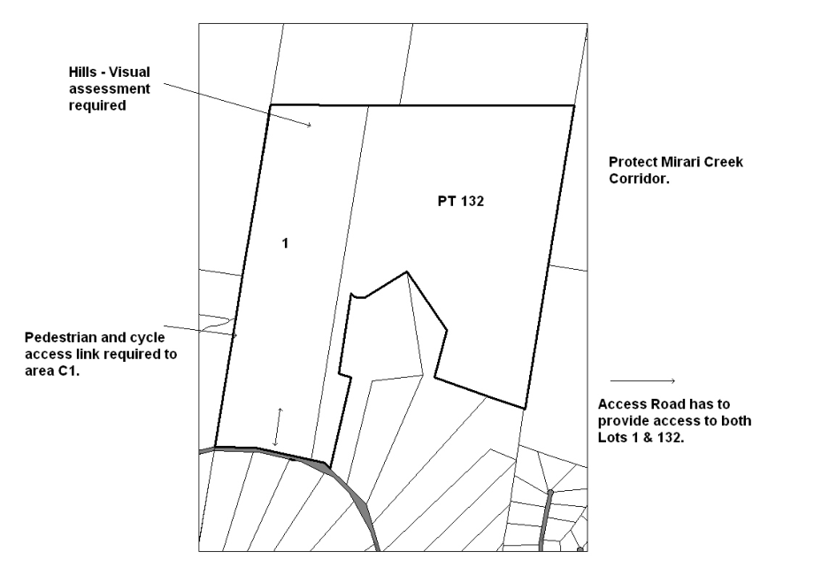

### 5.2 PLANNING AREA C2

#### The Area

Planning Area C2 lies to the east of Area C1 and to the north of Horns Crossing Road.  It incorporates 2 parcels of land:

Lot 1 DP1036373 PT 132 DP752445

Lot 1 is a long, narrow rectangular shaped lot with frontage to Horns Crossing Road.  PT 132 is also a large parcel of land.  It is an irregular shaped battleaxe lot with a long, narrow access handle providing access to Horns Crossing Road.

#### Development Potential

There is a small hill in the northern section of Lot 1 which forms part of steep, forested ridge system that lies to the north of the area.  This ridge system is visually prominent and an important part of the visual amenity of the Vacy area.  Any proposed development on the hill-slopes will require visual and habitat assessment.

Mirari Creek traverses this area and consideration will need to be given to drainage and run-off to prevent flooding downstream.

While the topography of the area is suitable for development, the shape of the existing lots is not conducive to sub-division on a stand-alone basis.   The lots will need to be jointly planned and developed.

Given the narrow road frontage of this area, only one access road off Horns Crossing will be permitted.  This access road must provide access to both Lot 1 and PT 123.

#### Masterplan

Not required provided that the land capability assessment and subdivision plan demonstrates how the development of both lots will be integrated.

### PLANNING AREA C2

> [Picture on page 57: a picture, saved as a picture (images/part-d3-vacy-local-area-plan-page-57-2.gif, 150 dpi).]

#### Issues & Performance Criteria

In addition to the planning controls setout in the LEP, DCP and Rural Strategy, the planning and assessment process for Area C2 must address.

| Issue | Planning Considerations / Performance Criteria |
|---|---|
| Integrated development of Lots 1 and Pt 132 | Subdivision plan to demonstrate integration of the two lots. |
| Access to Collector Roads - Horns Crossing Road | No additional private driveway access or right- of-ways Horns Crossing Road to be created. Access to Area C2 should be via a sealed local access road. Given the shape of this land and the relatively narrow frontage, only one access road to Horns Crossing Road is permitted, with this road designed to provide access to both Lot 1 and PT 123. The access roads must be sealed and it needs to be demonstrated that access can be achieved safely and is supported by Traffic Committee and Council. |

| Pedestrian and cycle access | To link Area C2 via Area C1 to Horns Crossing Bridge. |
|---|---|
| Visual amenity - The hills in the northern part of Lot 1 forms part of a prominent local feature of high scenic value. Horns Crossing Road is also an access gateway to Vacy. | Visual assessment to be undertaken as part of the planning process. The visual impact of any development along Horns Crossing Road needs to be minimised. No back yards to have direct frontage to Horns Crossing Road. |
| Motor Vehicle Wreckers | The motor wreckers adjacent to the area is an existing landuse. Appropriate buffers may need to be provided. |
