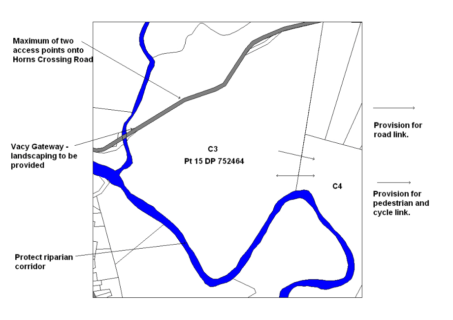

### 5.3 PLANNING AREA C3

#### The Area

Planning Area C3 is located on the southern side of Horns Crossing Road, and is bounded by the Allyn River to the west and the Paterson Rive to the south.  Area C3 comprises one parcel of land, PT 15 DP752464.

#### Development Potential

The northern and central portions of this area appear ideal for development.  The southern area, adjacent to the Paterson River may be prone to flooding.

#### Masterplan

Not required if a subdivision plan is submitted for the entire parcel and shows that access can be provided into Area C4.   Subdivision can be staged in accordance with the subdivision plan.

Pedestrian and cycle link through the area to provide access to Horns Crossing Bridge.

Provision needs to be made for a link through to Area C2 which abuts the eastern boundary of area C1.

### PLANNING AREA C3

> [Picture on page 59: a picture, saved as a picture (images/part-d3-vacy-local-area-plan-page-59-2.gif, 150 dpi).]

#### Issues & Performance Criteria

In addition to the planning controls setout in the LEP, DCP and Rural Strategy, the planning and assessment process for Area C3 must address.

| Issue | Planning Considerations / Performance Criteria |
|---|---|
| Access to Collector Roads - Horns Crossing Road | No additional private driveway access or right- of-ways Horns Crossing Road to be created. Access to Area C3 should be via sealed local access road. A maximum of two access points to Horns Crossing road is permitted. The access roads must be sealed and it needs to be demonstrated that access can be achieved safely and is supported by Traffic Committee and Council. |
| Internal Road network | To demonstrate how access to be provided to Area C4 to provide access to Lot 7. |
| Pedestrian and cycle access | Pedestrian and cycle link through the area to provide access to Horns Crossing Bridge. |

|  | Provision needs to be made for a link through to Area C4 which abuts the eastern boundary of area C3. |
|---|---|
| Visual amenity - Horns Crossing Road | Visual assessment to be undertaken as part of the planning process. The visual impact of any development along Horns Crossing Road needs to be minimised. No back yards to have direct frontage to Horns Crossing Road. |
| Vacy Entry Gateway | The area near the Horns Crossing Bridge is an entry point to Vacy. This area needs to be appropriately landscaped with a tree corridor, to create a sense of arrival. This gateway landscaping is to be planned in conjunction with the land across the road in Area C1. |
| Pateron & Allyn River Foreshores | No further riverfront lots or riparian rights to be created. Riparian vegetation to be protected. |
| Flooding | Assessment required to determine the 1:100 year flood level. No Rural Lifestyle or Rural Enterprise development is permissible below the 1:100 year flood level. |
