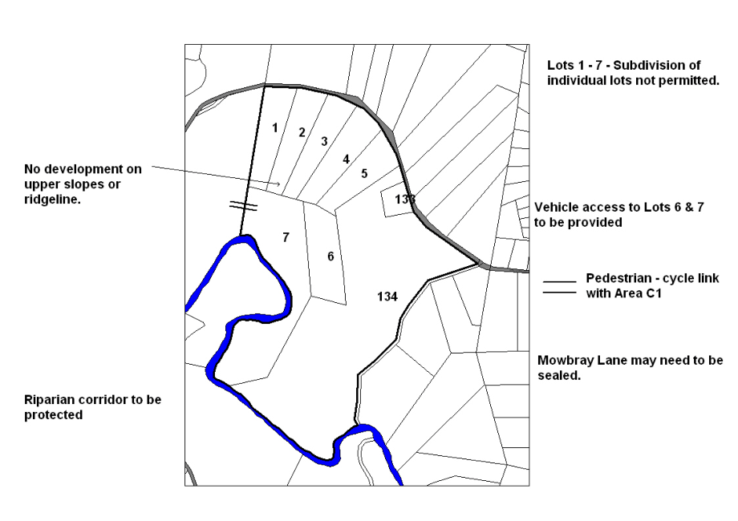

### 5.4 PLANNING AREA C4

#### The Area

Area C4 incorporates the land extending from Area C3, east to Mowbray Lane.  It is bounded by Horns Crossing Road to the north and the Paterson River to the south. Mowbray Lane is an unsealed road that provides access to rural residential properties in on the eastern side of the lane.  Area C4 incorporates 8 lots:

Lots 1, 2, 3, 4, 5, 6, 7 DP247313 Lot 134 DP854895

There is also another lot, Lot 133 DP854895 that has been excised from Lot 134 and has frontage to Horns Crossing Road.  This lot lies within the Investigation Zone, but not zoned as such and should be considered in conjunction with Lot 134.

#### Development Potential

Lots 1-7 have already been subdivided for small rural holdings.  The subdivision has resulted in the production of a 5 long narrow lots (Lots 1-5) with frontage to Horns

Crossing Road.  Lot 6 is also long and narrow, but has no road frontage or designated access.  Lot 7 is an irregular shaped lot along the Paterson River.  It also has no road frontage.  None of these lots are suitable for subdivision on an individual basis.  Any further subdivision will require owners to work together.  These lots could be subdivided in conjunction with development of Area C3, and/or as part of the development of Lot 134. Also, in relation to Lots 1-5, a minimum of two lots could be amalgamated for subdivision purposes.

No further subdivision of Lot 133 is permissible on a stand-alone basis; however this lot could be subdivided in conjunction with development of Lot 134, provided that no additional drive-way or right of way access to Horns Crossing Road is created, with access being via Lot 134.

Lot 134 appears suitable for development.  Any development of this site would require access to be provided to Lots 6 and 7.  If Mowbray Lane is to be used to provide access to the subdivision then, depending on likely traffic volumes, Council may require Mowbray Lane to be sealed at no cost to Council.

#### Masterplan

A masterplan is required.  Issues to be addressed by the plan include:

Access from Horns Crossing Road. Internal access and road layout, including provision of access to land-locked lots. Flooding. Visual impact of development, with no development to occur on the ridgeline.

### PLANNING AREA C4

> [Picture on page 61: a picture, saved as a picture (images/part-d3-vacy-local-area-plan-page-61-23.gif, 150 dpi).]

#### Issues & Performance Criteria

In addition to the planning controls setout in the LEP, DCP and Rural Strategy, the planning and assessment process for Area C2 must address.

| Issue | Planning Considerations / Performance Criteria |
|---|---|
| Integrated development of the area | Masterplan required. No subdivision of Lots 1-7 on a standalone basis. Lot 133 can only be further subdivided only in conjunction with subdivision of Lot 134. Lot 134 can be subdivided on a stand-alone basis provided that road access is made available to Lots 6 & 7. |
| Access to Collector Roads - Horns Crossing Road Internal Roads | No additional private driveway access or right- of-ways Horns Crossing Road to be created. For Lots 1-5 any access road from Horns Crossing Road must service at least 2 existing lots. Access roads must be sealed and it needs to be demonstrated that access can be achieved safely and is supported by Traffic Committee and Council. Any development of Lot 134 needs to demonstrate provision for access to Lots 6 and 7. Council may require Mowbray Lane to be sealed if traffic volumes on this road are increased by subdivision of Lot 134. |
| Pedestrian and cycle access | Provision needs to be made for a link from Area C4 through Area C3 to Horns Crossing Bridge. |
| Visual amenity | Visual assessment to be undertaken as part of the masterplanning process. The visual impact of any development along Horns Crossing Road needs to be minimised. No back yards to have direct frontage to Horns Crossing Road. No development to occur on the upper slopes and ridge-line that runs through Lots 1- 5. |

| Paterson River | No further riverfront lots or riparian rights to be created. Riparian vegetation to be protected. |
|---|---|
| Flooding | Assessment required to determine the 1:100 year flood level. No Rural Lifestyle or Rural Enterprise development is permissible below the 1:100 year flood level. |
