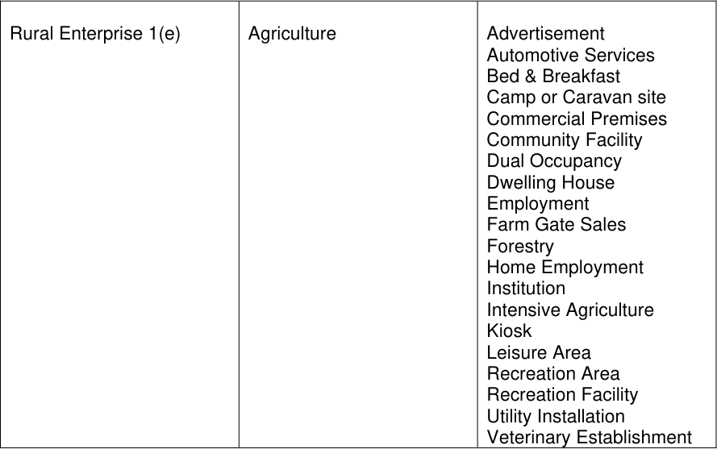

### 1.2  LOCAL AREA PLANS

Recognising that each community may have a different vision in relation to the type of settlement that it considers sustainable within the surrounding investigation zone, provisions have been included within the Shire-wide planning instruments for the preparation of Local Area Plans.

#### Land to which Local Area Plans Apply

Local Area Plans (LAP) are locality specific plans that are prepared for each town and village with an Investigation Zone 9(a).  The provisions contained within the Paterson LAP relate only to the Paterson area.

#### Purpose of Local Area Plans

Local Area Plans aim to establish a desired future character for the land that is contained within the Investigation Zone.  Local Area Plans contain locality based performance criteria and controls which are designed to address key issues and achieve the desired character.

#### Factors taken into consideration in preparing Local Area Plans

In preparing the Local Area Plans factors taken into consideration included:

Community Vision - the views expressed by the local community to which the Plan applies.

The physical and cultural features of the land within the Investigation Zone, including factors such as slope and stability, hydrology and flooding, flora and fauna, bushfire, views and visual impact, sites of cultural or heritage significance.

The existing road network - hierarchy, road alignment and condition etc.

Access - vehicle, pedestrian and cycle - to and within the Investigation Zone and between land within the Investigation Zone and the adjoining village.

Existing pattern of subdivision (size and shape of allotments).

Existing land use and settlement patterns and the characteristics of the neighbourhood.

The need for environmentally sustainable development.

The desired future character of development.

The Local Area Plans recognise that at some stage in the future, the land within the Investigation Zones that is subdivided for rural lifestyle living, may be needed to accommodate the growth of the village and may potentially be rezoned for residential and/or other uses such as recreation, commercial or special uses.  The Local Area Plans contain principles in relation to road networks and subdivision layout that will have the capacity to support closer subdivision patterns in the future.

#### Suitability of Investigation Zone land for development

Not all land within Investigation Zones will be suitable for re-development.  Section

12.4 (Constraints Criteria) of the Dungog Shire Rural Strategy details the constraints that exclude an area from Rural Lifestyle and Rural Enterprise subdivision and development. These criteria include:

Land in areas affected by the 1:100 year flood. Slope greater than 18 degrees. Not meeting minimum service/infrastructure requirements. Inadequate land for disposing of the effluent on-site. Bushfire prone land as defined by Council's bushfire map, if clearing of habitat and wildlife corridors is required and biodiversity objectives are not met. Ecologically sensitive land. Areas with high habitat values. Contaminated land. Access via a road complying with Council's Rural Roads Policy cannot be achieved.

Prominent positions in the landscape where development would be silhouetted on the skyline horizon. Not complying with the Performance Standards of Dungog Shire Rural Strategy:

- 8.1 Wastewater Treatment and Management of Effluent

- 8.2 New Development and Biodiversity

- 8.3 Aesthetic Design / Scenic Character / Energy Efficiency

- 8.4 Water and Riparian Management

- 8.5 Bushfire Hazard Mitigation

In addition to these criteria, Local Area Plans may identify site or locality specific criteria which may exclude certain land for development.

#### Land use and activities permissible within the Investigation Zones

Providing that the land, after detailed assessment, is considered suitable for development, then an application can be lodged with Dungog Shire Council to rezone the land zoned 9(a) Investigation to Rural Lifestyle 1(l) or Rural Enterprise 1(e).

Rural Lifestyle zones provide the opportunity for people to live in a rural environment close to settlements with services and facilities.

Rural Enterprise zones provide the opportunity for people to live in a rural environment and undertake small-scale commercial, service, intensive agricultural or light industrial activities on their property.

Details of the objectives of these zones, the activities that can be undertaken and the controls and guidelines governing subdivision and development are specified within the Dungog Shire Local Environmental Plan 2005, the Dungog Shire Rural Strategy 2003 and the Dungog Shire Development Control Plan 2004.  A summary of the various sections in these documents is given in Appendix 1.

| Zone | Permissible Uses |  |
|---|---|---|
|  | Without the consent of Council | Requiring Consent of Council |
| Rural Lifestyle Zone 1(l) | Agriculture | Advertisement Bed & Breakfast Camp or Caravan site Community Facility Dual Occupancy Dwelling House Farm Gate Sales Home Employment Leisure Area Recreation Area Utility Installation |

> [Picture on page 6: a map, saved as a picture (images/part-d5-paterson-local-area-plan-page-6-1.gif, 150 dpi); the street names and other small labels are on the picture.]
> Words printed on the picture (title and legend, copied from the PDF):
> Rural Enterprise 1(e) Agriculture
> Bed & Breakfast
> Camp or Caravan site
> Farm Gate Sales

All other land uses are prohibited within these zones.
