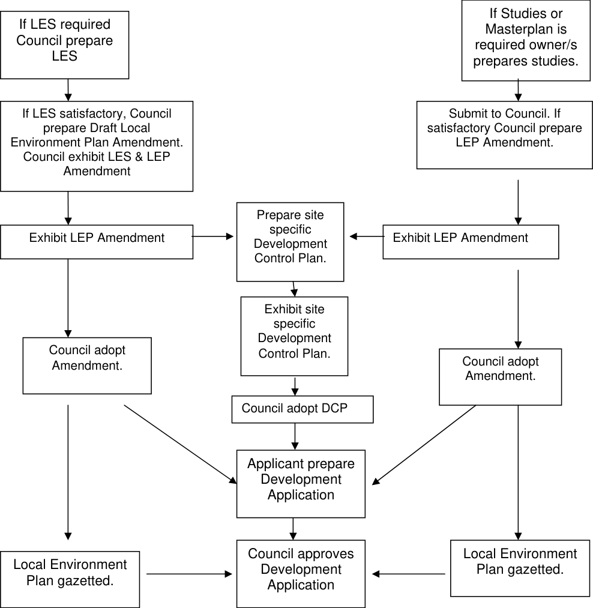

### 1.3 THE PLANNING PROCESS

The planning process for the rezoning and development of land within the 9(a) Investigation Zone is summarised in the following flow diagram.

The first step in the process to rezone land identified in the LAP as possibly suitable for development is for the landowner and/or their agent to have a pre-lodgement meeting with Council Officers.  At this meeting, Council Officers will explain the re-zoning process and identify the assessments and studies required.

Bookings for a pre-lodgement meeting are to be made with Council's Town Planning Department.  The land-owner (or their Agent) will need to supply the following information when booking the meeting.

- Property title details - address, Lot and DP number.

- Proof of ownership.

- For an Agent acting on behalf of an owner, written authorisation from the Owner.

Any studies or assessments already undertaken for the property should be brought to the pre-lodgement meeting.

Land zoned 9 (a) Investigation Local Environment Plan 2005

Council prepare Local Area Plan

Pre lodgement meeting with Council to identify Studies required or identify if a Local Environmental Study (LES) and/or

Masterplan is required.

-

> [Picture on page 7: a map, saved as a picture (images/part-d5-paterson-local-area-plan-page-7-8.gif, 150 dpi); the street names and other small labels are on the picture.]
> Words printed on the picture (title and legend, copied from the PDF):
> If LES required
> If Studies or
> If LES satisfactory, Council
> Submit to Council. If
> satisfactory Council prepare
> prepare Draft Local
> Environment Plan Amendment.
> Council exhibit LES & LEP
> Exhibit LEP Amendment
> Exhibit LEP Amendment
> Council adopt DCP
