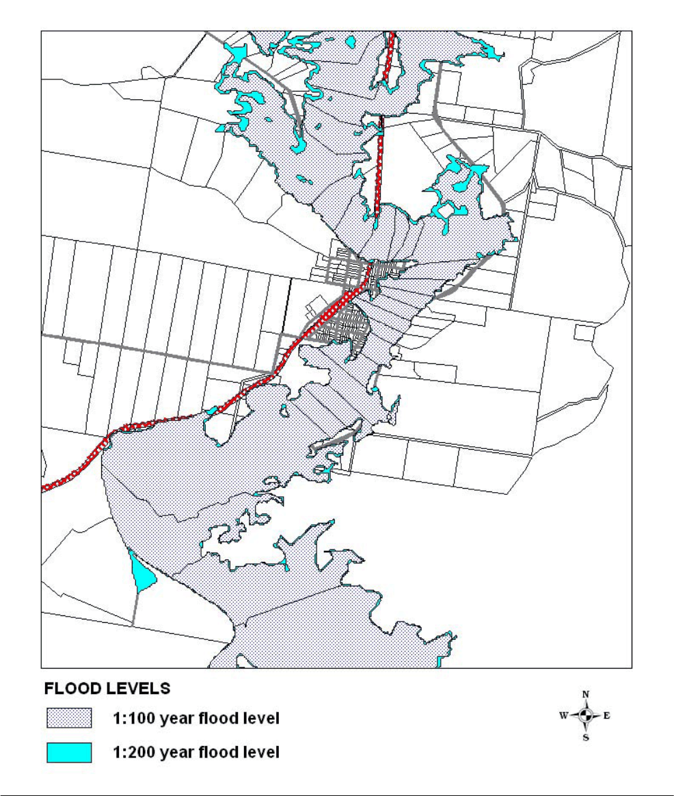
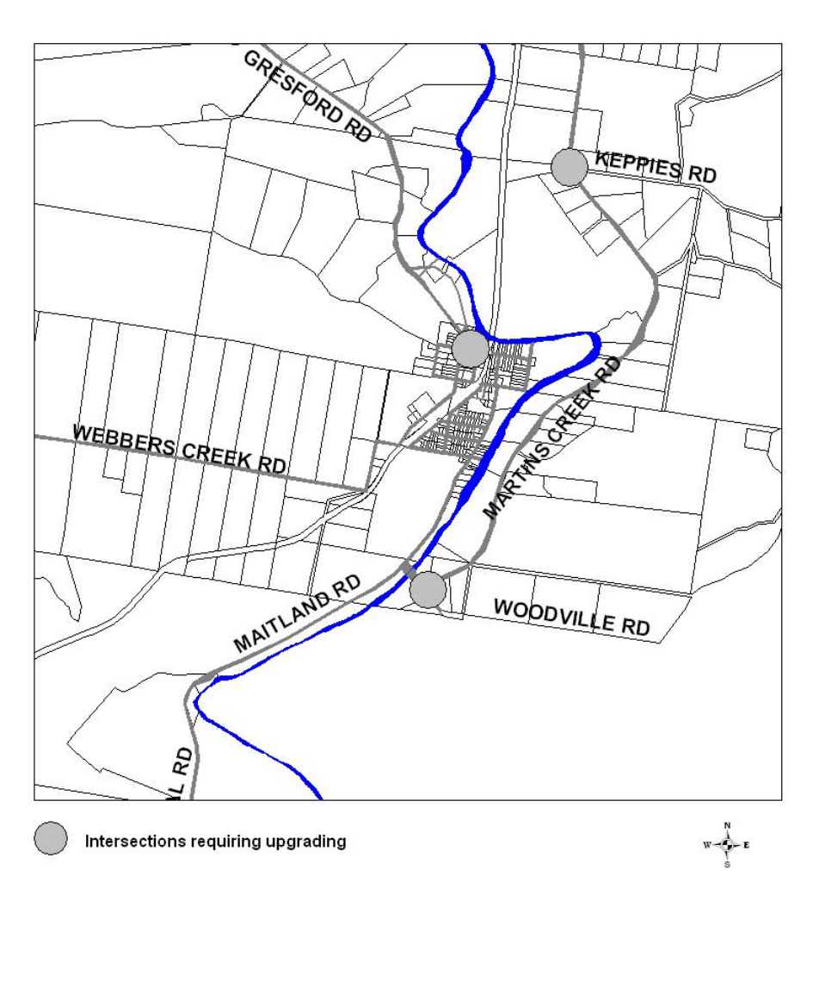
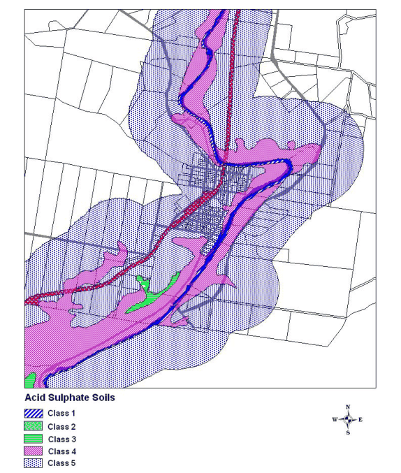
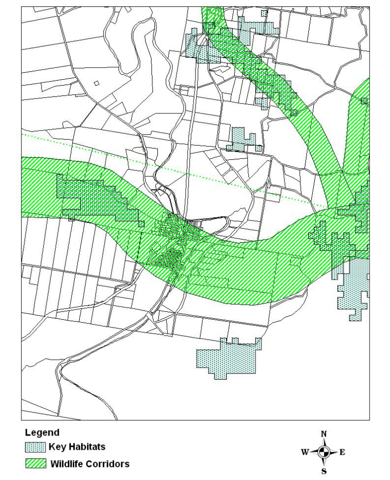
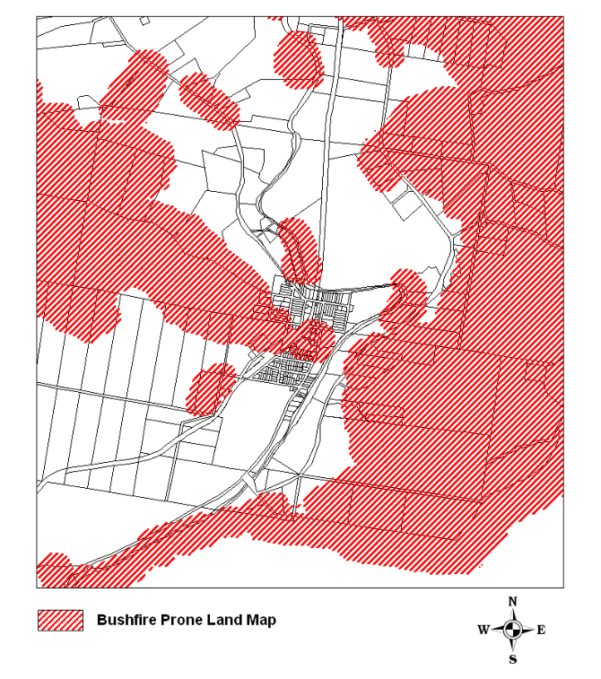
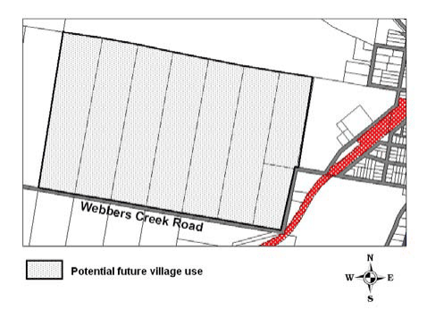

### 2.2 PLANNING FOR PATERSON

Key issues identified during the study process and consultation with the Paterson community are addressed in the Paterson LAP.  These issues are:

Flooding - much of the land surrounding Paterson is flood-affected. The need to retain the rural and heritage character of Paterson and surrounding area, and to protect areas of high visual significance, in particular the rural approaches to the village, the vegetated hills surrounding the village and the Paterson River floodplain. Roads and road access, including the limited capacity of existing roads to accommodate traffic increases, the negative impacts of increasing truck traffic through Paterson and access across the North Coast Railway line. Pedestrian and cycle access. Pattern of land subdivision. Lack of sewage system - Paterson is not sewered and there are problems in the village with effluent seepage from existing septic systems, particularly during wet weather. Problems with acid sulphate soils on the Paterson River floodplain. Need to protect habitat, including the wetlands adjacent to the village and forest habitat in the surrounding ranges. The need to protect the waterways and the Riparian corridor, particularly along the Paterson River. Development adjacent to the North Coast railway line. Accommodating the future growth of Paterson village.

#### Flooding

The Issue

Flooding of the Paterson River is a major natural hazard impacting on Paterson village and the surrounding area.  Large tracts of the Investigation Zone to the north, east and south of Paterson lie within the Paterson River Floodplain and are potentially at risk from flooding.

The main access roads into Paterson (Tocal, Gresford, Martins Creek and Woodville Roads), are cut by floodwaters in a 5% (1:20 year) flood event.  Depending on the severity of the flooding, the village may be isolated for a number of days.

In 2001 Dungog and Port Stephens Shire Councils jointly commissioned the Paterson River Floodplain Management Study and Plan for the Paterson River.  The Plan was prepared for the reach between the Gostwyck Bridge near Vacy through to the confluence of the Paterson and Hunter Rivers.

This study identified four (4) Floodplain Management Zones:

| No. | Zone | Definition / Criteria |
|---|---|---|
| 1 | Floodway and Excessive Depth Zone | Floodway or depth >4m in a 1% (1:100 year) AEP event. |
| 2 | High Risk (Velocity and Depth Zone) | Remaining area where provisional hazard is high in a 1% AEP event. |
| 3 | Isolated Islands Zone | Remaining area (above flood level) where evacuation is only possible through Zones 1 or 2. |
| 4 | Low Risk Zone | Remaining area below extreme flood level. |

The Floodplain Management Zones for the Paterson Investigation Area are shown in Map 2.

There is also an area along Webbers Creek Road that Paterson residents advised may be subject to local flood. This area needs investigation as part of any rezoning application.

### PATERSON LOCAL AREA PLAN 2005

### MAP 2 – PATERSON FLOOD PRONE LAND

> [Picture on page 11: a picture, saved as a picture (images/part-d5-paterson-local-area-plan-page-11-6.gif, 150 dpi).]

Planning Approach

Within the Investigation Zone, all development within the Paterson River Floodplain is to be undertaken in accordance with the Paterson River Floodplain Management Plan and provisions of the Dungog LEP, DCP and the Rural Strategy.

Under the provisions of the Floodplain Management Plan, residential dwellings are not permissible in Zones 1 and 2.  Residential dwellings maybe permissible in Zones 3 and 4, subject to meeting a number of criteria.  These criteria include (but are not limited to):

All floor levels for habitable space have to be 0.5m higher than the 0.5% (1:200 year) flood level.

All structures below the 0.5% flood level must have flood compatible building components.

Ability to evacuate - a reliable flood free access for pedestrians is required for a 0.5% (1:200 year) or higher flood event.  A flood evacuation strategy for pedestrians and vehicles has to be prepared for the applicant by a suitably qualified engineer and approved by Council.

Any development will not increase the impacts of flooding on adjoining properties or downstream.

The applicant must provide controls to prevent the discharge of pollution during flood events.  All septic tanks must be located above the 1% (1:100 year flood level) and all transpiration beds or aerated areas above the 5% (1:20 year level).

The LEP and Rural Strategy prohibit Rural Lifestyle and Rural Enterprise development on land affected by the 1% (1:100 years) flood level.  Under the LAP these areas are excluded from the Investigation Zone.

Further information on flooding and planning controls is available from Dungog Shire Council.

Desired Outcomes

To minimise the risk to people and property from flooding.

#### Areas of High Visual Significance

The Issue

Paterson is an historic rural village located on a bend of the Paterson River.  The Paterson area was settled in 1812 by convicts sent to the Paterson River Valley to cut timber.  In 1821 free settlers moved into the area and established farms.  Paterson rapidly developed as a river port and service centre and in 1833 the area was proclaimed a town.   A number of the buildings established in the 1800’s remain today and are an important feature and attraction of the village.

Part of Paterson's charm and attraction base lies in its setting.  Key features of this setting are the Paterson River, the fertile river plains to the north and south of the town and the surrounding forested ranges - the Hungry Hill - Red Hill - Kurrikaba Hill ranges to the east and the Mount Johnstone range to the west.  Both ranges converge on Paterson, and are a very significant part of the Paterson landscape and identity.

Retention of the historic and rural character and the appearance of the Paterson area is very important to the Paterson community and Shire residents.   Development has already occurred around the periphery of the forested ranges that has resulted in clearing and scarring of the landscape.  The Paterson community is very keen to prevent any further development on the ranges that involves clearing of the forest and/or is highly visible.

The appearance and setting of Paterson is also important for the tourism industry in the Shire. Paterson village is both an attraction in its own right, and a gateway to the Barrington Tops region.  Paterson marks the transition between the sprawling residential and industrial suburbs of Newcastle and the Lower Hunter and the rural - bush environment of Dungog Shire.

In addition to the village, the areas within the Investigation zone identified as having high scenic value are:

Hungry Hill - Red Hill - Kurrikaba Hill Ranges to the east of the village. Mount Johnstone Range (range dividing Corners Creek and Webbers Creek) on the western edge of Paterson. Tocal - the river flats to the south of town Floodplain immediately to the east of the village - the narrow strip of floodplain extending between the river and Martins Creek Road from the intersection of Martins Creek and Woodville Roads to just north of the 'horse-shoe' bend in the River. The river flats to the north of the village - on both sides of the Paterson River. The Gresford Road approach to Paterson - the river flats to the east and the range to the west of Gresford Road.

Planning Approach

Emphasis is on protecting the character and visual identity of the area. The LAP identifies areas where a visual and view shed analysis will be required as part of the planning process.

Design criteria for development in areas of high scenic value may include:

Prohibiting clearing of forested areas. Limiting or prohibiting further subdivision and development. Increasing the minimum lot size to avoid impact of dwellings and structures within significant view sheds. Appropriate siting and setbacks of new development, as per the Shire-wide DCP 2004. Use of landscaped buffers.  Buffers along collector roads will need to be in one ownership, possibly dedicated to Council or held as 'Community Land', to ensure effective management and control. Siting dwellings so that they front collector roads.  Backyards must not have direct frontage to collector roads Height limits on buildings, including limiting dwellings to single storey.

Desired Outcomes

Retention of the rural and historic character and setting of Paterson.

Retention  of areas of high scenic value, including, the Paterson River flats, the forested ranges and the rural vistas on the access roads into Paterson.

Minimise visual impact of rural residential development from the main routes through Paterson.  New development will be appropriately sited with landscaped buffers to these main routes.

#### Roads and Road Access

The Issues

The road and traffic issues within the Paterson Investigation Area include:

Increasing conflict between local and through traffic on the Tocal-Gresford Road, particularly through the village area.  The local community is of the view that this road has reached its capacity.

The need for a second crossing over the railway line.  The North Coast Rail-line divides the village in half.  The area to the west of the railway corridor is difficult to access. Additional development on the western side of the village will place increased pressure on the Church Street - Gresford Road intersection and on the Railway Crossing.

Increasing number of heavy trucks travelling through the village.  Village residents living on and in close proximity to the Tocal-Gresford Road consider early morning (4am -7am) truck traffic to be a major noise intrusion.  A significant proportion of the heavy truck traffic is generated by the State Rail Quarry at Martins Creek.

Poor condition of the main roads in the area, including damaged pavements, narrow widths and poor alignment.  Roads identified as requiring upgrading are:

- Tocal - Gresford Road (RTA responsibility)

- Martins Creek Road (identified in the Section 94 Plan)

- Webbers Creek Road

Council has advised that any development in the Martins Creek Road area cannot have access from Glenburn Road.

A number of intersections within Paterson and the Investigation Zone require upgrading. The intersections identified in the Section 94 Plan as needing improvement are:

- Gresford Road - Church Street

- Woodville Road - Martins Creek Road

- Martins Creek Road - Keppies Road

The Duke - King Street intersection will also require upgrading in the future to accommodate increased traffic volumes from new developments in the area.

It is the policy of Dungog Shire Council to limit private driveway access along the main access roads into towns and villages.  These roads are known as 'Collector Roads'.  Given the potential conflict between the siting of driveways and the higher volumes of traffic and, in some cases, the 80 to 100 kilometre speed limits along these routes, the continued use of private driveway access to collector roads is considered highly undesirable.  The narrow width of the pavement of a number of the Collector Roads and restricted sight-lines due to the road alignment, are also factors that limit the suitability of these roads for additional private driveway access.

The LAP contains design criteria for new subdivisions that will restrict direct access to collector roads from private driveways. Increased use of existing driveways on collector roads to service future battle-axe style sub-division is also restricted in the design criteria.

For the purposes of the Paterson LAP the collector roads are defined as:

Tocal Road (also known locally as Maitland Road) Gresford Road Martins Creek Road (including the Barton Street section) Webbers Creek Road Woodville Road

### PATERSON LOCAL AREA PLAN 2005

### MAP 3 – COLLECTOR ROADS

> [Picture on page 15: a picture, saved as a picture (images/part-d5-paterson-local-area-plan-page-15-8.gif, 150 dpi).]

Planning Approach

In new subdivisions, access to the collector roads will be by properly formed local roads and appropriately designed and sited intersections.  Existing intersections may need to be upgraded or relocated.  There will be no new direct driveway or right of way access from private dwellings to collector roads.  Where required, access ways for emergency vehicles will be permitted.

In designing subdivisions, careful consideration needs to be given to the internal road network.  Roads, unlike land uses or buildings, tend to become permanent features of a settlement.   As such it is important that the road layout be conducive to the long term sustainability of the area.

For local roads within subdivisions, preference is for through, connecting roads rather than cul-de-sacs and right-of ways.  A connected road network will minimise driving distances and generally provide for more than one entry-exit point within each subdivision. This is important particularly in areas potentially subject to bushfire or flooding.   A connected road network will also foster community interaction and facilitate development of bus routes, including school bus routes, as the need emerges.

Desired Outcomes

Reducing vehicular conflict and the potential for conflict through a significant reduction in the number of driveway access points to collector roads.

To deliver a high level of access and permeability via a network of inter-connecting roads throughout all subdivisions, not a series of cul-de-sac roads or right-of-ways.

To deliver a road network that will support closer settlement in the future.

#### Pedestrian and Cycle Access

The Issue

There is no public transport in Paterson to provide access to the shopping centre, school, railway station and recreation reserve for people living in outlying areas.  In addition, there has been no provision for pedestrians or cyclists along the collector roads. Due to the narrow, unformed verges and higher speed limits (80 to 100km), the collector roads do not provide a desirable environment for pedestrians and cyclists.

The Paterson River also forms a barrier between the village and the area to the east of the river.  The Woodville Road Bridge, located approximately one km south of Paterson is the only road and pedestrian link between Paterson and the area to the east of the River.  The need for a pedestrian link across the Paterson River has been raised by the Paterson Community. Suggestions have included suspending a footbridge off the railway bridge to service the development of the Brisbane Grove area, a footbridge over the river in the vicinity of Tucker Park (or further south) to link through to the school and recreation reserve, and a riverside walk and cycling trail connecting the village to the Woodville Road Bridge.

The Section 94 Plan has identified the need for a shared pedestrian-cycle path from King Street to Webbers Creek Road (1.6km).

Undesirable

Undesirable

Planning Approach

Where feasible, to incorporate shared pedestrian and cycle pathways within new subdivisions and the provision to link these routes between adjoining subdivisions.  In some areas the design intent will be to establish a shared pathway link to the Paterson village.

Desired Outcome

A network of shared pathways providing safe pedestrian and cycle access in and between subdivisions and, where feasible, create links between the subdivisions and Paterson village.

#### Existing Pattern of Subdivision

The Issue

Under previous planning schemes subdivision of rural land in some areas within the Shire was undertaken on an adhoc, uncoordinated basis.  This has resulted in significant fragmentation in land holdings.   In order to provide access to existing roads and/or river frontage, lots created were often long and narrow and/or with battleaxe or irregular shape. Where these lots exist in the Paterson Investigation Area (eg long narrow lots on Webbers Creek Road), further sub-division of individual lots would increase fragmentation and is not considered desirable. Fragmentation creates long term access and servicing problems.

Planning Approach

Emphasis is on creating a coordinated and integrated approach to subdivision design within the Investigation Zones. The Paterson LAP does not permit further subdivision of individual lots where the lots are small, irregular in shape and/or where the width to depth ratio of the lot is less than 1:3.  These lots are identified in the LAP.

Subdivision of these identified lots may only be permissible through consolidation of adjoining lots and/or through co-operation with adjoining land-owners to form a viable subdivision design area.  Masterplans may need to be prepared for subdivision design areas.

The Masterplan will detail the road network, lot layout and provision for open space, habitat corridors, environmental and scenic protection zones and shared pedestrian and cycle pathways within the subdivision design area.

Where there are lots suitable for subdivision that do not have existing public road frontage (eg in the Corners Creek Catchment area), then the subdivision design for the adjoining lots that have road frontage must ensure that provision is made for road and shared pathway access to the adjoining land.  This will prevent the sterilisation or ‘land-locking’ of developable land.

Desired Outcomes

No further fragmentation and adhoc subdivision of land.

A co-ordinated and integrated pattern of subdivision which is suitable for closer settlement patterns in the future to meet the needs of the Paterson village.

Co-ordinated approach to staged subdivision and land releases.

To avoid sterilisation of adjoining properties.

Create the opportunity for the development of an integrated community, not a series of separate enclaves.

To create a strong network of pedestrian, cycle and open space links throughout all subdivisions and, where required by Council, between the new subdivisions and Paterson village.

#### Sewage

The Issue

There is no sewerage system in Paterson.  Given funding constraints it is unlikely that a system will be in place within the next 10 years.  Any development within the Investigation Zone will need to use an acceptable septic system or package on-site sewage treatment plant. For properties located on flood liable land, specific conditions apply to the location of septic/sewerage systems and the disposal method and location.  Shallow soils overlying impermeable bedrock (eg on the surrounding hill-slopes) may also restrict the areas where septic systems are viable.  Basic information on soils in the Paterson area is available in the ERM Mitchell McCotter Report (1998) 'Dungog Biological Diversity Study - Paterson Planning District'.

Planning Approach

Applicants will need to meet all requirements of Dungog Shire Council and the Department of Environmental & Conservation in relation to the establishment and use of on-site effluent management systems. Council will require the applicant to provide detailed soil, geo-technical and/or hydrological studies.

Desired Outcomes

Establishment of on-site effluent management systems which:

Generate no public health risk Prevent contamination of surface and ground water Conserve and re-use resources.

#### Acid Sulphate Soils

The Issue

Within the Paterson Investigation Zone, most of the Floodplain land has Acid Sulphate Soils (ASS).  ASS are soils that form in sea or brackish water environments.  These soils contain iron sulphides which, when waterlogged, are stable.  However when these soils are exposed

to air (eg through excavation, drainage) the iron sulphide breaks down to form sulphuric acid. This acid can leach into the surrounding area acidifying drains, wetlands and watercourses. The acid also releases aluminium, iron and heavy metals from the soil.  The acid and metals can cause severe environmental damage as well as corrosion of iron, steel and concrete structures (eg concrete slaps, steel fencing, building foundations and concrete pipes).

The distribution of ASS within the Paterson Investigation Zone are shown on Map 4.   Soils are ranked in five categories, with Class 1 soils being the most 'dangerous'.  The sediment within the bed of the Paterson River channel is Class 1.  There is also a deposit of Class 3 ASS just south of the village, and a wider strip of Class 4 ASS flanking the River channel. Most of the remaining land on the Floodplain is Class 5 land.

Planning Approach

Development of land with ASS must be undertaken in accordance with 'Development Control Plan No 24 - Shire of Dungog - Acid Sulphate Soils and other relevant State Government policies.

Desired Outcome

To ensure that the ASS within the Paterson Floodplain remain stable and there is no release of sulphuric acid or associated metals that will cause damage to the environment, buildings and/or infrastructure.

### PATERSON LOCAL AREA PLAN 2005

### MAP 4 – ACID SULPHATE SOILS

> [Picture on page 19: a picture, saved as a picture (images/part-d5-paterson-local-area-plan-page-19-21.gif, 150 dpi).]

#### Habitat Protection

Habitat protection was identified as a priority by the Paterson community.

Information on the vegetation types in the Paterson area is contained within the ERM Mitchell McCotter (1998) report on the Biological Diversity Study for the Paterson Planning District and the ME Greenwood (1999) Dungog Vegetation & Biodiversity Study report.  The Paterson Investigation Area lies within the Paterson Planning District.

Five vegetation types have been identified within the Investigation Area:

Open forest - on the hills and ridges to the east and west of the village. Woodland - small pockets of woodland are found in the Corner Creek area to the north west of the village (Gresford Road area) and along Martins Creek Road immediately north of Tuckers Creek. Wetlands - on the southern edge of the village and within the horseshoe bend of the Paterson River. Riverine Forest - narrow strip along Tuckers Creek. Wet Sclerophyll Forest - very small pocket of remnant wet sclerophyll forest on Martins Creek Road. This remnant forest is protected through a 7(a) Environment zoning.

A number of rare and endangered flora and fauna species have been sighted in the Paterson Investigation Area.  These include Eucalyptus glaucina, phasocogales, koalas, broadnose bats and sooty owls.

The Native Vegetation Act 2003 and the accompanying Native Vegetation Regulations 2005, (which are expected to come into force in mid-2005), restrict the clearing of native vegetation.  Under the new Regulations, where clearing of remnant vegetation is proposed, (including clearing of mature stand-alone trees) separate approval will be required through the Catchment Management Authority (CMA) The approval process will generally require the preparation of a Property Vegetation Plan (PVP). The intent of the new Regulation is that clearing will only be approved where there is no net loss of native vegetation and where a PVP provides for significant offset planting and/or existing vegetation maintenance and improvement works.

The provisions of the Native Vegetation Act and Regulations must be addressed as part of the planning and assessment process for land within the Investigation Zone. Information on the Native Vegetation Act and Regulations is available through the Hunter Central River Catchment Management Authority or Dungog Shire Council.

Planning Approach

Flora and fauna assessments need to be undertaken as part of the rezoning process.  This must include addressing the requirements of the Native Vegetation Act 2003 and Regulations 2005.   At the rezoning stage, strategies for managing areas identified as having habitat value must be identified.  These strategies may include rezoning significant habitat areas as open space or environmental protection zones, provision of protective buffers and set-backs, increasing the minimum lots size, minimising clearing and avoiding structures or development in habitat areas.

As detailed in the previous section the proposed Native Vegetation Legislation will require concurrent approval from the CMA for any proposed non exempt clearing. The preparation of a PVP by the CMA for vegetation removal will also include consideration of the relevant requirements of Threatened Species Legislation. Prior to undertaking flora and fauna

assessment, it is recommended that development (where clearing is proposed) be referred to the CMA.

Desired Outcomes

Preservation and protection of habitat that supports viable wildlife communities, particularly rare and endangered species.

Establishment of a network of interconnected wildlife corridors not isolated protection zones or remote 'islands' of habitat.

Protection of watercourses and the vegetation along these watercourses.

### PATERSON LOCAL AREA PLAN 2005

### MAP 5 – KEY HABITATS & WILDLIFE CORRIDORS

> [Picture on page 21: a picture, saved as a picture (images/part-d5-paterson-local-area-plan-page-21-11.gif, 150 dpi).]

The key habitat areas and wildlife corridors shown in the above map are indicative only. These areas are based on aerial mapping and further investigations are required to more accurately delineate the extent of the areas.

#### Bushfire

The Issue

There are areas within the Paterson Investigation Zone that are prone to bushfire.  These areas are identified on the 'Dungog Shire Bushfire Prone Land ' Map and shown in Map 6.

Planning Approach

All subdivision designs must comply with the provisions of the NSW Rural Fire Service requirements as specified in the 'Planning for Bushfire Protection 2001’, and/or other relevant bushfire regulations.

Desired Outcome

To minimise the risk to people and property from the impacts of bushfire.

### PATERSON LOCAL AREA PLAN 2005

### MAP 6 – BUSHFIRE PRONE AREAS

> [Picture on page 22: a picture, saved as a picture (images/part-d5-paterson-local-area-plan-page-22-16.gif, 150 dpi).]

#### Waterways – River Foreshores

The Issues

The Paterson River and other watercourses within the Investigation Zone play an important role within the Paterson area.  These watercourses contribute to the sustainability of agriculture, recreation, tourism, water supply, habitat and bio-diversity and to the microclimate of the area.  In addition the Paterson River features significantly in the local character of Paterson.

Issues include:

> [Picture text on page 23 is stored in the PDF without readable letters (no character map), so it could not be copied; see the original PDF.]

The cumulative negative impacts of development. Preventing pollution from effluent and stormwater runoff and other activities. Maintaining water quality and the flow of the rivers by limiting the pumping of river water. Minimising impacts of development on the ecology associated with watercourses and wetlands. Weed infestation along river banks, particularly along the Paterson River. Protecting and re-establishing the Riverine Forest and the riparian vegetation corridors along the Paterson River.

Planning Approach

The planning approach incorporates:

Protecting watercourse ecology Maintaining water quality and water flow Providing for public access to the waterways Minimising the impacts of flooding

This can be achieved by:

Providing adequate buffers and set-backs from watercourses, as per the Shire-wide DCP 2004. Ensuring that no further riparian rights are created, as required by the LEP 2005 and Shire-wide DCP 2004. Prohibiting further subdivision of the river foreshore areas – new lots with river frontage cannot be created. Encouraging foreshore areas to be kept in one title and zoned appropriately. Requiring developers to re-establish Riverine Forest were appropriate, in accordance with a vegetation management plan.  (The Paterson River Floodplain Management Strategy recommends the preparation of a Vegetation Management Plan for the riparian corridor.) Providing public access to foreshore areas. Encouraging the installation of package sewage treatment plants rather than on-site effluent management systems.

Desired Outcomes

Protection of riparian vegetation and re-establishment of Riverine Forest along the Riparian corridors. Maintenance of water quality and water flow. Providing public or community access to the river foreshore areas. Implementation of a Vegetation Management Plan in accordance with the recommendations of the Paterson River Floodplain Management Strategy.

#### North Coast Railway Line

The Issue

The North Coast Railway Line runs north-south though the middle of Paterson Village and the Paterson Investigation Area.  The main issues in relation to the line are:

Noise and vibration. Access across the railway line.

The railway line effectively divides Paterson Village into two.  The shopping centre is located on the eastern side of the railway line, and the school and recreation facilities on the western

side.  There is a pedestrian-cycle bridge across the railway line providing a link to the school and recreation areas.

Vehicle access across the line is only available ON Gresford Road at the northern end of the village.  This is an 'at grade' crossing with flashing signals and automatic barriers.   The crossing creates traffic problems within the village.  The lack of a second vehicle crossing also results in conflict between through traffic and local traffic, with all vehicle movement between the eastern and western sides of the village having to use the crossing.  There is a need for a second vehicle crossing closer to the southern side of Paterson Village for local traffic.

Australian Rail Track Corporation (ARTC - formerly State Rail) has advised that it will not permit the development of any additional at-grade vehicle or pedestrian crossings across the railway line.   Bridges or tunnels are the only crossings that ARTC will consider.

ARTC advise that potential noise, vibration and safety impacts need to be addressed as part of the assessment and planning process for land within the Investigation Zone. To minimise potential impacts, appropriate subdivision and building design measures are to be incorporated in any new development.  A Road & Rail State Environmental Planning Policy (SEPP) is currently being prepared by the Department of Infrastructure, Planning and Natural Resources (DIPNR).  The requirements of this policy must be addressed in the planning and development of land within the Martins Creek Investigation Zone.

Planning Approach

Feasibility of an vehicle crossing (bridge) across the North Coast Railway line to be explored as part of the planning and assessment process for development of land on the western side of Paterson village, in particular for the Webbers Creek Road area.

For areas potentially impacted on by the railway, noise, vibration and safety impacts are to be identified and assessed as part of the planning and development process.

Noise and vibration attenuating strategies are to be addressed at the planning and development stage.  These strategies may include:

- Provision of setbacks and buffer zones.

- Design requirements - such as placement of windows away from the rail corridor, double glazing of windows, use of double brick construction etc.

Desired Outcomes

Provision of safe pedestrian, cycle and vehicle access between the eastern and western sides of Paterson Village.

To minimise the noise and vibration impacts of the rail corridor on development within the Investigation Zone.

#### Future Growth of Paterson

The Issue

There is growing demand for residential and rural-residential land within the Lower Hunter

area.  Land surrounding the villages to the south of Paterson (located within Maitland City) has already been subdivided and developed, with these villages fast approaching their capacity.  There is increasing pressure for land to be released in the Paterson area.   To date, growth in Paterson has been constrained by the village's floodplain location and the lack of access to the sewer.  There are very few vacant residential lots exist within the village and no additional land has been identified or zoned for future residential use.

As the population in and around Paterson increases, there will be demand for the provision of additional facilities and services in the village, possibly including a neighbourhood shopping centre, recreation and aged care facilities and employment land.

Provision must be made for the long-term growth of Paterson village.  Given flooding constraints, the land considered most suitable for the future expansion of the village is the land along the northern side of Webbers Creek Road which adjoins the existing village boundary.

Planning Approach

The LAP identifies the Webbers Creek Road area as the preferred location for future village

uses. Part of this area may be affected by local flooding of the creek system. Further investigation is required as part of a land capability assessment/rezoning application. Future development of this area would only be considered under a Community Title development with a sewerage treatment package. It is recommended that this area be rezoned ‘Village’ land-banked for this purpose. This area is shown in Map 7

Desired Outcome

To provide sufficient land to accommodate the future growth of Paterson village.

### PATERSON LOCAL AREA PLAN 2005

### MAP 7 – POTENTIAL FUTURE VILLAGE USE

> [Picture on page 25: a picture, saved as a picture (images/part-d5-paterson-local-area-plan-page-25-30.gif, 150 dpi).]
