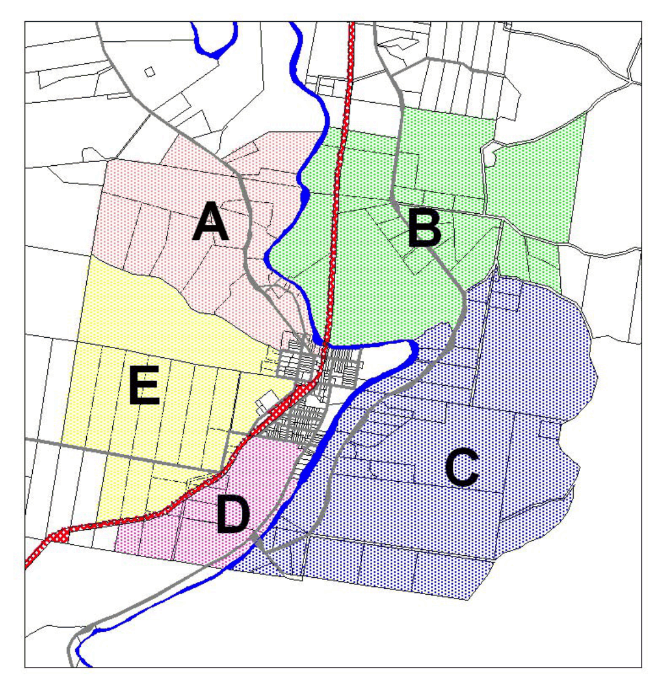
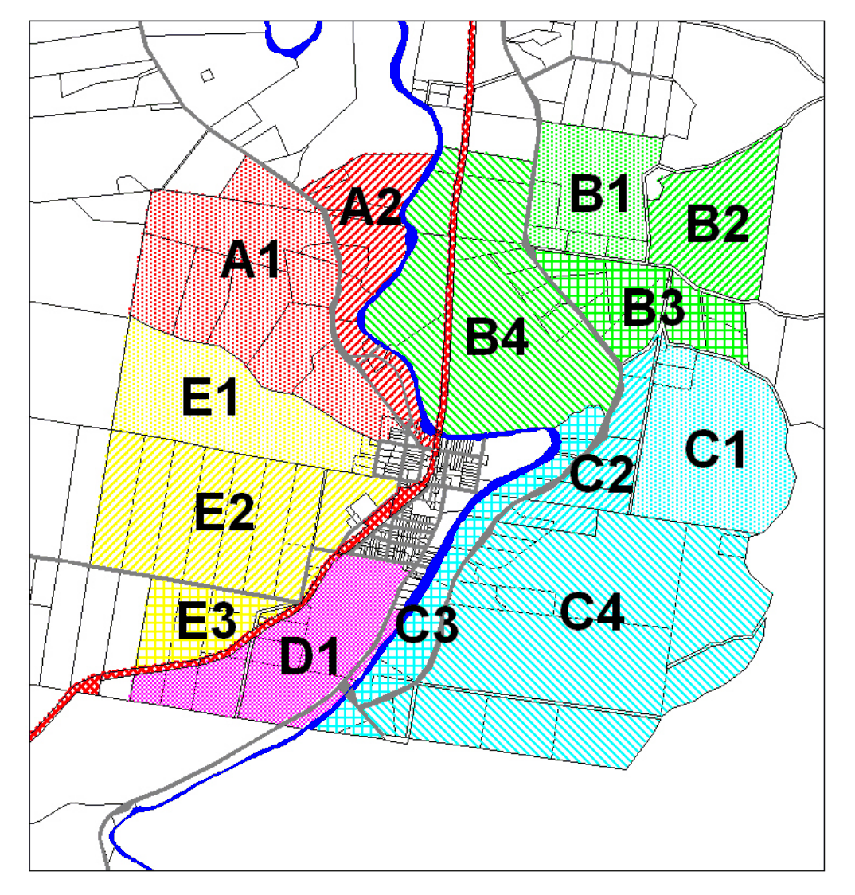

### 2.3 PLANNING PRECINCTS

The Paterson LAP divides the Investigation Zone into 5 planning precincts.  These precincts are shown on Map 8.

Precinct A - Gresford Road area to the north-west of Paterson.  This area is bounded by the Paterson River to the east and the ridge line that forms the drainage divide between the Corners Creek and Webbers Creek catchment areas to the south.  Much of Precinct A is drained by Corners Creek.

Precinct B - Martins Creek Road (North) area - This area lies along both sides of Martins Creek Road and is bounded by the Paterson River to the west, Paterson River and Glenburn Road to the south and the Martins Creek Village Investigation Zone to the north.  The northern part of this Precinct is drained by Tuckers Creek.

Precinct C - Paterson East - Hungry Hill area - Precinct C is located along Martins Creek Road to the east of Paterson.   It is bounded by the Shire Boundary to the south and east, Paterson River to the west and Glenburn Road to the north.

Precinct D - Tocal Road - Precinct D abuts the southern edge of Paterson village.  It is bounded by the Paterson River to the east and the North Coast Rail line to the west.

Precinct E - Webbers Creek Road - this Precinct abuts the western edge of Paterson village and includes the land along Webbers Creek Road.

Each Precinct is divided into planning areas.  These areas are shown on Map 9.

### PATERSON LOCAL AREA PLAN 2005

### MAP 8  – PLANNING PRECINCTS

> [Picture on page 27: a picture, saved as a picture (images/part-d5-paterson-local-area-plan-page-27-3.gif, 150 dpi).]

### PATERSON LOCAL AREA PLAN 2005

### MAP 9 – PLANNING AREAS

> [Picture on page 28: a picture, saved as a picture (images/part-d5-paterson-local-area-plan-page-28-3.gif, 150 dpi).]
