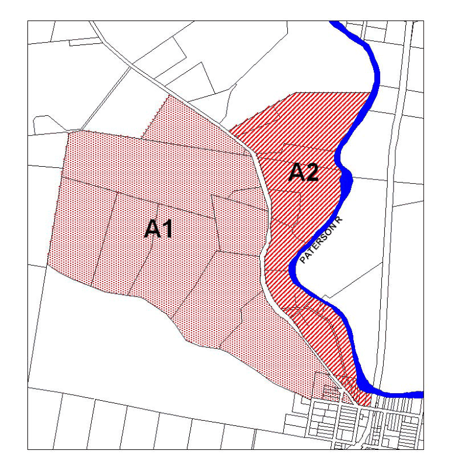

## 3. PRECINCT A - GRESFORD ROAD

Precinct A is divided into two (2) planning areas, A1 to the west of Gresford Road and A2 to the between Gresford Road and the Paterson River.

### PLANNING PRECINCT A

> [Picture on page 31: a picture, saved as a picture (images/part-d5-paterson-local-area-plan-page-31-5.gif, 150 dpi).]
