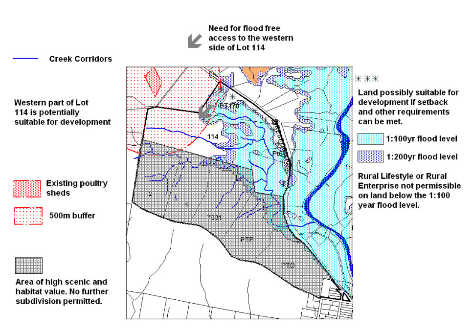

### 3.1   PLANNING AREA A1

#### The Area

Planning Area A1 incorporates 12 parcels of land.

Lot 75 DP 752467 Lot 7002 DP1053699 PTs D, E and F DP195158 Lot 7001 DP1053705 Lots 1 & 2 DP797920 Lot 87 DP586211 Lot 114 DP774843 Lots 88 & 89 DP707747

Lot 7001 DP1053705 is Crown land dedicated as a Travelling Stock Reserve. The southern half of this lot is zoned 7(a) Environment.  A six lot subdivision has been approved for PTs D and E DP195158.

### PLANNING AREA A1

> [Picture on page 32: a picture, saved as a picture (images/part-d5-paterson-local-area-plan-page-32-5.gif, 150 dpi).]

#### Development Potential

The development potential of Area A1 is relatively limited.  The northern and central portions of the area are part of the Paterson River floodplain and subject to flooding, while the southern area is steep and forested.  The key issues in Area A1 are:

Flooding - much of the area is flood-prone. Access from Gresford Road - Gresford Road is a collector road.  No additional driveway access will be permissible. Provision of flood-free access to lots without road frontage. Areas of steep topography with slopes greater than 18%. Managing and protecting Corners Creek and its tributary watercourses - no additional riparian lots to be created. Protection of habitat. Visual impact - the ridge system along the southern boundary of Area 1 is an area of high visual significance and an important element in the Paterson landscape and identity. Poultry Sheds- there is a commercial poultry farm located just north of Area A1.  No development will be permissible within 500m of these sheds.

Rural Lifestyle and Rural Enterprise development is prohibited on all land below the 1:100 year flood level.

Lot 87 DP586211 and Pt F DP195158 are not suitable for Rural Lifestyle or Rural Enterprise development.  Almost all of the land within these lots lies within the 1:100 year flood level. There is with only a narrow strip of land adjacent to Gresford Road which is above this line and also above the 1:200 year flood line.  This area of land is too small to be subdivided. The narrow width of the land does not allow for a building envelope that meets the set-back requirements from main roads.

Lot 89 DP707747 is also flood affected with most of the central and southern areas of lot lying below the 1:100 year flood level.  Flood-free land is located along the Gresford Road frontage and the north-western boundary of the lot.   This land may be suitable for subdivision if set-back and access requirements can be met.  Gresford Road is a collector road and new lots created are not permitted to have driveway access from Gresford Road. The flood-free land along the north western site boundary links with the western half of Lot 114 and is a potential access point for lots along the western side of Area A1.

Most of the eastern half of Lot 114 DP 774843 lies below the 1:100 year flood line. Subdivision and development of this part of the lot is not permissible. The small strip of land along Gresford Road above the 1:100 and 1:200 year flood levels is not suitable for subdivision and development because it does not meet the setback requirements to Gresford Road.

The western half of Lot 114 DP774843 is flood free and gently undulating.  The area however is impacted on by the poultry sheds located just north of Lot 114, with most of the western part of Lot 114 lying within 500m of the sheds. No development is permissible in the western half whilst the poultry farm is operating.

Should the poultry farm cease operations then Council may give to further investigating the potential of this land.  Any development on the western part of Lot 114 will be dependent on being able to provide flood free access from Gresford Road.   A major tributary of Corners Creek flows through the middle of this area, with the main Corners Creek watercourse located on adjoining land just to the south of this lot.  Under the provisions of the LEP 2005 the watercourses need to remain in one ownership and no riparian lots are to be created.

There are 5 lots, Lots 1 and 2 DP797920, Lot 7001 DP1053705 and Pts D and E DP195158, located on the hilly ridge system along the southern boundary of Area A1. The side slopes and ridge-line are visually prominent and considered to be of high visual significance.  Steep topography with slopes over much of this area limits its development potential. Lot 7001 is a dedicated Travelling Stock Reserve. Most of the area is forested with the forested area on Lot 7001 already zoned 7(a) Environment.  Habitat protection is a key issue. The northern edge of Lot 2 also falls within the 500m poultry shed buffer zone.

The main Corners Creek watercourse flows through the northern half of Lots 1, 2 and 7001 and Pt E, with the northern parts of Lot 7001, Pt D and Pt E being flood affected.  A six lot subdivision has been approved by Council for Pts D and E DP195158.

Lots 1, 2 and 7001 are 'land-locked' in that they have no frontage to a public road.  They are currently accessed from right-of-ways from Count Street and Gresford Road. The Right-of- Way is not conducive to the development of a local road. Pt E has no flood-free access, with its Gresford Road frontage lying below the 1:100 year flood level.  The Gresford Road frontage of Pt D is also flood affected, however access to this lot is available from Count Street in Paterson.

Given the constraints in this area no further subdivision and development of Lots 1 and 2 DP797920, Lot 7001 DP1053705 and Pts D and E DP195158 is permitted.

#### Masterplan

The area of land potentially available for development in Area A1 is limited to pockets of flood free land along Gresford Road and possibly the western area of Lot 114 should the poultry farm cease operations and flood-free access from Gresford Road can be provided.  A masterplan is not required for the areas along Gresford Road, however any subdivision plan for these areas will need to define the flood-free areas, address access issues and ensure that set-back requirements for road and creek systems are met.  Council may require the preparation of a Masterplan for Lot 114.

#### Issues & Performance Criteria

In addition to the planning controls setout in the LEP, DCP and Rural Strategy, the planning and assessment process for developable land within Area A1 must address:

| Issue | Planning Considerations / Performance Criteria |
|---|---|
| Flooding | All land located below the 1:100 year flood level to be excluded from the Investigation Zone and rezoned rural. All development to comply with Dungog Shire policies for floodplain development. |
| Suitability of Area A1 for development | Detailed land capability assessment to be undertaken to determine development potential of flood-free land in Area A1. Key issues to be addressed include access, flood- free access, topography and drainage, visual significance, bush fire risk,vegetation - habitat value and the buffer area for the poultry farm. |
| Poultry Farm | 500m buffer zone to be provided around any operating commercial poultry sheds. No development is permissible within this buffer zone. |
| Access to Collector Roads - Gresford Road | No additional private driveway or right-of-way access to Gresford Road. For subdivision, access to Gresford Road must be via a properly formed and sited access road and intersection. |
| Access to land-locked lots | In any masterplan and subsequent subdivision plan for the area, provision will need to be made for road and pedestrian-cycle access to 'land-locked' areas that have been identified in the land capability assessment as having development potential. |
| Gresford Road is a gateway entry point to Paterson. The visual Impact of development along Gresford Road | Visual assessment to be undertaken to determine set-back requirements. These may vary from the DCP, with the Visual |

| needs to be minimised. | Assessment requirements having precedence. No backyards to have direct frontage to Gresford Road. |
|---|---|
| Protection of Corners Creek and its tributary watercourses | Riparian vegetation corridors to be defined and protected. No additional riverfront lots or riparian rights to be created, other than possibly for public recreation. |
| Areas of high visual significance - The ridge system (sideslopes and ridge-line) has been identified by the Paterson community as having high scenic value that needs to be protected. | No further subdivision or development to occur on the ridge system (Lots 1 and 2 DP797920, Lot 7001 DP1053705 and Pts D and E DP195158). Visual impact assessment to be undertaken to identify and protect areas of high visual significance. |
| Habitat protection | Habitat value to be assessed. No clearing of bushland on the ridge system. |
