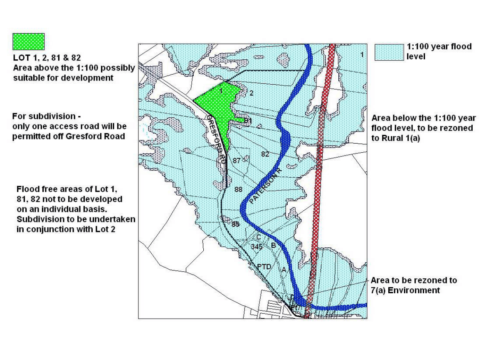

### 3.2 PLANNING AREA A2

Planning Area A2 is the strip of land between Gresford Road and Paterson River. This area incorporates 17 lots:

Lot 1 DP198720 Pt 7 DP758830 Lot 51 DP752467 (3 parts) Pt D DP195158 Lot 345 DP1030709 Lots A, B & C DP 195158 Lot 1 DP 752469 Lot 3 Sec 1 DP 195158 Lot 85 DP246941 Lots 87 & 88 DP803838 Lots 81 & 82 DP246941 Lots 1 & 2 DP835294

Most of Pt D DP195158 and the south western corner of Lot 345 DP103070 have been zoned 7(a) Environment.

#### Development Potential

Lot 1 DP198720, Pt 7 DP758830, Lot 51 DP752467 (3 parts), Pt D DP195158, Lot 345 DP1030709, Lots A, B & C DP 195158, Lot 1 DP 752469,  Lot 3 Sec 1 DP 195158, Lot 85

DP246941 and Lots 87 & 88 DP803838 are floodprone and lie below the 1:100 year flood level.  Development of these lots is not permissible.  Lot 1 DP198720, Pt 7 DP758830, Lot 51

DP752467 (3 parts) should be rezoned 7(a) Environmental Protection, with the remaining area below the 1:100 year flood level rezoned Rural 1(a)

Lot 1 DP835294 and the western section of Lot 2 DP835294 and Lots 81 and 82 DP246941 lie above the 1:100 and 1:200 flood levels.  It may be possible to subdivide the combined flood-free area for Rural Lifestyle development.   Most of the land suitable for development is on Lot 2.  Due to its size and narrow shape, Lot 1 is not suitable for subdivision on an individual basis.  Any development of Lot 1 needs to occur in conjunction with Lot 2. Likewise the area of floodfree land on Lots 81 and 82 is too small to be subdivided on an individual basis and can only be subdivided in conjunction with Lot 2.

#### Masterplan

Not required provided that the subdivision plan for the flood-free for Lot 2 DP835294 makes provision for access to adjoining lots (Lot 1 DP835294, Lot 2 DP835294 and Lots 81- 82 DP246941).  Only one properly formed and sited access road will be permitted off Gresford Road to service this area.

### PLANNING AREA A2

> [Picture on page 36: a picture, saved as a picture (images/part-d5-paterson-local-area-plan-page-36-16.gif, 150 dpi).]
