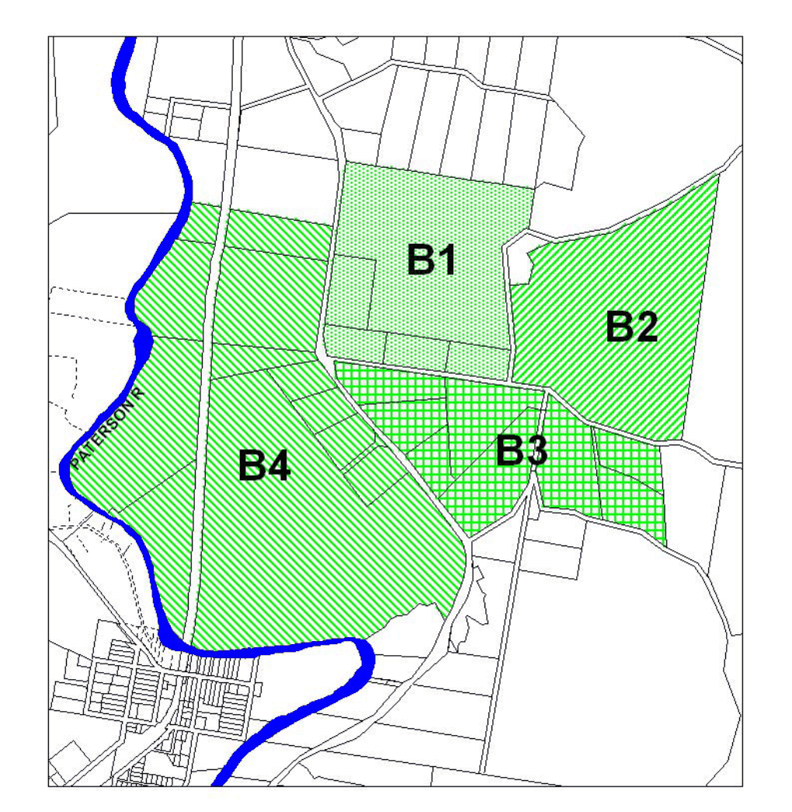

## 4. PRECINCT B - MARTINS CREEK ROAD (NORTH)

Precinct B incorporates the area along Martins Creek Road to the north-east of Paterson.  It is bounded by the Paterson River to the west, the Martins Creek Village Investigation Zone to the north and Glenburn Road to the south.  The northern part of Precinct B is drained by Tuckers Creek, which is a tributary of the Paterson River.  This Precinct is divided into four

(4) planning areas, numbered Planning Areas B1, B2, B3, B4.

There are two local rural roads within Precinct B - Keppies Road and Glenburn Road.  These roads will require upgrading and sealing (as per Council's Rural Roads Policy) in conjunction with any development that will increase traffic on these roads.  The intersections of these roads with Martins Creek Road will also require improvement.

### PLANNING PRECINCT B

> [Picture on page 37: a picture, saved as a picture (images/part-d5-paterson-local-area-plan-page-37-12.gif, 150 dpi).]
