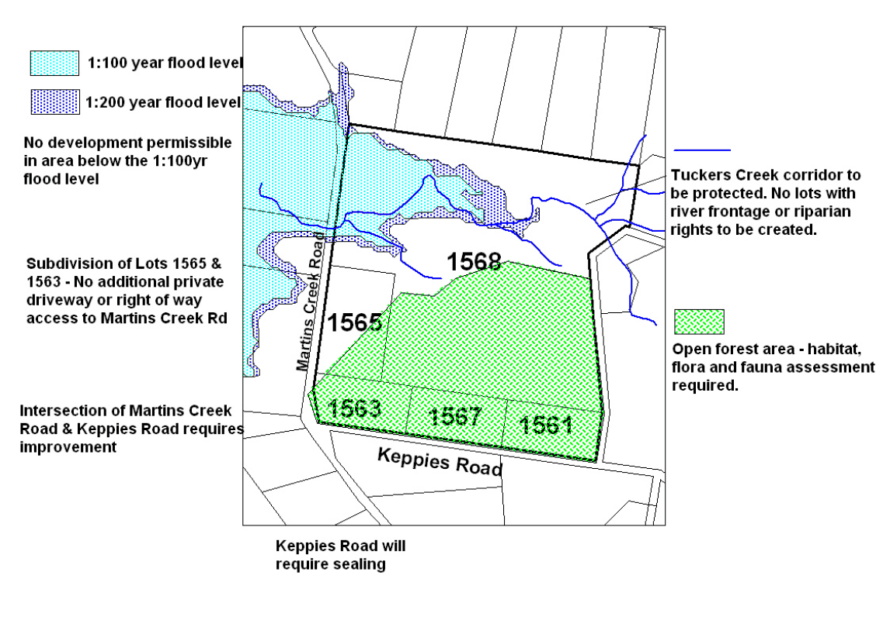

### 4.1 PLANNING AREA B1

#### The Area

Planning Area B1 is bounded by Martins Creek Road to the west, Keppies Road to the south, a Crown Road Reserve to the east and the Martins Creek Investigation Area to the north. It incorporates five parcels of land:

Lot 1568 DP845957 Lot 1565 DP794465 Lot 1563 DP794464 Lot 1567 DP845957 Lot 1561 DP630441

A dirt road has been constructed on part of the road reserve.

### PLANNING AREA B1

> [Picture on page 38: a picture, saved as a picture (images/part-d5-paterson-local-area-plan-page-38-13.gif, 150 dpi).]

#### Development Potential

A large portion of Area B1 appears suitable for development.  The area is flat to undulating with road access available on three sides.    Tucker Creek drains the northern part of Area

B1 with the north-western part of Lot 1568 being flood affected, lying below both the 1:100

and 1:200 flood level.  Development is not permissible below the 1:100 year flood level.   The remainder of this lot appears to be suitable for development.

A significant proportion of the southern part of Area B1 is Open Forest.  The habitat value of this area needs to be assessed as part of the development process.  Rare and endangered species, including koalas, have been reported in this area.

Due to the lot configuration and availability of access each of the lots could be individually subdivided.

Lots 1563, 1567 and 1561 are small lots with frontage to Keppies Road.   Any lots produced by the subdivision of these lots must have a width to depth ratio of at least 1:3.  Direct driveway access is permissible from Keppies Creek Road.

Access to Lot 1565 is from Martins Creek Road.  If this lot is subdivided on an individual basis, the subdivision will require the establishment of a single access road in from Martins Creek Road.  Alternatively Lot 1565 could be developed in conjunction with Lot 1568 with access coming from Lot 1568. No lot created through the subdivision of Lot 1565 can have private driveway or right-of-way access from Martins Creek Road.

#### Master Plan

Not required.

#### Issues & Performance Criteria

In addition to the planning controls setout in the LEP, DCP and Rural Strategy, the planning and assessment process for Area B1 must address:

| Issue | Planning Considerations / Performance Criteria |
|---|---|
| Flood prone land | Rural Lifestyle / Enterprise development is not permissible on land below the 1:100 year flood level. |
| Protection of habitat - Rare and endangered species have been reported in this area. | Detailed habitat, flora and fauna assessment to be undertaken as part of the rezoning process. The assessment is to incorporate the total forested part of Area B1. |
| Access from a Collector Road - Martins Creek Road | New lots created cannot have private driveway or right of way access from Martins Creek Road. Subdivision of Lot 1565 will require a properly formed access road in from Martins Creek Road or access via an adjoining property. |
| Pattern of subdivision | Any lot created must have a minimum width to depth ratio of 1:3. |
| Protection of Tuckers Creek - Riverine forest is found along the | Riparian vegetation corridor to be defined and protected. |

| creek corridor. | No additional riverfront lots or riparian rights to be created. |
|---|---|
| Minimise visual impact of any development from Martins Creek Road. | To maintain the visual integrity of this area, no backyards are to have direct frontage to Martins Creek Road or Keppies Road. |
| Areas subject to bushfire risk | Bushfire risk to be assessed and addressed in subdivision planning and design. |
