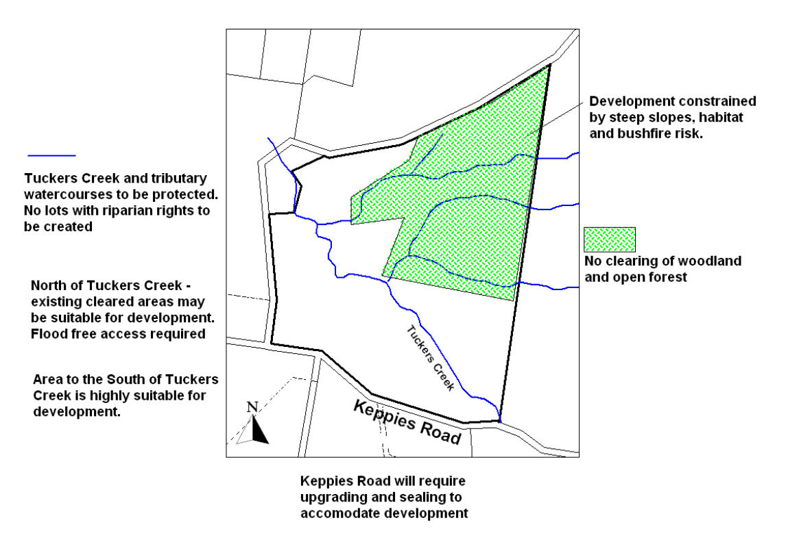

### 4.2 PLANNING AREA B2

#### The Area

Planning Area B2 lies to the east of B1. It is bounded by a Crown Road Reserve to the west and Keppies Road to the south.  Access is from Keppies Road.  Area B2 consists of one lot - Lot 2 DP577633.

### PLANNING AREA B2

> [Picture on page 40: a picture, saved as a picture (images/part-d5-paterson-local-area-plan-page-40-8.gif, 150 dpi).]

#### Development Potential

Parts of Area B2 are ideal for Rural Lifestyle or Rural Enterprise development.

Tuckers Creek flows diagonally through Area B2 effectively dividing the property in half.  The land on the southern side of Tuckers Creek (between the Creek and Keppies Road) is flat to undulating.  This area has been cleared and is ideal for development.

The development potential of the area to the north of Tuckers Creek is limited.  This northern area is part of the foothills and sideslopes of Kurrikaba Hill.  The topography is undulating to hilly with steep slopes (in excess of 18 degrees) in the north-eastern corner of the lot.  The hill slopes are drained by a number of creeks that flow into Tuckers Creek.  There are small pockets of cleared land adjacent to Tuckers Creek. The remainder of the northern area is forested with a mix of Open Forest and Woodland vegetation communities.  There is also Riverine Forest along Tuckers Creek.  Rare and endangered species have been reported in the area.  The forested area is bush-fire prone. The need to provide flood free access across Tuckers Creek and its tributary watercourses will be a constraint to developing land on the northern side of Tuckers Creek.

On the northern side of Tuckers Creek, development (dwellings and buildings) will be limited to the existing cleared areas, provided that building sites can be identified that meet the set-back requirements from watercourses and the bushfire buffer criteria.   Flood free access across Tuckers Creek must be provided.  No development or clearing of the forested area on the northern side of Tuckers Creek is permissible.

#### Masterplan

A masterplan is not required, provided that the subdivision plan addresses the total area and protects the creek system and forested areas.

#### Issues & Performance Criteria

In addition to the planning controls setout in the LEP, DCP and Rural Strategy, the planning and assessment process for Area B2 must address.

| Issue | Planning Considerations / Performance Criteria |
|---|---|
| Area suitable for development | The area to the south of Tuckers Creek is considered suitable for development (subject to meeting environmental and bushfire requirements). Land capability assessment will be required for the area to the north of Tuckers Creek to assess suitability for development. Any development must occur on existing cleared land. Key considerations are bushfire risk, habitat protection, setback from Tuckers Creek and its tributary watercourses and provision of flood-free access. |

| Habitat protection | No further clearing of forest and woodland vegetation on the northern side of Tuckers Creek. No subdivision of the forested areas on the northern side of the site. |
|---|---|
| Areas subject to bushfire risk | Bushfire risk to be assessed and addressed as part of the subdivision planning and design. |
| Lots created | All lots created must have a minimum width to depth ratio of 1:3. Creation of long narrow lots extending from Keppies Road to Tuckers Creek is not permissible. |
| Visual impact | No backyards to have direct frontage to Keppies Road. |
| Tuckers Creek corridor | No further riverfront lots or riparian rights are to be created. Riparian vegetation to be protected. |
