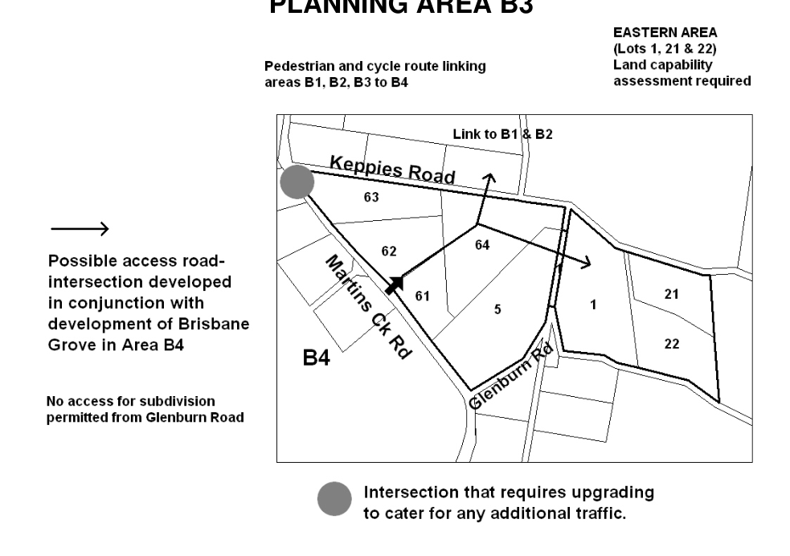

### 4.3 PLANNING AREA B3

#### The Area

Planning Area B3 lies to the east of Martins Creek Road and extends from Keppies Road south to Glenburn Road.   Area B3 incorporates nine (9) lots.  There is also a road reserve that links Keppies Road to Glenburn Road. however, the section of the road reserve adjacent of Lot 5 has been closed and there is an application to close the remaining section adjacent to Lot 64.

Lots 21 & 22 DP826264 Lot 1 DP556628 Lots 61, 62, 63, 64 DP811070 Lot 5 DP244817 Lot 1 DP251498

Lot 1 DP251498 is the closed section of the road reserve.  Lots 21 & 22 DP826264 and Lot 1

DP556628 lie to the east of the road reserve.  The remainder of the lots lie between the road reserve and Martins Creek Road.

#### Development Potential

Most of Area B3 appears ideal for Rural Lifestyle or Rural Enterprise development.  The area to the west of the closed road reserve is flat to undulating and well suited to development. The area is drained by a small creek system.  All lots within this area are above the 1:100 year flood level, with a very small area of land on Lot 61 (where the creek flows under Martins Creek Road), that lies below the 1:200 year flood level.

The area to the east of the closed road reserve is part of the foothills and sideslopes of Hungry Hill.  The area along Keppies road is undulating to hilly, rising to steep slopes (in excess of 18 degrees) in the south-eastern corner of this eastern area.  The headwaters of the creek system that drains Area B3 rise in these slopes.  Part of the area also drains to Tuckers Creek.  Most of this area is forested and bushfire prone.

Access is an issue in the eastern part of Area B3.  The three lots to the east of the unformed road reserve are accessed from Keppies Road, with Lot 22 having a long battleaxe driveway off Keppies Road.  Lot 1 DP556628 and 22 DP826264 also have frontage to an unformed road reserve that extends east from Glenburn Road. Lot 1 DP 556628 is accessed via Glenburn Road rather than Keppies Road.  Council has advised that it will not permit access to Glenburn Road to service any new development.  Access for Area B3 is to be via Keppies and/or Martins Creek Roads.

In the area to the west of the closed road reserve, Lots 63 and 64 have frontage to Keppies Road, Lots 61, 62, 63 and 5 have frontage to Martins Creek Road with Lot 5 also having frontage to Glenburn Road.  Keppies Road will require upgrading and sealing to accommodate development in the area.  Council will not permit access from Glenburn Road for any new development in Area B3.

There is a proposal for a large rural lifestyle estate at Brisbane Grove, in area B4 to the west of Martins Creek Road.  The main access road for this subdivision is expected to intersect with Martins Creek Road, opposite Lot 62.  This proposed intersection could potentially be amplified to facilitate access to the western side of Area B3.

> [Picture on page 43: a picture, saved as a picture (images/part-d5-paterson-local-area-plan-page-43-22.gif, 150 dpi).]

### PLANNING AREA B3

#### Masterplan

Two basic masterplans are required.  These Plans are to be prepared for the eastern and western parts of Area B3.  The lots that must to be planned jointly are:

The area to the east of the closed road reserve - Lots 1 DP556628 and Lots 21 and 22 DP826264. The area to the west of the closed road reserve - Lots 61, 62, 63 and 64 DP811070 and Lot 5 DP244817.

The Masterplan for the eastern section of Area B3 needs to include a land capability assessment addressing topography, drainage, habitat value and bushfire risk.

The Masterplan for the western part of Area B3 should focus on access and show the subdivision layout, including the location of roads and the treatment of the creek corridor. Pedestrian and cycle links from Area B4 through this area to Areas B1, B2 and the eastern side of Area B3 also need to be considered.

#### Issues & Performance Criteria

In addition to the planning controls setout in the LEP, DCP and Rural Strategy, the planning and assessment process for Area B3 must address.

| Issue | Planning Considerations / Performance Criteria |
|---|---|
| Suitability of the eastern part of Area B3 for development | Land capability assessment to be undertaken as part of the planning and assessment process. |
| Access to Collector Roads - Martins Creek Road | No additional private driveway access or right- of-ways to Martins Creek Road can be created. The intersections of Martins Creek Road with Keppies Creek and Glenburn Road both require upgrading as part of any development of the area. The location of the access road /intersection from Martins Creek Road to the Brisbane Grove development in Area B4 needs to be taken into consideration in assessing access options for Area B3. |
| Pedestrian and cycle access | Pedestrian and cycle links through the area must be provided to link areas B1, B2 and B3 to Area B4. If a pedestrian-cycle link over the Paterson River is developed, then a pedestrian-cycle link from Area A3 to Area B4 will be required by Council. |

| Visual Impact | The visual impact of any development along Martins Creek Road needs to be minimised. No back yards to have frontage to Martins Creek Road. |
|---|---|
| Creek system | No further riverfront lots or riparian rights to be created. Riparian vegetation to be protected. |
| Areas subject to bushfire risk | Bushfire risk to be assessed and addressed as part of any subdivision design. |
