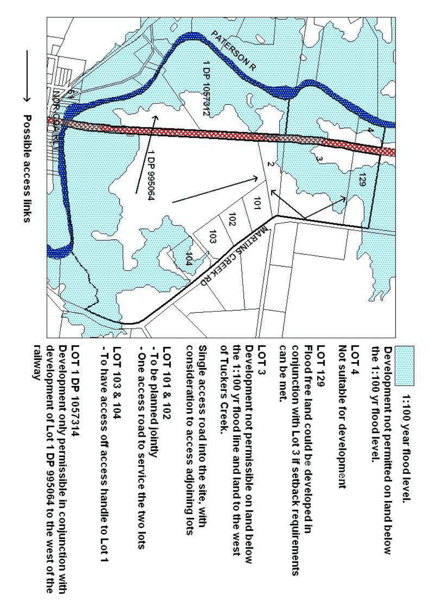

### 4.4 PLANNING AREA B4

#### The Area

Planning Area B4 lies to the east of Martins Creek Road.  It is bounded by Martins Creek Road to the east, the Paterson River to the west and the Martins Creek Village Investigation Zone to the north.  The North Coast railway line runs through the western part of this area.

Area B4 incorporates ten (10) lots.

Lot 129 DP1056686 Lot 3 DP1057314 Lot 4 DP1057315 Lot 2 DP1057313 Lot 1 DP1057312 Lots 101, 102, 103, 104 DP633958 Lot 1 DP995064

### PLANNING AREA B4

> [Picture on page 46: a picture, saved as a picture (images/part-d5-paterson-local-area-plan-page-46-2.gif, 150 dpi).]

#### Development Potential

Within Area B4 there are large tracts of flood prone land adjacent to the Paterson River, Tuckers Creek and other tributary creeks that flow through the area.  All land below the 1:100 year flood line is excluded from development for Rural Lifestyle or Rural Enterprise use.

In addition to flooding the other constraints in Area B4 are:

North Coast railway line - The Australian Rail Track Corporation (ARTC) requires potential noise, vibration and safety impacts of the railway line to be identified and assessed and appropriate noise attenuation strategies adopted in any planning and subdivision design

There no road access to the area to the west of the railway line.

Landlocked lots - Lot 4 DP1057315 and Lot 1 DP1057312 have no road access.

Collector Road - Martins Creek Road is a Collector Road.  Any new lots created are prohibited from having private driveway or right-of-way access to Martins Creek Road.

Habitat protection - need to preserve and enhance Riverine vegetation along the Paterson River and creek systems.

Visual significance - parts of the floodplain to the north of Paterson Village are very scenic and considered by the Paterson community to have high visual significance that should be protected.

Lot 4 DP1057315 is located to the west of the railway line with no road or road reserve access.  The western part of the lot lies below the 1:100 year flood line, with the only flood free access to the site being along the railway line.  The area of land that is not flood affected is too small for subdivision.  This Lot is not considered suitable for Rural Lifestyle or Rural Enterprise development.

Lot 129 DP1056686 is flood affected with the central portion of the lot lying below the 1:100 year flood line.  There are two small areas of flood free land - the south eastern corner of the lot adjacent to Martins Creek road, and the western boundary of the lot, adjacent to the railway line. The area adjacent to the railway line does not have flood free access and is not suitable for rural Lifestyle or Rural Enterprise development.  The floodfree area adjacent to Martins Creek Road could potentially be developed in conjunction with development of the adjoining Lot 3, provided that dwelling sites can be identified that meet the requirements of set-back from Martins Creek Road, Tuckers Creek and the 1:100 and 1:200 flood levels. This area cannot be developed on a stand-alone basis.

Lot 3 DP 1057314 extends from Martins Creek Road to the Paterson River, with the North Coast railway line dividing the lot into two. Large tracts of the Lot are flood liable with flood free land located adjacent to the railway line and along the eastern edge (Martins Creek Road frontage) of the site.  The area to the west of Tuckers Creek is not considered suitable for Rural Lifestyle or Rural Enterprise development due to lack of flood free access.

The eastern part of this Lot (Martins Creek Road area) is possibly suitable for development provided that dwelling sites can be identified that meet the requirements of set-back from Martins Creek Road, Tuckers Creek and the 1:100 and 1:200 flood levels.  Development of this area will require the construction of an access road in from Martins Creek Road.  No new lots created can have private driveway or right-of-way access to Martins Creek Road.  In

developing Lot 3, consideration needs to be given to providing vehicle access to the flood-free areas of the adjoining lots - Lot 129 and Lot 2, which front Martins Creek Road.

Lot 2 DP1057313 is a long narrow lot with a width to depth ratio less than 1:3.  Further subdivision of this lot on an individual basis in not permitted.  This lot can only be developed in conjunction with adjoining lots - Lot 3, Lot 101 and/or Lot 1 DP995064.

Lots 101 and 102 DP633958 are flood free lots with frontage to Martins Creek Road.  Due to access restrictions, the development of Lots 101 and 102 need to be jointly planned, with one access road servicing both two lots.  This road could also service Lots 2 and 3 to the north.  Alternatively, access to Lots 101 and 102 could be provided in conjunction with the development of Lot 1 DP995064.

Lots 103 and 104 DP633958 are also flood free lots with frontage to Martins Creek Road that are suitable for subdivision for Rural Lifestyle or Rural Enterprise development. These lots are separated by a narrow strip of land that is an access 'handle' for Lot 1 DP995064.  A rezoning application is being prepared for Lot 1 for Rural Lifestyle, it is proposed that the access handle is to become the main access road into the subdivision.   If this road is developed as proposed, Council needs to ensure that Lots 103 and 104 can have access from this road for subdivision purposes.  Any additional lots created on Lots 103 and 104 cannot have direct driveway or right-of-way access to Martins Creek Road.

Lot 1 DP1057312 is located between the North Coast Rail line and the Paterson River.  The Lot has no road or road reserve access.  The western side of Lot 1 lies below the 1:100 year flood level and is excluded from development.  The eastern half of Lot 1 adjacent to the railway line is flood free, however has no flood free access.  Lot 1 is not considered suitable for development on an individual basis.  Development of flood free land may be possible in conjunction with development of the adjoining land to the south, namely the part of Lot 1

DP995064 which lies to the west of the railway line.

Lot 1 DP995064, also known as Brisbane Grove, is a large parcel of land that comprises the southern half of Area B4.  This Lot extends from Martins Creek Road through to the Paterson River, with the Paterson River forming both the western and southern boundary of the lot. The North Coast railway line divides the lot, with a small area of land located to the west of the railway.  Parts of Lot 1 lie below the 1:100 year flood level and are excluded from Rural Lifestyle or Rural Enterprise development.  Parts of Lot 1 also lie within the area identified as having high visual significance by the Paterson community.  The flood free areas of Lot 1 appear suitable for development.  Any development of the part of this lot lying to the west of the railway line, needs to make provision for access to the flood-free area of Lot 1 DP1057312.

#### Masterplan

A Masterplan may not be required if access issues to flood-free sections the northern part of Area B4 can be resolved.  The first step in the process is to identify the flood free areas on Lots 129 DP1056686, Lot 3 DP1057314 and Lot 2 DP1057313 and assess the subdivision potential of this area.  If there is potential, then the ideal access route (through Lot 1

DP995064 and/or from Lot 3 DP105731) needs to be identified and incorporated in the subdivision planning for the area.

In addition:

Any development of Lot 1 DP995064 must give consideration to providing access to adjoining lots to the east, north and west.  In addition, Lots 103 and 104 must be

guaranteed access from any road constructed in the access handle that lies adjacent to these lots.

Any development of the part of Lot 1 DP995064 lying to the west of the railway line, needs to make provision for access to the flood-free area of Lot 1 DP1057312.

Any development of Lot 3 DP1015731 must take into consideration the provision of road access to adjoining lots if they are not being serviced by an access road from Lot 1 DP995064.

#### Issues & Performance Criteria

In addition to the planning controls setout in the LEP, DCP and Rural Strategy, the planning and assessment process for flood free land in Area B4 must address.

| Issue | Planning Considerations / Performance Criteria |
|---|---|
| Flood prone land | Rural Lifestyle / Enterprise development is not permissible on land below the 1:100 year flood level and no dwellings are permissible below the 1:200 year flood level. Areas below the 1:100 year flood level to be rezoned Rural 1(a) or Environment 7(a) depending on the location and environmental attributes of the area. |
| Land not suitable for development for Rural Lifestyle or Rural Enterprise | Subdivision for Rural Lifestyle or Rural Enterprise development is not permissible on Lot 4 DP1057315 or to the west of Tuckers Creek on Lot 3 DP1057314. |
| Co-ordinated subdivision and access | Access from Martins Creek road is an issue in Area B4 and lots will need to be planned jointly to ensure access is available for all land suitable for subdivision. In relation to access, the following lots need to be planned jointly: Lots 129 DP1056686, Lot 3 DP1057314 and Lot 2 DP1057313 Lots 101 and 102 DP633958 Lot 1 DP995064 and Lots 103 and 104 DP633958 Any subdivision of flood free land for Rural Lifestyle lots on Lot 1 DP995064 to the west of the railway line must be designed to facilitate access to the floodfree land on Lot 1 DP1057312. |

| Access to Collector Roads - Martins Creek Road | No additional private driveway access or right- of-ways to Martins Creek Road can be created. Design of the intersection of Martins Creek Road and the access road for Lot 1 DP995064 (Brisbane Grove development) must be designed to facilitate access to Area B3 to the east of Martins Creek Road. Due to the size and topography of Lot 1 DP995064, this Lot can have a maximum of 2 access points off Martins Creek Road. Lots 101 and 102 - if not developed in conjunction with Lot 1 DP995064 - these lots may one access road off Martins Creek Road to service lots. |
|---|---|
| Pedestrian and cycle access | The feasibility of providing a pedestrian-cycle link between Area B4 and Paterson village is to be considered as part of any development proposal for Lot 1 DP995064. |
| Visual Impact - the Paterson River floodplain immediately north of Paterson Village has been identified by the Paterson Community as having high visual / scenic value. | Visual assessment required as part of the planning for development of Lot 1 DP995064. The visual impact of any development along Martins Creek Road needs to be minimised. No back yards to have frontage to Martins Creek Road. |
| Paterson River, Tuckers Creek and other watercourses. | No further riverfront lots or riparian rights to be created. Riparian vegetation to be protected and the riverbank and watercourses rehabilitated. |
| Public access to the Paterson River | In developing Lot 1 DP995064, an appropriate location for a river front reserve on the Paterson River to service the residents of Area B4 must be identified and included in the subdivision design. |
| North Coast Railway | Noise, vibration and safety impacts of the rail corridor to be identified and assessed and appropriate noise-attenuating strategies incorporated in the planning and development of Area B4. |
