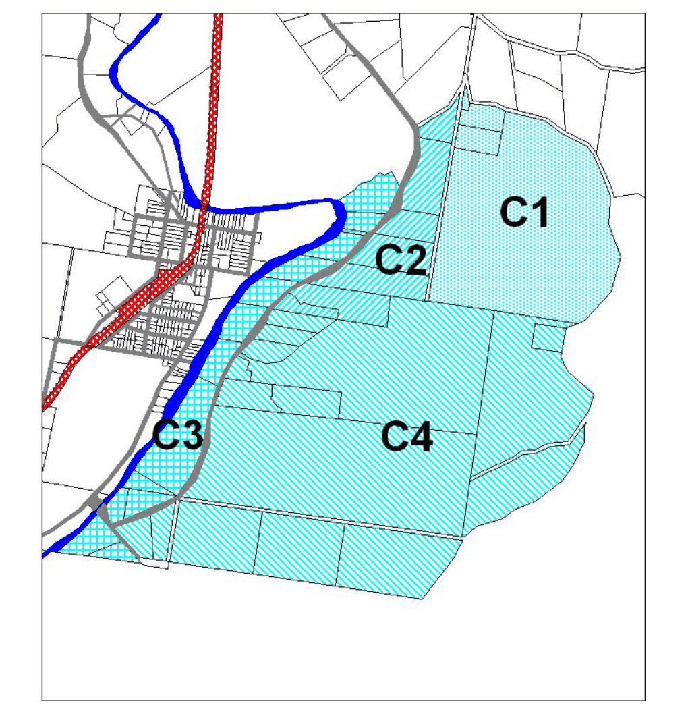

## 5. PRECINCT C - PATERSON EAST - HUNGRY HILL

Precinct C incorporates the area within the investigation Zone to the east of Paterson, extending from the Hungry Hill ridge-line in the east through to the Paterson River in the

west.  The Shire boundary runs along the southern and eastern boundaries of the Precinct. Precinct C is divided into 4 planning areas.

> [Picture on page 51: a picture, saved as a picture (images/part-d5-paterson-local-area-plan-page-51-6.gif, 150 dpi).]
