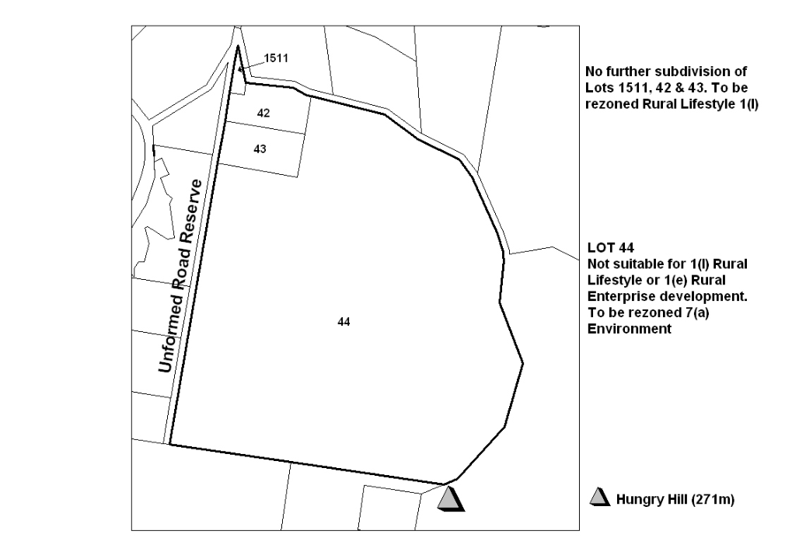

### 5.1 PLANNING AREA C1

Area C1 occupies the north-western sideslopes of Hungry Hill.  It is bounded to the north and east by a road reserve - fire trail that extends east from the 'end' of Glenburn Road.  Area C1 incorporates 4 lots:

Lot 1511 DP581503 Lots 42, 43, 44 DP78996

There is a road reserve running along the eastern boundary of all lots, which separates Area

C1 from Area C2.  Within this road reserve there is a dirt road providing access to Lots 1511, 42 and 43.

### PLANNING AREA C1

> [Picture on page 52: a picture, saved as a picture (images/part-d5-paterson-local-area-plan-page-52-11.gif, 150 dpi).]

#### Development Potential

Lot 1511 is a small lot - no further subdivision is permitted.

Lots 42 and 43 DP 789996 have already been subdivided and developed.   Lot 42 is 2.93ha in area, which is below the minimum 3ha area needed for further subdivision.  Lot 43 is 3.2ha in area.  Both are forested and bushfire prone.  Further subdivision of Lots 42 and 43 is not permitted.

Lot 44 DP789996 is a very large lot that occupies the sideslopes and ridge of Hungry Hill. Hungry Hill is a significant, local landmark, reaching an elevation of 271m just south of the

southern corner of Area C1.  Most of the higher elevated area on site has slopes in excess of 18 degrees.  The area is drained by a number of steep watercourses that form a creek system which flows into the Paterson River.

Lot 44 is forested with rare and endangered species, including koalas, reported in the area. Hungry Hill was identified by the Paterson Community as having high scenic value.  Hungry Hill is part of a prominent range of three hills - Hungry Hill, Red Hill and Kurrikaba Hill - that form the 'backdrop' to the villages of Paterson and Martins Creek.

Given its topography, vegetation, habitat value and visual significance, subdivision and development of Lot 44 for Rural Lifestyle or Rural Enterprise development is not permitted.

Lots 1511, 42 and 43 are to be rezoned Rural Lifestyle 1(l) and Lot 44 rezoned 7(a) Environment.
