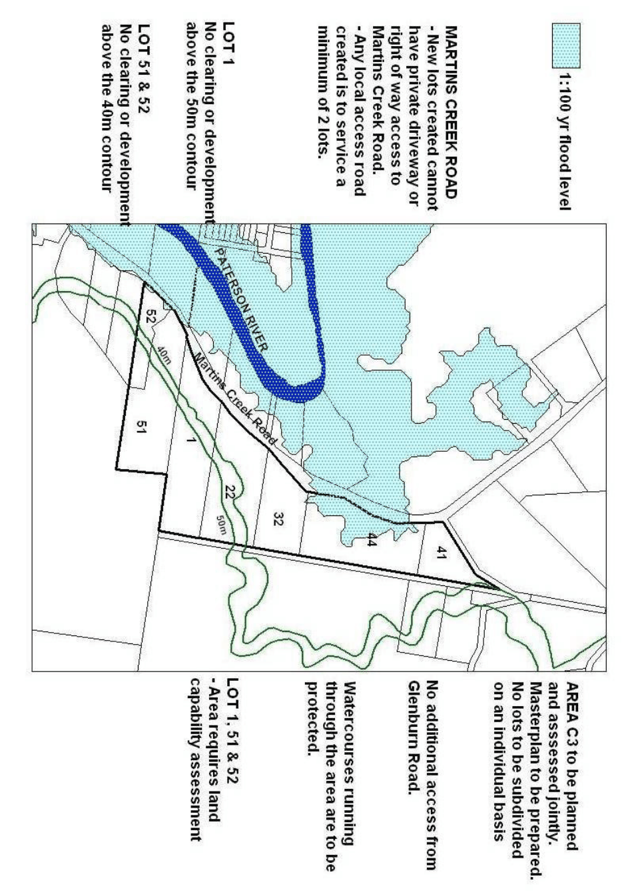

### 5.2 PLANNING AREA C2

#### The Area

Planning Area C2 lies between Area C1 and Martins Creek Road.  It is bounded by Glenburn Road to the north.  It incorporates seven (7) lots:

Lots 41 & 44 DP789996 Lot 32 DP829629 Lot 22 DP1004818 Lot 1 DP244817 Lots 51 & 52 DP1071505

Lot 41 has already been zoned 1(l) Rural Lifestyle.  On Lot 44, an area along the frontage to Martins Creek Road has been zoned 7(a) Environment due to its habitat value (remnant wet sclerophyll forest).

#### Development Potential

The four northern lots in Area C2 occupy the footslopes of Hungry Hill, with the topography being undulating.  There are a number of watercourses that flow through the area.  The area on Lot 44 zoned Environment 7(a) lies below the 1:100, with the 1:200 flood level extending further east, close to the eastern boundary of the Lot.  There appears to be a poultry shed on Lot 44. Council will not permit access from Glenburn Road for any new development in Area C2.

Lots 1 DP244817 and Lots 51 & 52 DP1071505 are long narrow lots with a width to depth ratio of less than 1:3.   These lots occupy steeper land with slopes in excess of 18 degrees along their eastern boundaries.  The undulating areas next to Martins Creek Road have been cleared and developed, while the more steeply sloping areas in the central and eastern parts of these lots remain forested.  The forested areas are part of the Hungry Hill habitat area and contribute to the visual integrity of the Hungry Hill area.   These areas are bushfire prone. On Lot 1, no further clearing or development above the 50m contour is permissible.  On Lots 51 and 52, no further clearing or development above the 40m contour is permissible.  These contour lines approximate the existing vegetation line, with the objective being to prohibit further clearing of native bushland.

All lots within Area C2 have frontage to Martins Creek Road which is a collector road.  Any lots created in the subdivision of this area cannot have direct driveway or right-of-way access from Martins Creek Road.

Given their size, shape and access issues, none of the lots within this area are suitable for subdivision on an individual basis.  For Lots 41, 44, 32 and 22, the minimum area that can be subdivided is 2 adjoining lots (for example - a minimum area would be Lots 41 and 44 combined).

The southern 3 lots, Lots 1, 51 and 52, are to be assessed and planned jointly.  Lot 1 could be developed in conjunction with Lot 22 and Lot 32, provided that:

Lot 51 is included in the land capability assessment, and, If Lot 51 is assessed as suitable for further subdivision, provision for access to Lot 51 is included in any subdivision plan for the adjoining northern lots.

#### Masterplan

A Masterplan is required, with the Plan to address:

Land capability - topography, drainage, habitat, slopes and flooding and bushfire risks. Access - any local access road created, needs to service a minimum of 2 existing lots. Subdivision layout. Protection of the watercourses and the area zoned Environment 7(a).

#### Issues & Performance Criteria

In addition to the planning controls setout in the LEP, DCP and Rural Strategy, the planning and assessment process for Area C2 must address.

| Issue | Planning Considerations / Performance Criteria |
|---|---|
| Coordinated development | Masterplan to be prepared to provide the framework for the development of Area C2. |
| Subdivision | No subdivision of individual lots. For Lots 41, 44, 32 and 22 the minimum area that can be subdivided is two adjoining existing allotments (eg Lots 41 and 44 combined). Lots 51, 52 and 1 needed to be jointly assessed and planned. Narrow lots with a width to depth ratio of less than 1:3 cannot be created. For newly created lots, private driveway access or right-of-way access to Glenburn Road is not permitted. |

| Access to Collector Roads - Martins Creek Road | No additional private driveway access or right- of-ways to Martins Creek Road to be created. Any new access road coming off Martins Creek Road, must service a minimum of 2 existing lots. |
|---|---|
| Protection of Habitat - Rare and endangered species have been reported in this area. | No further clearing of areas of forest vegetation. On Lot 1 DP DP244817 no clearing or development is permissible above existing vegetation line which is approximated by the 50m contour. On Lots 51 & 52 DP1071505 no clearing or development is permissible above the existing vegetation line which is approximated by the 40m contour. Any proposed development in the area needs to demonstrate that there will be no negative impact on the area of land zoned Environment 7(a). |
| Areas subject to bushfire risk | Bushfire risk to be assessed and addressed as part of any subdivision design. |
| Visual Impact | View-shed analysis / Visual assessment required. Development to have no or minimal impact on the Hungry Hill vista. The visual impact of any development along Martins Creek Road needs to be minimised. No back yards to have frontage to Martins Creek Road. |
| Creek and watercourses | No further riverfront lots or riparian rights to be created. Riparian vegetation to be protected. |
| Poultry Shed | Development should not impact on the operation or viability of this enterprise. Buffer zones to be provided as per the Shire- wide DCP 2004 requirements. |

### PLANNING AREA C2

> [Picture on page 56: a picture, saved as a picture (images/part-d5-paterson-local-area-plan-page-56-2.gif, 150 dpi).]
