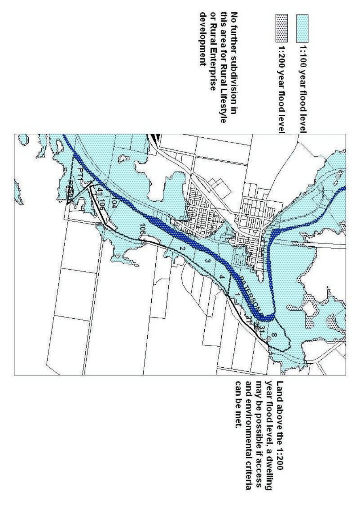

### 5.3 PLANNING AREA C3 - PATERSON RIVER FLOODPLAIN

#### The Area

Planning Area C3 occupies the area bounded by Martins Creek Road to the east and the Paterson River to the west.  This area incorporates 13 parcels of land.  Of these lots, 3 have been zoned 7(a) Environment.  A further 5 lots have 2 zonings - Rural Lifestyle 1(l) along the Martins Creek Road frontage and 7(a) Environment on the remainder of the site.  The Rural Lifestyle zone has been placed on properties with existing dwellings.  Of the remaining properties, two are zoned 9(a) Investigation while three properties have very small areas zoned Investigation 9(a) adjacent to Martins Creek Road, with the bulk of the area being zoned 7(a) Environment.

The Lots with a 9(a) Investigation zoning are:

Lot 8 DP244617 - part only Lot 1 DP 244817 - part only Lot 105 DP255124 Pt 1 DP1056154 - part only - remainder of the site is Environment 7(a) and rural Lifestyle 1(l). Pt 105 DP1063596

#### Development Potential

Most of Area C3 is flood affected, lying below the 1:100 and 1:200 flood levels.  The area has also been identified by the Paterson community as having a very high scenic value that needs to be protected.

Given the flood risk in this area and high scenic value of this area, no further subdivision is permitted.  Development of a dwelling on an existing lot may be possible in areas above the 1:200 flood level provided that access, setback from Martins Creek Road and environmental criteria can be met.

> [Picture on page 58: a picture, saved as a picture (images/part-d5-paterson-local-area-plan-page-58-1.gif, 150 dpi).]
