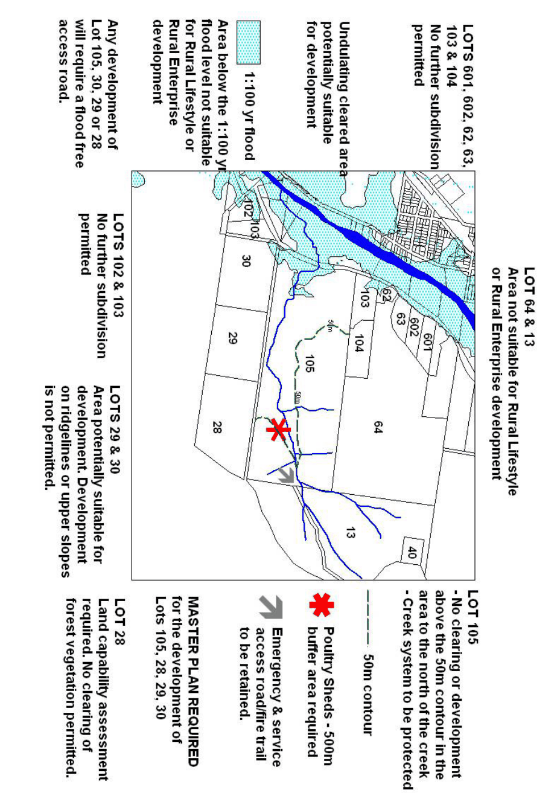

### 5.4 PLANNING AREA C4

#### The Area

Planning Area C4 is located on the eastern side of Martins Creek Road to the north of Woodville Road.  The area incorporates 14 lots:

Lots 601 and 602, DP786865 Lots 63 and 64 DP705752 Lot 62 DP620222 Lots 103 and 104 DP1081230 Lot 105 DP255124 Lot 13 DP752451 Lots 28, 29 and 30 DP752451 Lots 102 and 103 DP225124

There is an unformed road reserve (Phillips Street) located along the southern boundary of Lot 105, with this reserve providing access to Lots 28, 29 and 30.

#### Development Potential

Lots 601, 602, 62, 63, 102 and 103 are already zoned Rural Lifestyle 1(l) and further subdivision is not permissible.  Part of Lots 62 and 102 also have an Environment 7(a) zoning.

Lots 103 and 104 DP1081230 are small lots with Lot 104 being steep and forested.  No further subdivision is permitted.

Lot 64 DP707752 is a very large lot that incorporates the western slopes of Hungry Hill.  The elevation on this lot rises from 20 metres above sea-level at the Martins Creek Road entrance to 260 metres along the eastern site boundary.  Slopes over much of this lot exceed 18 degrees.  The lot is forested with the forested slopes being both an important habitat area and a significant contributor to the visual amenity of the Paterson area.  This area is bushfire prone.  Lot 64 is not suitable for subdivision for Rural Lifestyle or Rural Enterprise development.

Lot 105 DP255124 is also a very large lot.   The northern and eastern parts of the lot occupy the southern foothills and sideslopes of Hungry Hill.  The topography of this area is hilly to steep with slopes exceeding 18 degrees in the more elevated areas.  This area is bushfire prone.  This part of Lot 105 is not suitable for Rural Lifestyle or Rural Enterprise development.

The western and southern parts of Lot 105 are flat to undulating, with the area drained by a small creek system.  Flooding occurs along the Martins Creek Road frontage with an area along the creek system affected by the 1:100 year flood.   Some sections of this lot appear suitable for Rural Lifestyle and/or Rural Enterprise development.

The lower areas of Lot 105 have been cleared and there is a large poultry complex near the eastern boundary of the Lot.  The area to the north of the creek, above the 50m contour is forested and forms part of the Hungry Hill habitat area.  Rare and endangered species have been recorded in the area.  This part of the site is also bushfire prone.  No development or clearing is permissible above the 50m contour.  This contour approximates the vegetation line.

Lot 13 DP752451 incorporates the upper slopes and crest of Hungry Hill (elevation 271m). This area is very steep with most of the area being forested.  Due to the topography, habitat value, visual significance and bushfire risk, subdivision and development of this area for Rural Lifestyle or Rural Enterprise is not permissible.

Lots 29 and 30 DP752451 are undulating to hilly, with localised areas of steep slopes in Lot

29\.  Most of lot 30 has been cleared, with small pockets of open forest on Lot 29.  The southern boundary of these lots is elevated 100m asl, and visible from Paterson and Martins Creek Road.  These lots are considered suitable for Rural Lifestyle or Rural Enterprise development.

Lot 28 DP752451 is located on the sideslopes and ridge-line of a spur ridge extending south from Hungry Hill.  Much of the lot is hilly to steep, reaching an elevation of 146m asl on the south western corner of the lot.  The lot is drained by three small watercourses.  The eastern half of the lot is forested and the area is bushfire prone.  The north western corner of the lot appears to be suitable for Rural Lifestyle or Rural Enterprise development.

#### Masterplan

A Masterplan is required to identify the developable land on Lots 105, 28, 29 and 30 and provide the framework for co-ordinated development.  A land capability assessment is required as part of the master-planning process.

#### Issues & Performance Criteria

In addition to the planning controls setout in the LEP, DCP and Rural Strategy, the planning and assessment process for the developable land within Area C4 must address.

| Issue | Planning Considerations / Performance Criteria |
|---|---|
| Lots 601 and 602, DP786865 Lot 63 DP705752 Lot 62 DP620222 Lots 103 and 104 DP1081230 Lots 102 and 103 DP225124 | No further subdivision permitted. Lots zoned 9(a) Investigation to be rezoned Rural Lifestyle 1(l). |
| Lot 13 DP752451 Lot 64 DP705752 | Lots not suitable for subdivision and development for Rural Lifestyle or Rural Enterprise development. These lots are to be rezoned Environmental Protection |
| Lots 105, 28, 29, 30 | Masterplan including a land capability assessment is required to identify land suitable for development and determine access, areas for habitat and scenic protection and subdivision layout. |
| Flood prone land | Rural Lifestyle / Enterprise development is not permissible on land below the 1:100 year flood level. |

| Access to Collector Roads - Martins Creek Road | No additional private driveway access or right- of-ways to Martins Creek Road to be created. In developing Lots 105, 28, 29 and 30, a maximum of two (2) access roads will be permitted off Martins Creek Road. At least one of these roads must provide flood free access with all lots being able to access this road. |
|---|---|
| Emergency and Service Access - Hungry Hill | Any local road network developed in the southern part of Area C4 needs to ensure that there is a vehicle access road through to Lot 13 |
| Habitat Protection - Rare and endangered species have been reported in this area. | No further clearing of land or development of dwellings and buildings above the following contour lines: 40 m for Lots 601, 602, 63, 64, 101 and 102 DP873504 50m for the area to the north of the creek line on Lot 105. Lots 28 and 29 - to be determined by habitat and visual assessments as part of a land capability assessment. Forested areas are to be rezoned Environmental Protection. |
| Areas subject to bushfire risk | Bushfire risk to be assessed and addressed as part of the subdivision design. |
| Visual Impact - the forested hills and ridges that form Hungry Hill are an important part of the visual amenity and identity of Paterson. This forested slopes have been identified by the Paterson Community as having high visual / scenic value. | View-shed analysis / Visual assessment required. Development to have no or minimal impact on the Hungry Hill vista. The visual impact of any development along Martins Creek Road needs to be minimised. No back yards to have frontage to Martins Creek Road. |
| Creek and watercourses | No further riverfront lots or riparian rights to be created. Riparian vegetation to be protected. |
| Poultry Shed | Development should not impact on the operation or viability of this enterprise. Buffer zones to be provided as per the Shire- wide DCP 2004 requirements. |

> [Picture on page 62: a picture, saved as a picture (images/part-d5-paterson-local-area-plan-page-62-1.gif, 150 dpi).]
