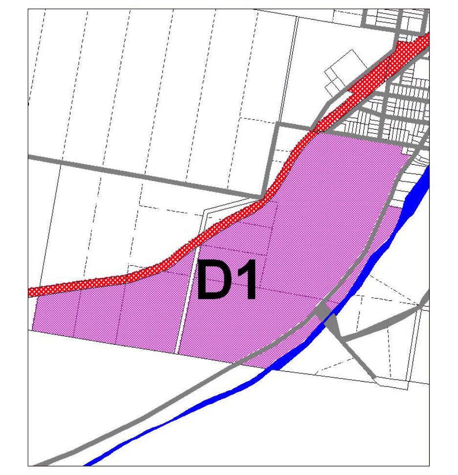
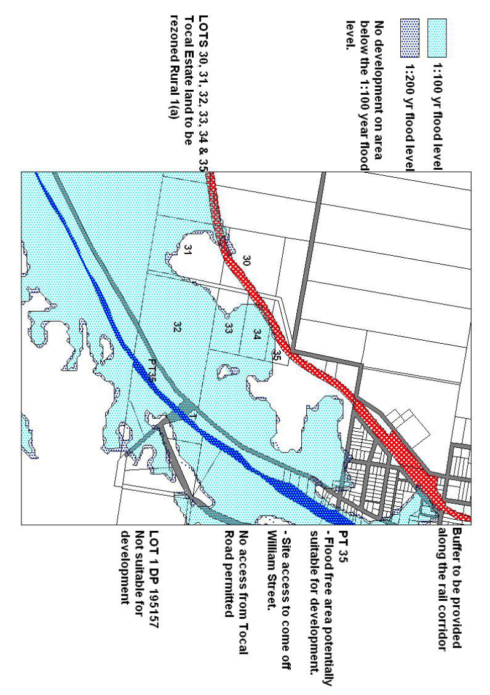

## 6. PRECINCT D - TOCAL ROAD

> [Picture on page 63: a picture, saved as a picture (images/part-d5-paterson-local-area-plan-page-63-2.gif, 150 dpi).]

#### The Area

Precinct D incorporates the area within the Investigation Zone, that abuts the southern boundary of Paterson village.  The area is bounded by the Paterson River to the east and the North Coast Railway line to the west. Tocal Road runs parallel to the River through the eastern side of the Precinct.

Precinct D incorporates 8 Lots.

Pt 35 DP752467 Lot 1 DP195157 Lots 30, 31, 32, 33, 34, 35 DP975697

Paterson Road runs north-south through Pt 35 and Lot 32 creating a long narrow strip of land between Paterson Road and the Paterson River.

The North Coast Railway line traverses Lots 30, 31, 34 and 35.  The western corners of Lots 31, 34 and 35 lie to the west of the railway line in Precinct E.  Most of Lot 30 lies in Precinct E - Webbers Creek Road with its south-east corner in Precinct D.

The northern edge of Lot 35 DP752467 that has frontage to William Street has been zoned 2(v) Village and 7(a) Environment.

#### Development Potential

Lots 30, 31, 32, 33, 34, 35 DP975697 form part of the Tocal Estate and CB Alexander Agricultural College and are not available for development.  These lots are to be re-zoned Rural 1(a).

Lot 1 DP195157 is owned by Dungog Shire Council and forms part of the Woodville Bridge Road Reserve.   It is small, floodprone and not suitable for development.

Pt 35 DP752467 is a large parcel of land that abuts the southern boundary of the village. Part of this lot is flood affected, with development not permissible on the area lying below the 1:100 year flood level.  The western edge and central portions of the lot are elevated and potentially suitable for development.  Flood-free access to this area is available from William Street.

#### Masterplan

Not required.

#### Issues & Performance Criteria

In addition to the planning controls setout in the LEP, DCP and Rural Strategy, the planning and assessment process for the flood-free area of Pt 35 DP752467 must address:

| Issue | Planning Considerations / Performance Criteria |
|---|---|
| Vehicle Access | All access to the area is to be via a local road coming off William Street. No access to Tocal Road |
| Habitat protection | Development of the site is not to impact negatively on the adjoining wetlands or watercourses. |
| Tocal Road is an entry point to Paterson. The visual Impact of development along Tocal Road needs to be minimised. | Visual assessment to be undertaken to determine requirements to minimise visual impact of any development from Tocal Road. These may vary from the DCP, with these requirements having precedence. |
| Poultry Shed | 500m buffer zone to be provided around any |

operating commercial poultry sheds.

North Coast Railway line

Noise, vibration and safety impacts of the rail corridor to be identified and assessed and appropriate noise-attenuating strategies incorporated in the planning and development of the area.

### PLANNING AREA D1

> [Picture on page 65: a picture, saved as a picture (images/part-d5-paterson-local-area-plan-page-65-9.gif, 150 dpi).]
