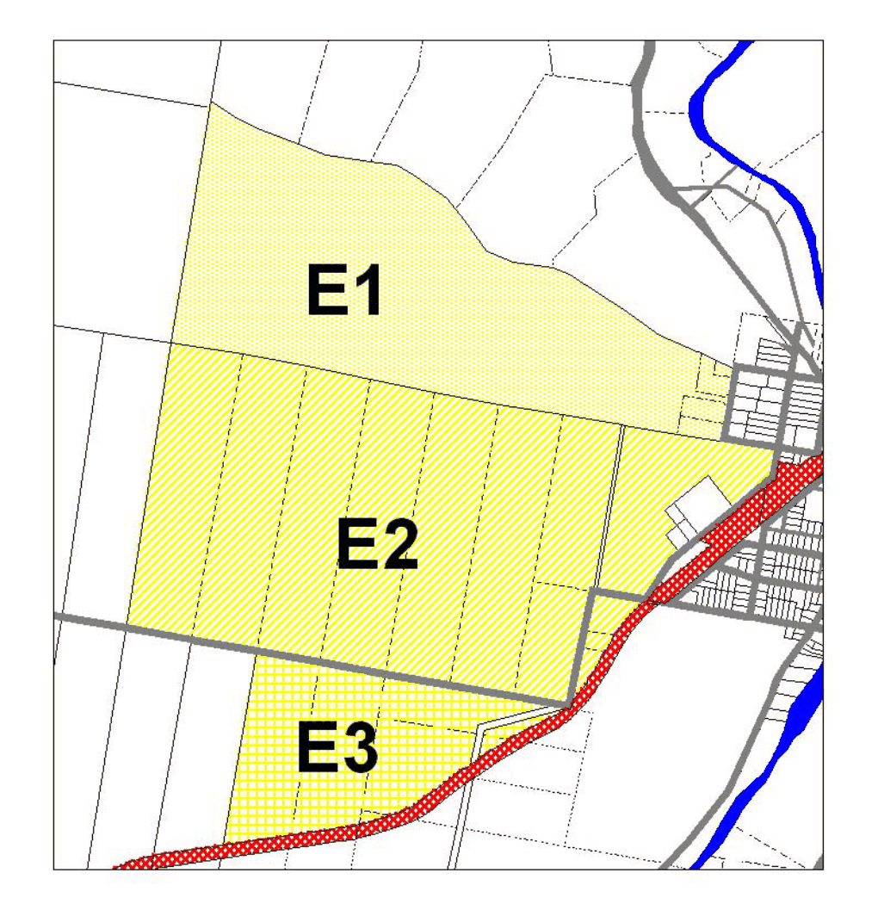

## 7.    PRECINCT E - WEBBERS CREEK ROAD

> [Picture on page 66: a picture, saved as a picture (images/part-d5-paterson-local-area-plan-page-66-2.gif, 150 dpi).]

Precinct E incorporates the area to the west and south west of Paterson Village.  The area is bounded by the village, golf course and cemetery to the east, the ridge line (drainage divide) between the Corners Creek and Webbers Creek catchment areas to the north and the North Coast Railway line to the south.

Precinct E is divided into three (3) Planning Areas:

Area E1 - Sideslopes and ridgeline. Area E2 - Lots with frontage to the northern side of Webbers Creek Road. Area E3 - Lots to the south of Webbers Creek Road.
