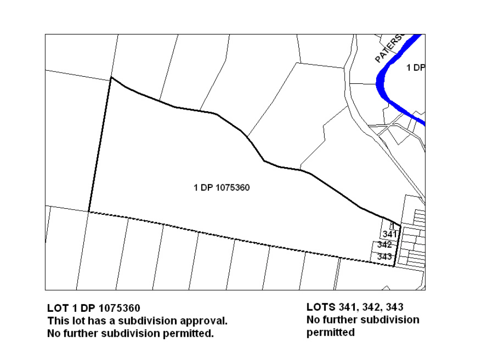

### 7.1 PLANNING AREA E1

#### The Area

Area E1 incorporates the sideslopes leading up to the ridgeline that separates the Corners Creek and Webbers Creek Catchment areas.

Area E1 incorporates four lots:

Lot 1 DP 1075360 Lots 341, 342, 343 DP834072

### PLANNING AREA E1

> [Picture on page 67: a picture, saved as a picture (images/part-d5-paterson-local-area-plan-page-67-9.gif, 150 dpi).]

#### Development Potential

Lots 341, 342, 343 DP834072 within Area E1 have been zoned Rural Lifestyle 1(l).  No further subdivision is permissible.

A 25 lot subdivision has been approved for Lot 1 DP 1075360.  No further subdivision of these 25 lots is permissible.
