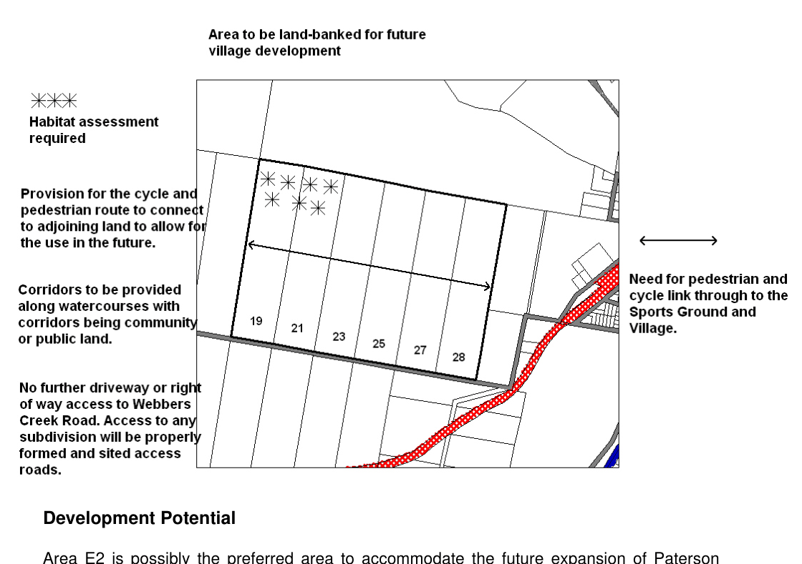

### 7.2  PLANNING AREA E2

#### The Area

Area E2 lies immediately to the west of the Paterson Sports Ground and Cemetery.  It incorporates six (6) lots with frontage to the northern side of Webbers Creek Road.

Lots 19, 21, 23, 25, 27 and 28 DP975697

### PLANNING AREA E2

> [Picture on page 68: a picture, saved as a picture (images/part-d5-paterson-local-area-plan-page-68-7.gif, 150 dpi).]

#### Development Potential

Area E2 is possibly the preferred area to accommodate the future expansion of Paterson Village.  The area is flat to undulating, and appears to have no significant physical constraints.  Local residents have advised that the area may be subject to local flooding along the creek system. This requires further investigation prior to development. The area is drained by a tributary creek system of Webbers Creek.   Most of the area has been cleared with small pockets of forest vegetation along the northern boundary of Lots 25, 27 and 28 and on the northern part of Lots 19 and 21.  These vegetated areas are part of a larger vegetation corridor and as such their habitat value will need to be assessed.

If flooding is not an issue, consideration should be given to land-banking this area to accommodate the future growth of Paterson.  Residential subdivision will be considered for Area E2.  The proponent will need to address water-supply and provide an onsite sewage system.

#### Masterplan

A Masterplan is required.  The Plan is to show staged subdivision for residential and village uses, including the subdivision layout, road network, pedestrian and cycle access routes, open space and interface with the creek system.  The Masterplan must demonstrate how development of the area will be staged.   It is likely that eastern only part of the area will be needed for residential development in the short to medium term.  Rural Lifestyle and/or Rural Enterprise may be considered on the western part of Area E2 provided that the lot layouts that will enable subdivision for residential / village uses in the future.

#### Issues & Performance Criteria

In addition to the planning controls setout in the LEP, DCP and Rural Strategy, the planning and assessment process for Area E2 must address:

| Issue | Planning Considerations / Performance Criteria |
|---|---|
| Flooding | Flood assessment to be undertaken to assess extent of flooding and its implications for the development of the site. |
| Need for co-ordinated development | Masterplan to be prepared for Area E2. Subdivision must be in accordance with the adopted Masterplan for Area E2. Subdivision can be staged in accordance with this plan. |
| Future expansion of Paterson Village in relation to providing land for residential, retail-commercial, recreation and community needs. | As part of the Masterplanning process - identification of future needs and allocation of land to meet these needs. |
| Access to Collector Roads - Webbers Creek Road | No direct private driveway or right of way access to be provided from Webbers Creek Road. |
| Capacity of Webbers Creek Road | Traffic study to be undertaken as part of the development potential assessment to determine the suitability of Webbers Creek Road to accommodate increased traffic |
| Pedestrian and cycle access | Pedestrian and cycle route to link through to the Sports Ground and the Village is required. Provision to be made to enable the pedestrian-cycleway to link with land to the west of Area E2 which may be required in the future for closer settlement. |
| Protection of the creek system | No additional Riparian Rights are to be created. |

Retention of bushland / habitat protection.

For the remnant forest areas, flora and fauna assessment required and appropriate protection controls put in place if required.
