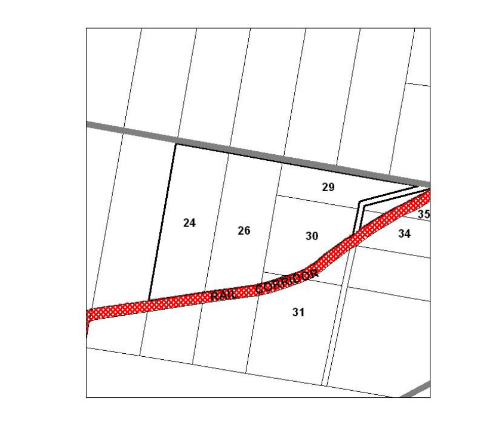

### 7.3  PLANNING AREA E3

#### The Area

Area E3 lies to the south of Webbers Creek Road with the North Coast railway line forming the eastern and southern boundary of the area.  Area A3 incorporates seven (7) lots, 4 of which are part lots created by the rail corridor.

Lots 24, 26, 29 DP975697 Part Lot 30 DP975697 (major part of this lot lies in Precinct E3) Corners of Lots 31, 34, 35 DP975697 (Major part of these lots lie in Precinct D)

#### Development Potential

These Lots form part of the Tocal Estate and CB Alexander Agricultural College and are not available for development.  The area is to be re-zoned Rural 1(a).

### PLANNING AREA E3

> [Picture on page 70: a picture, saved as a picture (images/part-d5-paterson-local-area-plan-page-70-18.gif, 150 dpi).]
