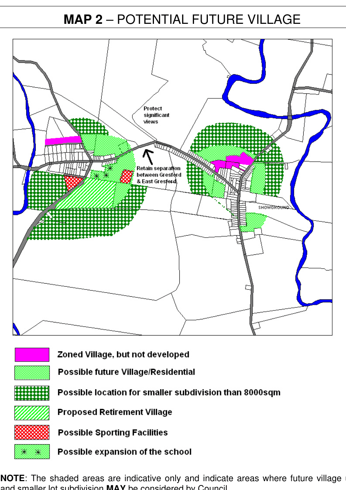
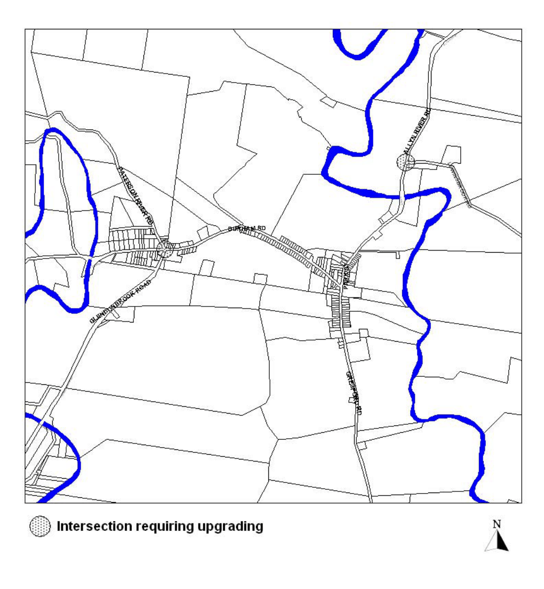
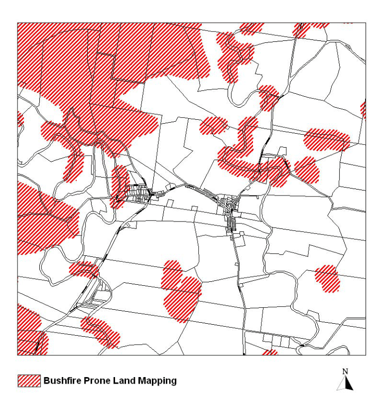

### 2.2 PLANNING FOR GRESFORD

Key issues identified during the study process and consultation with the Gresford community are addressed in the Gresford LAP.  These issues are:

The need for growth in the village, in particular the need for additional residential lots, aged housing, additional recreation and sporting facilities adjacent to the school, and more retail-commercial development.

The need to retain the village atmosphere and the rural and heritage character of Gresford and surrounds.    There is also a strong desire to retain the separation between Gresford and East Gresford, with open space / parkland separating the two settlements.

The need to preserve areas of high visual significance. Areas identified by the community as significant included the rural approaches to the village, the hills within and surrounding the village, the 'Camyr Allyn' Valley and the river flats along the Paterson and Allyn River. Areas nominated by the Gresford community as having prime views are

- The view from Durham Road north over the vineyards to the Barrington Ranges.

- From Allyn River Road west / south west over the Allyn River Valley (Camyr Allyn Valley)

- The Paterson River Valley, particularly the area west of Pound Crossing Bridge and from Paterson River Road west across the valley to 'Cawarra'.

Roads and road access, including the poor condition of roads within the area and the limited capacity of existing roads to accommodate the traffic increases that are likely to result from increased development.

Pedestrian and cycle access - the need for improved pedestrian and cycle access between Gresford and East Gresford, possibly along the Durham Road corridor.

Lack of sewage system.

Need to preserve native vegetation and protect habitat, including the riverine forest along the Allyn and Paterson Rivers and remnant forest on the surrounding hills.

Flooding - areas of land along both the Paterson and Allyn Rivers are flood prone.

Water supply and water quality - The water for Gresford is pumped from both the Paterson and Allyn Rivers.  It is important that river flows and water quality are maintained.

Quarry - Lewinsbrook Road - the future of the quarry – the quarry is operational and likely to be expanded in the future.

Agriculture - There are two intensive agricultural activities within the Investigation Zone, viticulture and a commercial nursery, as well as a market garden located just south of the Zone.   These activities have existing use rights and their right and ability to operate needs to be preserved.

Industrial areas - there were mixed views within the community regarding the need for industrial land and for Rural Enterprise Zones within the Investigation Area.

#### Future Growth of Gresford

The Issue

The Gresford community has identified the need for additional residential development in the village, both to meet the growing demand for land and to build the population base of the area in order to retain and expand services.

There is shortage of zoned, undeveloped residential lots within Gresford and East Gresford, with most of the land within the village area already developed.  Lack of access to the sewer has prevented land from being rezoned and released for development.

With the aging population base, there is a need for aged housing within the village.  The Anglican Church is exploring the feasibility of establishing a small retirement home in Gresford. Another land owner in close proximity to the village may also be considering aged housing as a development option and there may be other suitable sites on the periphery of the village that could be developed

As land within the Investigation Zone is developed, and the population in and around Gresford - East Gresford increases, there will be demand for the provision of additional facilities and services in the village, including  a neighbourhood shopping centre, additional sporting and recreation facilities and employment land.   Gresford Public School has a small site with limited outdoor play space.  As the population in the area grows, the school may need to expand and options for achieving this need to be considered in the LAP.  There is also a need for sporting facilities (oval and two netball courts) to be located in Gresford in close proximity to the school.  The former Rubbish Tip site was nominated at the Community Workshop as a potential site for additional sporting facilities.

Provision must be made for the long-term growth of Gresford-East Gresford.   The objective should be for growth to occur in the areas adjoining the existing village area, rather than allow further strip development along Durham Road and/or Park Street.

There is land in very close proximity to the village that has been zoned 9(a) Investigation Area and identified as potentially suitable for Rural Lifestyle and/or Rural Enterprise development.  This form of development envisages subdivision with a minimum lot size of 8000 square metres.  Once subdivided and developed for either of these uses it may be difficult to re-consolidate and redevelop this land to meet the future needs of the village. Subject to provision of town water and sewer, and the land having no flooding, environmental or access/egress constraints, some of the land adjoining the existing village areas may be rezoned for future village uses and/or smaller lot sizes than 8,000 sqm may be considered.

Planning Approach

There are areas within the Investigation Zone within very close proximity to the existing village boundary that may be suitable for the future expansion of Gresford and East Gresford.  These Lots are:

East Gresford

Lot 21 DP 816421 - south eastern corner Lot 20 DP 608401 Lot 20 DP 1014637 - eastern edge Lot 7 DP 38901

Gresford

Lots 35 & 36 DP 7055 Lot 1 DP 661450 - southern half Lot 73 DP 629501 Lot 1 DP 562046 Lot 20 DP 1014637 - western section PT 5 DP 752464 - the area to the east of Glendonbrook Road has been identified as the location for the Anglican retirement Home.

Lot 2 DP 1059713 - former rubbish tip - identified as a possible location for sporting facilities for Gresford.

Possible areas that may be suitable for future village uses are shown on Map 2.

### GRESFORD LOCAL AREA PLAN 2005

> [Picture on page 12: a picture, saved as a picture (images/part-d6-gresford-local-area-plan-page-12-5.gif, 150 dpi).]

### MAP 2 – POTENTIAL FUTURE VILLAGE

NOTE: The shaded areas are indicative only and indicate areas where future village uses and smaller lot subdivision MAY be considered by Council.

Further investigation of these lots is required to determine their suitability for future village

uses.  In particular, it needs to be determined whether these lots have any environmental or physical constraints and can be connected to the water supply and sewered most probably via an on-site package treatment plant.

Following these investigations, an area or areas, should be identified and rezoned for future village uses. The key areas should be land-banked to ensure that they are available for future development.

Land surrounding these key areas should be subdivided and developed in such a way that it can be further subdivided in the future as required.  For example, the subdivision could be designed as a residential subdivision and then the lots amalgamated into larger parcels of 8,000 sq metres and sold as rural lifestyle lots.

Alternatively, if not required for a land bank, and environmental, water and sewerage requirements can be met, consideration may be given to allowing closer settlement of all or parts of lots within close proximity to the existing village area, with the minimum lot size being reduced (for example, to 2,000 square metres).  Within the Investigation Area the preferred location for smaller lot subdivision is the area immediately south of Gresford village, and east of Glendonbrook Road with the area incorporating PT 5 DP752464, the western section of PT 6 DP 752464 and the north-western area of Lot 6 DP831568.

The LAP identifies land adjacent to East Gresford and Gresford as possible locations for future village uses. Unless the sewer, which is currently being investigated by Council, become available in Gresford, future development of these areas will only be considered under a Community Title development which includes a sewerage treatment package.

Desired Outcome

To provide sufficient land to accommodate the future growth of Gresford village.

#### Areas of High Visual Significance

The Issue

Part of Gresford's charm and attraction base lies in its setting.  Key features of this setting are the hill and ridge which separates Gresford and East Gresford, the Allyn and Paterson Rivers and fertile river flats, the hills and ridges surrounding Gresford – East Gresford and the spectacular views of the Barrington Ranges to the north.

Retaining the rural character and appearance of the Gresford area are very important to the Gresford community and Shire residents. The Gresford community is very keen to preserve the Camyr Allyn Valley, significant views, the river flat areas, to retain remnant forest on the surrounding hills and along the rivers, and to prevent development on the hills and ridges surrounding Gresford and East Gresford that are visible from the town and the main access roads.

The appearance and setting of Gresford is also important for the tourism industry, locally and Shire-wide. Gresford is both an attraction in its own right, and a gateway to the Barrington Tops region. The Tourism Plan for Dungog Shire, recognises the scenery and views of the Barringtons from Gresford, as part of the attraction base of the area.

The areas within the Investigation Zone identified as having high scenic value are:

The hill immediately south of the village - this hill provides the back-drop for the village and separates Gresford and East Gresford.

Camyr Allyn Valley - the vineyard, rolling hills and Allyn River corridor.  The view from Durham Road north across the valley to the Barrington Ranges is considered one of the best views in the Shire.  The Dungog Shire Tourism Plan recommends the development of a look/out viewing area along Durham Road to capitalise on this view.  The view of the valley from the Allyn River Road was also identified by the Gresford community as being significant.

The Paterson River Valley - in particular the river flat areas to the west and north west of Pound Crossing Bridge and the view west from Paterson River Road across the river flats to the Cawarra estate area.

The hills and ridges surrounding the village.

Rural approaches to the villages - Gresford Road, Allyn River Road, Glendonbrook Road and Paterson River Road.

The Gresford community also expressed the desire to retain the visual separation between Gresford and East Gresford, with the area between the two settlements to remain rural or be developed as parkland.

Planning Approach

Emphasis is on protecting the character and visual identity of the area. The LAP identifies areas where a visual assessment (including a view shed analysis) will be required as part of the planning process.

Design criteria for development in areas of high scenic value may include:

Prohibiting clearing of forested areas. Limiting or prohibiting further subdivision and development. Increasing the minimum lot size to avoid impact of dwellings and structures within significant view sheds. Appropriate siting and setbacks of new development, as per the Shire-wide DCP 2004. Use of landscaped buffers.  Buffers along collector roads will need to be in one ownership, possibly dedicated to Council or held as 'Community Land', to ensure effective management and control. Siting dwellings so that they front collector roads.  Backyards cannot have direct frontage to collector roads Height limits on buildings, including limiting dwellings to single storey. Prohibiting further ribbon or strip development along the main roads into and through Gresford-East Gresford.

Desired Outcomes

Retention of the rural character and setting of Gresford-East Gresford.

Retention of areas of high scenic value, including the view from Durham Road.

Minimise visual impact of rural residential development when viewed from the village and from the main routes into and through Gresford - East Gresford.  New development will be appropriately sited with landscaped buffers to these routes.

#### Roads and Road Access

The Issues

The road and traffic issues within the Gresford Investigation Area include:

The poor condition of main roads in the area, including damaged pavements, narrow widths and poor alignment.

Narrow width of Lewinsbrook Road.  This road has been identified in the Section 94 Plan as requiring widening and upgrading.

A number of intersections within Gresford and the Investigation Zone require upgrading. The intersections identified in the Section 94 Plan as needing improvement are:

- Allyn River Road - Lewinsbrook Road

- Glendonbrook Road - Paterson River Road - Durham Road

Increasing number of heavy trucks travelling through the village.   The route from Singleton to Dungog via Gresford is emerging as a 'short-cut' between the Pacific Highway and New England Highway for heavy vehicles.

It is the policy of Dungog Shire Council to limit private driveway access along the main access roads into towns and villages.  These roads are known as 'Collector Roads'.  Given the potential conflict between the siting of driveways and the higher volumes of traffic and, in some cases, the 80 to 100 kilometre speed limits along these routes, the continued use of private driveway access to collector roads is considered highly undesirable.  The narrow width of the pavement of a number of the collector roads and restricted sight-lines due to the road alignment, are also factors that limit the suitability of these roads for additional private driveway access.

The LAP contains design criteria for new subdivisions that will restrict direct access to collector roads from private driveways. Increased use of existing driveways on collector roads to service future battle-axe style sub-division is also restricted in the design criteria.

For the purposes of the Gresford LAP the collector roads are defined as:

Gresford Road Allyn River Road Park Street Durham Road Glendonbrook Road Paterson River Road

### GRESFORD LOCAL AREA PLAN 2005

### MAP 3 – COLLECTOR ROADS

> [Picture on page 16: a picture, saved as a picture (images/part-d6-gresford-local-area-plan-page-16-3.gif, 150 dpi).]

Planning Approach

In new subdivisions, access to the collector roads will be by properly formed local roads and appropriately designed and sited intersections.  Existing intersections may need to be upgraded or relocated.  There will be no new direct driveway or right of way access from private dwellings to collector roads.  Where required, access ways for emergency vehicles will be permitted.

In designing subdivisions, careful consideration needs to be given to the internal road network.  Roads, unlike land uses or buildings, tend to become permanent features of a settlement.   As such it is important that the road layout be conducive to the long term sustainability of the area.

For local roads within subdivisions, preference is for through, connecting roads rather than cul-de-sacs and right-of ways.  A connected road network will minimise driving distances and generally provide for more than one entry-exit point within each subdivision. This is important particularly in areas potentially subject to bushfire or flooding.   A connected road network will also foster community interaction and facilitate development of bus routes, including school bus routes, as the need emerges.

Desired Outcomes

Reducing vehicular conflict and the potential for conflict through a significant reduction in the number of driveway access points to collector roads.

To deliver a high level of access and permeability via a network of inter-connecting roads throughout all subdivisions, not a series of cul-de-sac roads or right-of-ways.

To deliver a road network that will support closer settlement in the future.

#### Pedestrian and Cycle Access

The Issue

Gresford and East Gresford are located approximately 2 kilometres apart.  The main shopping precinct, hotel, licensed club, showground and sporting facilities are located in East Gresford, while the primary school and general store are located in Gresford.  There is currently a walk-way along Durham Road between the two settlements.  The walk-way is not sealed and is poorly maintained.  As such it is not well used, particularly by cyclists.  The need for a properly formed shared footpath and cycleway in the Durham Road corridor was identified in the Shire Bicycle Plan and included in the Section 94 Contribution Plan.

Planning Approach

Where feasible, to incorporate shared pedestrian and cycle pathways within new subdivisions and the provision to link these routes between adjoining subdivisions.  In some areas the design intent will be to establish a shared pathway link between the development and Gresford or East Gresford.  Upgrading the existing walkway between Gresford and East Gresford, and/or developing a new walkway is considered essential.

Desired Outcome

A network of shared pathways providing safe pedestrian and cycle access in and between subdivisions and, where feasible, create links between the subdivisions and Gresford and/or East Gresford.

#### Village Gateways

The Issue

The main access roads within the Investigation Zone are also the main access roads into Gresford and East Gresford.  In the past strip development has occurred along these roads. The Gresford community has identified a need to improve the presentation of Gresford and East Gresford through the implementation of a town improvement program.  Co-ordinated landscaping will be an important component of the improvement program. The town centre improvement program will need to address the Gateway arrival points for the area.

Planning Approach

The LAP recognises the importance of the village entry approaches in creating a 'sense' of arrival' to the village.  The gateway arrival corridors include Park Street and the Allyn River Road, Gresford Road, Paterson River Road and Glendonbrook Road approaches to the village.   The presentation of Durham Road is also considered very important within the village.

A landscape policy will be developed by Council to ensure a co-ordinated approach to the provision of landscape buffers along the entry corridors and Durham Road.  All development along these corridors will be in accordance with this Policy.

In preparing this Policy a visual assessment will be undertaken to determine set-back requirements.  These requirements may vary from the DCP with the Gresford Landscape Policy requirements having precedence.  A landscaped buffer and/or corridor tree planting along the corridors may be required, with the policy defining the buffer requirements and species to be planted.

Desired Outcome

To enhance the appearance and presentation of the village by creating coordinated entry corridors and gateways.

#### Sewage

The Issue

There is no sewerage system in Gresford. While Council is investigating options for sewering Gresford, East Gresford, Vacy and Paterson in the future, the sewer is unlikely to be on line within the next 5 years. As such, any development within the Investigation Zone will need to use an acceptable septic system or package on-site sewage treatment plant.

For properties located on flood liable land, specific conditions apply to the location of septic/sewerage systems and the disposal method and location.  Shallow soils overlying impermeable bedrock (eg on the surrounding hill-slopes) may also restrict the areas where septic systems are viable.

Planning Approach

Applicants will need to meet all requirements of Dungog Shire Council and the Department of Environmental & Conservation in relation to the establishment and use of on-site effluent management systems. Council will require the applicant to provide detailed soil, geo-technical and/or hydrological studies.

Desired Outcomes

Establishment of on-site effluent management systems which:

Generate no public health risk Prevent contamination of surface and ground water Conserve and re-use resources.

#### Habitat Protection

Most of the land within the Gresford Investigation Zone has been cleared.  There are small pockets of remnant forest vegetation on some of the hills  surrounding the village and riverine forest remnants along both the Allyn and Paterson Rivers.

The Native Vegetation Act 2003 and the accompanying Native Vegetation Regulations 2005, restrict the clearing of native vegetation.  Under the new Regulations, where clearing of remnant vegetation is proposed, (including clearing of mature stand-alone trees) separate approval is required through the Catchment Management Authority (CMA) The approval process will generally require the preparation of a Property Vegetation Plan (PVP). The intent of the new Act and Regulation is that clearing will only be approved where there is no net loss of native vegetation and where a PVP provides for significant offset planting and/or existing vegetation maintenance and improvement works.

The provisions of the Native Vegetation Act and Regulations must be addressed as part of the planning and assessment process for land within the Investigation Zone. Information on the Native Vegetation Act and Regulations is available through the Hunter Central River Catchment Management Authority or Dungog Shire Council.

Planning Approach

Flora and fauna assessments need to be undertaken as part of the rezoning process.  This must include addressing the requirements of the Native Vegetation Act 2003 and Regulations 2005.   At the rezoning stage, strategies for managing areas identified as having habitat value must be identified.  These strategies may include rezoning significant habitat areas as open space or environmental protection zones, provision of protective buffers and set-backs, increasing the minimum lots size, minimising clearing and avoiding structures or development in habitat areas.

As detailed in the previous section the proposed Native Vegetation Legislation will require concurrent approval from the CMA for any proposed non exempt clearing. The preparation of a PVP for the CMA for vegetation removal will also include consideration of the relevant requirements of Threatened Species Legislation. Prior to undertaking flora and fauna assessment, it is recommended that development (where clearing is proposed) be referred to the CMA.

Desired Outcomes

Preservation and protection of habitat, particularly habitat that supports viable wildlife communities.

Where possible, the establishment of a network of interconnected wildlife corridors not isolated protection zones or remote 'islands' of habitat.

Protection of watercourses and the vegetation along these watercourses.

#### Bushfire

The Issue

There are areas within the Gresford Investigation Zone that are prone to bushfire.  These areas are identified on the 'Dungog Shire Bushfire Prone Land ' Map and shown in Map 4. Rezoning applications for land shown on the Bushfire Prone will need to provide a bushfire risk assessment as part of the application.

Planning Approach

All subdivision designs must comply with the provisions of the NSW Rural Fire Service requirements as specified in the 'Planning for Bushfire Protection 2001’, and/or other relevant bushfire regulations.

Desired Outcome

To minimise the risk to people and property from the impacts of bushfire.

### GRESFORD LOCAL AREA PLAN 2005

### MAP 4– BUSHFIRE PRONE AREAS

> [Picture on page 20: a picture, saved as a picture (images/part-d6-gresford-local-area-plan-page-20-15.gif, 150 dpi).]

#### Flooding

The Issue

Flooding is an issue along both the Paterson and Allyn Rivers.   As data is not available on flooding within the Gresford Investigation Area, any proposal to develop along the river corridors or in other areas that may be susceptible to flooding will need to assess the flood regime and identify the 1:100 year flood level.

The LEP 2005 and Rural Strategy 2003 prohibit Rural Lifestyle and Rural Enterprise development on land affected by the 1% (1:100 year) flood level.  Under the LAP these areas are excluded from the Investigation Zone.

Further information on flooding and planning controls is available from Dungog Shire Council.

Planning Approach

The LEP and Rural Strategy prohibit Rural Lifestyle and Rural Enterprise development on land affected by the 1% (1:100 years) flood level.  Under the LAP these areas are excluded from the Investigation Zone.

The LAP also requires that:

All structures below the 0.5% (1:200 year) flood level must have flood compatible building components.

Ability to evacuate - a reliable flood free access for pedestrians is required for a 0.5% (1:200 year) or higher flood event.  A flood evacuation strategy for pedestrians and vehicles has to be prepared for the applicant by a suitably qualified engineer and approved by Council.

Any development will not increase the impacts of flooding on adjoining properties or downstream.

The applicant must provide controls to prevent the discharge of pollution during flood events.  All septic tanks must be located above the 1% (1:100 year flood level) and all transpiration beds or aerated areas above the 5% (1:20 year level).

Desired Outcomes

To minimise the risk to people and property from flooding. To prevent pollution of waterways.

#### Waterways – River Foreshores

The Issues

The Paterson and Allyn Rivers  and other watercourses within the Investigation Zone play an important role within the Gresford area.  These watercourses feature significantly in the local character of Gresford  and contribute to the sustainability of agriculture, recreation, tourism, water supply, habitat and bio-diversity and to the microclimate of the area.   The water supply for Gresford is pumped from the Allyn River (adjacent to the south-eastern corner of the Camyr Allyn vineyard) and from the Paterson River (adjacent to the Anglican Church).

Issues include:

> [Picture text on page 22 is stored in the PDF without readable letters (no character map), so it could not be copied; see the original PDF.]

The cumulative negative impacts of development on waterways. Preventing pollution from effluent and stormwater runoff and other activities. Maintaining water quality and the flow of the rivers by limiting the pumping of river water. Minimising impacts of development on the ecology associated with watercourses and wetlands. Weed infestation along river banks. Protecting and re-establishing the riverine forest and the riparian vegetation corridors along both rivers. Protecting the existing easements for the rising mains from the Allyn and Paterson River pumping stations to the reservior.

Planning Approach

The planning approach incorporates:

Protecting watercourse ecology Maintaining water quality and water flow Providing for public access to the waterways Minimising the impacts of flooding

This can be achieved by:

Providing adequate buffers and set-backs from watercourses, as per the Shire-wide DCP 2004. Ensuring that no further riparian rights are created, as required by the LEP 2005 and Rural Strategy 2003. Prohibiting further subdivision of the river foreshore areas – new lots with river frontage cannot be created. Encouraging foreshore areas to be kept in one title and zoned appropriately. Requiring developers to re-establish Riverine Forest were appropriate, in accordance with a vegetation management plan. Providing public access to foreshore areas. Encouraging the installation of package sewage treatment plants rather than on-site effluent management systems.

Desired Outcomes

Protection of riparian vegetation and re-establishment of riverine forest along the riparian corridors. Maintenance of water quality and water flow. Providing public or community access to the river foreshore areas.

#### Subdivision Patterns

The Issue

Under previous planning schemes, subdivision of rural land in some areas within the Shire was undertaken on an adhoc, uncoordinated basis.  This has resulted in significant fragmentation in land holdings.   In order to provide access to existing roads and/or river frontage, lots created were often long and narrow and/or battleaxe or irregular shapes. Further sub-division of these type of lots on an individual basis would increase fragmentation

and is not considered desirable. Fragmentation creates long term access and servicing problems.

Planning Approach

Emphasis is on creating a coordinated and integrated approach to subdivision design within the Investigation Zones. The Gresford LAP does not permit further subdivision of individual lots where the lots are small, irregular in shape and/or where the width to depth ratio of the lot is less than 1:3.  These lots are identified in the LAP.

Subdivision of these identified lots may only be permissible through consolidation of adjoining lots and/or through co-operation with adjoining land-owners to form a viable subdivision design area.  Masterplans may need to be prepared for subdivision design areas.

The Masterplan will detail the road network, lot layout and provision for open space, habitat corridors, environmental and scenic protection zones and shared pedestrian and cycle pathways within the subdivision design area.

Where there are lots suitable for subdivision that do not have existing public road frontage (eg in the Camyr Valley area and the area to the east of the Allyn River) then the subdivision design for the adjoining lots that have road frontage must ensure that provision is made for road and shared pathway access to the adjoining land.  This will prevent the sterilisation or ‘land-locking’ of developable land.

Desired Outcomes

No further fragmentation and adhoc subdivision of land.

A co-ordinated and integrated pattern of subdivision which is suitable for closer settlement patterns in the future to meet the needs of the Gresford village.

Co-ordinated approach to staged subdivision and land releases.

To avoid sterilisation of adjoining properties.

Create the opportunity for the development of an integrated community, not a series of separate enclaves.

To create a strong network of pedestrian, cycle and open space links throughout all subdivisions and, where required by Council, between the new subdivisions and Gresford village.

#### Existing Agricultural Activities

The Issue

There are a number of existing agricultural activities within and in close proximity to the Gresford Investigation Zone which are classified as Intensive Agriculture.  These activities include:

Camyr Allyn Vineyard Commercial nursery in East Gresford Market garden, near Pound Crossing Bridge, just south of the Investigation Zone

There may also be animal boarding, breeding or training establishments and/or intensive animal industries within or in close proximity to the Investigation Zone.

These activities may operate 24 hours a day and create noise, odour or other emissions and/or involve the application of chemical sprays.  The operation of the Showground and the Northern Hunter Winery may also create noise or odour issues for adjoining land.

There is potential for conflict to occur where residential / rural residential development encroaches into agricultural areas.  In order to minimise the potential for conflict and to protect the existing use rights of these activities, Dungog Shire Council requires that a buffer zone be provided between these activities and any new development.  The Buffer Zone requirements are detailed in the 'Dungog Development Control Plan No 1 - Buffer Zones'.

A Buffer Zone is defined as an 'area of land separating adjacent land uses that is used for mitigating the impacts of one land use upon another'.  Buffer elements (ie a natural or artificial feature) may be used within the buffer zone to mitigate adverse impacts.   In some cases the buffer zone widths specified in DCP 1 may be varied through the use of buffer elements.

Planning Approach

The LAP recognises the existing use rights of agricultural activities within the Investigation Zone.  Any development proposed adjacent to or in close proximity to agricultural activities will need to address the DCP 1 Buffer Zone requirements.

Desired Outcome

To minimise conflict between land uses that are potentially incompatible by establishing well defined boundaries and protecting the prior rights of lawful development.

#### Extractive Industry –Camyr Allyn Quarry, Lewinsbrook Road

The Issue

The Lewinsbrook Road Quarry is an active quarry that is owned and operated by Dungog Shire Council.  The Quarry provides road base material for use in road construction and maintenance within the Shire.

DCP 1 - Buffer Zones, recognises that quarrying activities are incompatible with residential / rural activities and requires a minimum buffer zone of 500m between the quarry and residential development.  Where blasting is part of the quarry operation, the buffer zone may be extended.

Planning Approach

Dungog Shire Council needs to address the future of the quarry and define whether a  buffer zone of more than 500m is required.  Development of land within this buffer zone for Rural Lifestyle or Rural Enterprise use will not be permissible while the quarry remains operational.

Desired Outcome

To prevent conflict between land uses that are potentially incompatible by defining boundaries and protecting the prior rights of the quarry.
