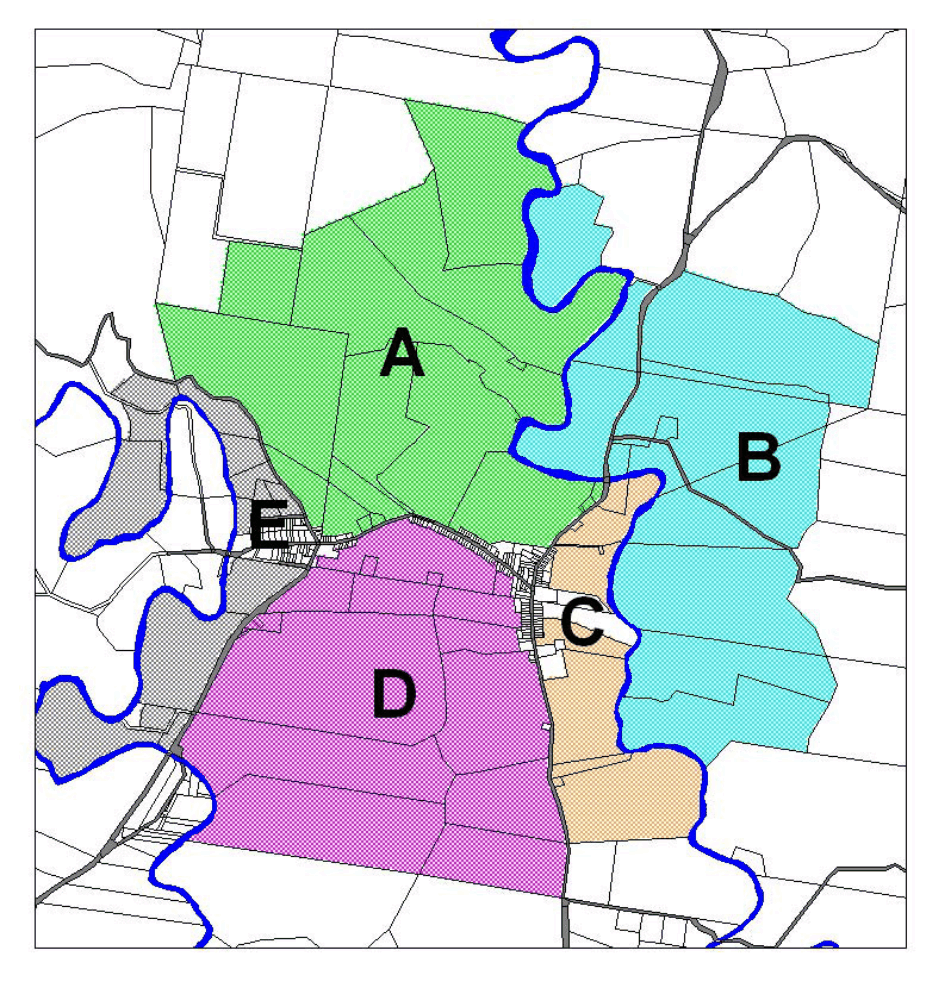
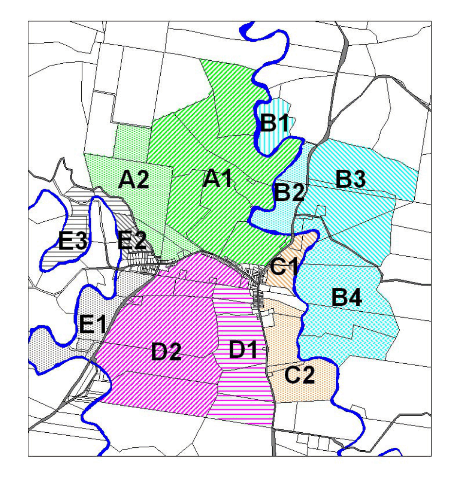

### 2.3 PLANNING PRECINCTS

The Gresford LAP divides the Investigation Zone into 5 planning precincts.  These precincts are shown on Map 5.

Precinct A - Gresford North - This area lies to the north of Durham Road.  It is bounded by the Allyn River and Park Street / Allyn River Road to the east and Paterson River Road to the west.

Precinct B - Allyn River Road - Lewinsbrook Road area - This area lies to east of the Allyn River in the area to north and east of East Gresford.

Precinct C - Gresford East  - Precinct C abuts East Gresford, and incorporates the area between Park Street and the Allyn River, extending north to Camyr Allyn Bridge.

Precinct D - Gresford South - Precinct D incorporates the large hill just south of the village.  The Precinct abuts the southern edge of Gresford and East Gresford and is bounded by Durham Road to the north, Park Street - Gresford Road to the east and Glendonbrook Road to the west.

Precinct E - Paterson River - Gresford West - this Precinct abuts the western edge of Gresford village and is bounded by the Paterson River to the west, Pound Crossing Bridge to the south and Glendonbrook and Paterson River Roads to the east.

Each Precinct is divided into planning areas.  These areas are shown on Map 6.

### GRESFORD LOCAL AREA PLAN 2005

### MAP 5 – PLANNING PRECINCTS

> [Picture on page 26: a picture, saved as a picture (images/part-d6-gresford-local-area-plan-page-26-3.gif, 150 dpi).]

### GRESFORD LOCAL AREA PLAN 2005

### MAP 6 – PLANNING AREAS

> [Picture on page 27: a picture, saved as a picture (images/part-d6-gresford-local-area-plan-page-27-3.gif, 150 dpi).]
