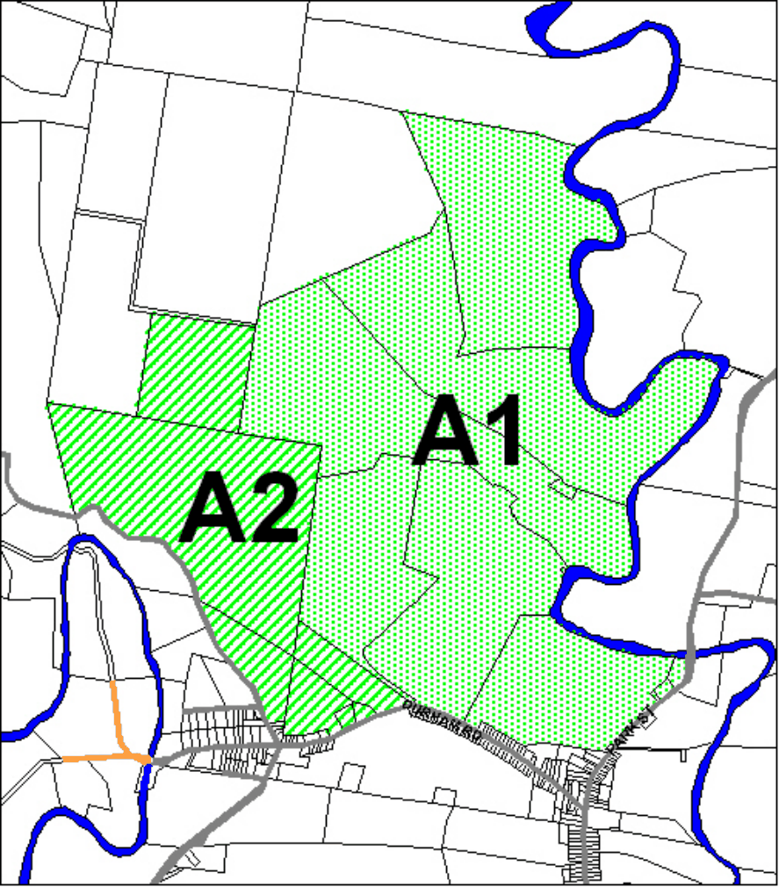

## 3. PRECINCT A - GRESFORD NORTH

Precinct A area lies to the north of Durham Road.  It is bounded by the Allyn River and Park Street / Allyn River Road to the east and Paterson River Road to the west.

Precinct A is divided into two (2) planning areas.

### PLANNING PRECINCT A

> [Picture on page 30: a picture, saved as a picture (images/part-d6-gresford-local-area-plan-page-30-6.gif, 150 dpi).]
