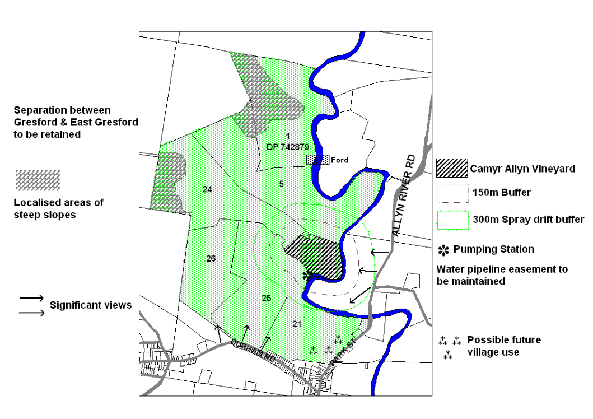

### 3.1   PLANNING AREA A1

#### The Area

Planning Area A1 incorporates the 'Camyr Allyn’ Valley and surrounding hills.  It is bounded by Durham Road to the south and Allyn River Road and the Allyn River to the east.  Area A1 incorporates seven (7) lots.

Lot 1 DP 742879 Lot 5 DP 1047402 Lot 1 DP 159911 Lot 24 DP 816421 Lots 25 & 26 DP 875973 Lot 21 DP 816421

Lots 25 and 26 have access from Durham Road.  Lot 21 has frontage to both Durham Road and Park Street - Allyn River Road.  The remaining lots are 'landlocked'.  Lot 1 DP 159911 and Lots 5 and 24 are accessed via a right of way through Lots 21 and 25. While Lot 24 appears to have legal access via a Right of Way, the situation in relation to Lots 1 & 5 is unclear and will require the landowners to provide relevant information to Council.

Alternative access for Lot 5 and access to the southern end of Lot 1 DP 742879 is available through Area B1 via a ford over the Allyn River. The northern part of Lot 1 DP 742879 is accessed via a 4WD trail and ford over the Allyn River which is located north of the Investigation Zone.  These alternative access routes are flood prone.

#### Development Potential

The Camyr Allyn Valley is a significant feature and integral part of the Gresford area. The Valley forms part of the view north from Durham Street to the Barrington Ranges and from the Allyn River Road approach to East Gresford. In addition, the Camyr Allyn Vineyard and Cellar Door is one of the main visitor attractions in Gresford and Dungog Shire. Part of the appeal of the vineyard is the scenery of the surrounding valley.

While development will be permitted in the Valley, it needs to be undertaken sensitively to ensure that the character and appeal of the area is retained. A detailed visual assessment including view shed analysis must be undertaken as part of any rezoning application with development to be limited to areas where the visual impact will be minimal.

Other issues that impact on the development potential of Area A1 include:

Intensive Agriculture - A commercial vineyard (Camyr Allyn Wines) has been established on the eastern section of Lot 24.  The vineyard is classified as Intensive Agriculture and a minimum buffer zone of 150m is required.  As the Vineyard uses chemical sprays the buffer is extended to 300m.  The vineyard is a 24 hour operation with spraying and harvesting often undertaken at night.  This generates both noise and light emissions.  As this is a valley location, the noise may 'echo' or be amplified.  Further investigation is required to measure the impact of the vineyard on adjoining properties and determine whether a wider buffer zone is required.  Any development that occurs in the Valley needs to recognise that the vineyard is a legitimate existing use and that the vineyard operations have precedence over 'new ' development.

Poor Access - more than half the area is 'landlocked' and accessed by right-of-ways over adjoining properties.  The costs involved in providing sealed road access to Lot 5 and Lot 1 DP 742879  to cater for development is potentially prohibitive.

Flooding - some of the flatter areas along the Allyn River are low lying and appear to be flood prone.  Further investigation is required to determine the 1:100 year flood level, with development not permitted below this level.

Steep slopes -  The western part of Area A1 is part of the Coulston Range, with localised areas of steep slopes (slopes greater than 18 degrees) occurring in the more elevated areas and along the water course gullies.

Lot 1 DP 742879 - the development potential of this area is very limited, with the main constraints being lack of access and hilly to steep terrain.  The western part of this lot is also bushfire prone.  Any development within this area should be on the southern half of the lot and undertaken in conjunction with development of Lot 5 to the south.

Lot 5 DP 1047402 - The south eastern corner of Lot 5 lies within the vineyard buffer zone and development will not be permitted within this buffer area.  The eastern part of this lot also appears to be flood prone.  There is also a creek system with numerous tributary water courses that traverses the area.  The requirements for buffers along watercourses will limit the amount of land available for development. Access is also an issue, the property owner will need to establish that there is legal access via Right of Way through adjoining properties. The Right of Way may only apply to a specific lot and the Right of Way of access may not necessarily extend to additional lots created by subdivision.

Lot 1 DP 159911 - This is a small, concessional lot.  No further subdivision will be permitted.

Lot 24 DP 816421 - The vineyard and surrounding buffer area prevent development on the eastern half of this lot.  Development could potentially occur in the western part of the site, in areas with slopes of less than 18 degrees and not identified as visually significant within the Valley (ie. Development to be 'hidden' and have no or very minimal impact on the visual amenity of the Valley). Access is also an issue and the possibility of using the Right of Way to service additional lots needs to be investigated.

Lots 25 & 26 DP 875973 - these lots are located adjacent to Durham Road and are part of the foreground view.   Development will need to be undertaken sympathetically with buildings designed and located to minimise the visual impact.  Development is to occur below the level of Durham Road, with no strip development permitted along Durham Road.  There are localised areas of steep slopes on both Lots as well as a number of watercourses.  This will also impact on the development potential.  The north-eastern part of Lot 25 lies within the vineyard buffer zone and development will not be permitted in this area.

Lot 21 DP 816421 - the southern part of Lot 21 has been identified as possibly suitable for the future expansion of East Gresford.  Further investigation is required to determine whether all or part of this lot is suitable for future village uses and/or for smaller lot sizes (eg 2,000

sqm) than permissible in the Rural Lifestyle zone.  In particular, it needs to be determined whether Lot 21 is free of physical and environmental constraints and can be connected to the town water supply and sewered via an on-site package treatment plant (or other system).  No development will be permitted in areas identified as having high visual significance.

### PLANNING PRECINCT A1

> [Picture on page 33: a picture, saved as a picture (images/part-d6-gresford-local-area-plan-page-33-2.gif, 150 dpi).]

#### Masterplan

Due to the visual significance of this area, the presence of the vineyard and access issues, a Masterplan for the area is required.

#### Issues & Performance Criteria

In addition to the planning controls setout in the LEP, DCP and Rural Strategy, the planning and assessment process for developable land within Area A1 must address:

#### Issue

Detailed visual assessment - view shed analysis to be undertaken as part of the planning and assessment process.

Development may be prohibited in areas which are identified as having high visual significance.

#### Planning Considerations / Performance Criteria

Visual Impact - parts of Area A1 have high visual / scenic value that is to be retained and protected.  The Camyr Allyn Valley is one of the main physical assets and features of the Gresford area and protection of this asset is a priority.

|  | Integrated building design is required for any development within this area. |
|---|---|
| Vineyard Buffer Zone – the vineyard has priority over any proposed development. | 300m buffer to be provided around the vineyard. Dwellings will not be permitted within the buffer zone. |
| Need for coordinated development | Land capability assessment is to be undertaken for Area A1 to identify land suitable for development. If suitable for development, a Masterplan is to be prepared for Area A1. Subdivision is to occur in accordance with the Masterplan. |
| Future expansion of East Gresford. - Lot 21 DP 816421 | The southern section of Lot 21 may be suitable for future village uses. As part of the Masterplanning process – assessment of the future needs of the village is to be undertaken and the suitability of the part of Lot 21 that abuts the village needs to be evaluated. |
| Access to Collector Roads - Allyn River Road and Durham Road. | No additional private driveway access or right- of-ways to Allyn River Road or Durham Road can be created. Ability to use the Right of Way to access Lots created by subdivision of Lots 1 DP 742879, Lot 5 DP 1047402 and Lot 24 DP 816421 requires investigation. Capacity of the Right of Way to accommodate increased traffic needs to be investigated. Sealing may be required. |
| Internal access - pedestrian & bicycle routes . | Any development on Lot 21 is to include a pedestrian - cycle link through to East Gresford shopping centre. A link is also to be provided to the walking track between Gresford and East Gresford |
| Arrival corridors / village gateways | Landscape buffer / corridor tree planting along the Allyn River Road frontage to create a village entry statement in accordance with the Landscape Policy for Gresford - East Gresford. |

|  | No strip development along Allyn River Road or Durham Road. For Lots 21 and 25, all development is to occur below the Durham Road level to retain both views and the visual separation between Gresford and East Gresford. |
|---|---|
| Allyn River Corridor / watercourses through the area | Flooding / hydrology / drainage of the area is to be assessed as part of the land capability assessment. No development below the 1:100 year flood level. Watercourses are to be protected. Development is to be setback from watercourses as required in DCP 1. No further riverfront lots or riparian rights are to be created. Riparian vegetation to be protected and the riverbank and watercourses rehabilitated. |
| Areas subject to bushfire risk | Bushfire risk to be assessed and addressed as part of any subdivision design. |
| Reafforestation | Areas to be re-vegetated are to be identified in the Masterplan and included in subsequent development plans. |
