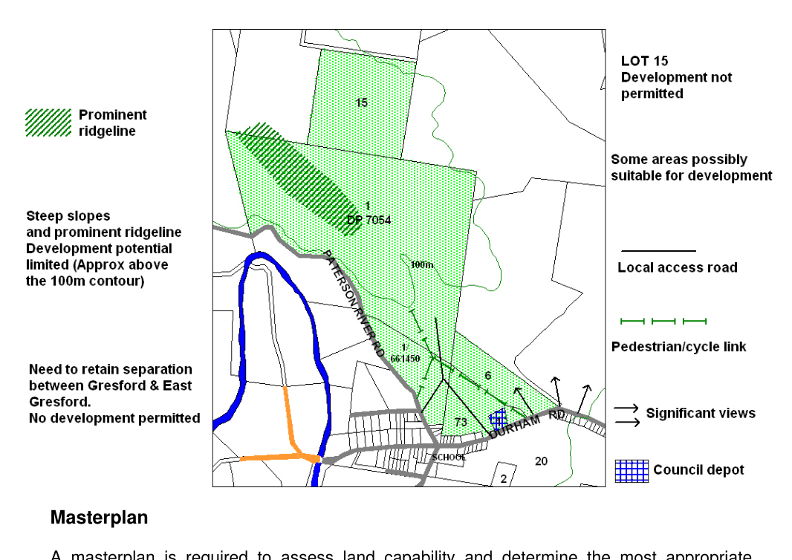

### 3.2 PLANNING AREA A2

Planning Area A2 adjoins Gresford Village.  The area is bounded by Paterson River Road to the west and Gresford Village - Durham Road to the south.  The area occupies the southern ridges of the Coulston Range.  Area A2 incorporates six  (6) lots:

Lot 15 DP 752469 Lot 1 DP 7054 (part to the east of Paterson River Road) Lot 1 DP 661450 Lot 73 DP 629501 Lot 6 DP 38581 Lot 1 DP 562046

Lot 1 DP 7054 and Lot 1 DP 661450 have frontage to Paterson River Road, while Lots 6 and 73 have frontage to Durham Road.  Lot 15 is 'land locked'.  Lot 1 DP 562046 is the Council Depot and is zoned 5(a) Special Uses.  Parts of this lot may be surplus to Council requirements and as such, the lot needs to be considered in conjunction with the adjoining land.

#### Development Potential

The undulating land adjacent to Gresford village is potentially suitable for development.  The development potential is very limited in the steeper, hilly central and northern parts of Area A2.

Lot 1 DP 661450, Lot 73 629501 and Lot 1 DP 562046 abut Gresford Village.  Lot 1 DP 562046 and the southern half of Lot 1 DP661450 and Lot 73 have been identified as possibly suitable to accommodate future village growth. Further investigation is required to assess whether all or part of these lots are suitable for future village uses and/or for smaller lot sizes (eg 2,000 sqm) than permissible in the Rural Lifestyle zone.  In particular, it needs to be determined whether these lots are free of physical and environmental constraints and can be connected to the town water supply and sewered via an on-site package treatment plant (or other system).

Lot 6 DP 38581 - Forms part of the visually significant area along Durham Road.  A visual assessment will be required to identify possible areas for development.  In order to protect views and retain the physical separation between Gresford and East Gresford, no development will be permitted along Durham Road.

Lot 1 DP 7054 (east) - Lot 1 is a very large parcel of land that incorporates the main ridge that extends south from Mount Coulston.  The topography of the Lot 1 ranges from flat to undulating along the southern section  to hilly and steep in the central and northern sections, with localised areas of very steep slopes along the watercourses and gullies.  There are also localised areas of undulating land along the main ridge crest and a secondary ridge that leads up to the former 'Landing Ground'.  These ridges are prominent features of the local landscape and the visual integrity of these areas is to be protected.   The central and northern parts of the site are bush fire prone.

The southern part of the Lot appears suitable for development.  Subject to both a land capability assessment and visual assessment, limited development may be permissible in the less hilly areas of the central area of this lot, in locations that are not visually prominent (ie visual impact of development is to be minimal).  Development will not be permitted on the northern part of this lot.

Lot 15 DP752469 - Development not permitted due to access constraints, steep topography of much of the site and bush fire risk.

### PLANNING PRECINCT A2

> [Picture on page 37: a picture, saved as a picture (images/part-d6-gresford-local-area-plan-page-37-2.gif, 150 dpi).]

#### Masterplan

A masterplan is required to assess land capability and determine the most appropriate pattern of subdivision for the developable land within Area A2. The Masterplan is to show:

Areas for the future expansion of Gresford village. How the visual separation between Gresford and East Gresford is to be achieved. The proposed subdivision layout, including areas to be subdivided for village use as well as for rural lifestyle / rural enterprise development. Road layout and pedestrian and cycle links through the area. Open space areas and corridors. Areas of visual significance and the provisions to preserve and protect  these areas.

#### Issues & Performance Criteria

In addition to the planning controls setout in the LEP, DCP and Rural Strategy, the planning and assessment process for flood free land in Area A2 must address.

| Issue | Planning Considerations / Performance Criteria |
|---|---|
| Lot 15 DP 752469 and the northern third of Lot 1 DP 7054 | No subdivision permitted |
| Future expansion of Gresford village | Lot 1 DP 562046, the southern part of Lot 1 DP 691450 and Lot 73 are to be assessed to determine their suitability to provide land for the future growth of Gresford. |
| Coordinated development | Land within Area A2 needs to be planned and subdivided on a coordinated basis. Development of individual lots is not permitted. A Masterplan is to be prepared for Area A2 with subdivision to occur in accordance with the Masterplan. |
| Pattern of development | No development in visually prominent areas. No strip development along Paterson River Road. |
| Visual Impact - parts of Area A2 have high visual / scenic value. | Visual assessment required. No development will be permitted in areas which have high visual significance. No development on ridge lines or upper slopes in the areas that are visible from Gresford, East Gresford, Durham Road or any of the access roads into the area. To retain the separation between Gresford and East Gresford and to protect views, no development that impacts on, or restricts views of the Camyr Allyn Valley and the ranges to the north, is permitted along the Gresford Road frontage of Lot 61 in the area to the east of the Council Depot. |
| Access | Only one access road will be permitted from Paterson River Road. This access road is to service Lot 1 DP661450 and Lot 1 DP 7054. Only one access road will be permitted off Durham Road with this road servicing , Lot 1 DP 562046 , Lot 61 and Lot 73. The location of the access road intersections with the collector roads are to be determined in consultation with Council and the RTA. |

|  | No additional private driveway access or right- of-ways to Paterson River Road can be created. In relation to development of Lot 73 only, driveway access to Durham Road may be permitted for new lots that are located to the west of the Council Depot. |
|---|---|
| Arrival corridors / village gateways | Landscape buffer / corridor tree planting along Paterson River Road frontage to create a village entry statement in accordance with the Landscape Policy for Gresford - East Gresford. |
| Pedestrian and cycle access | Any development in Area A2 must provide a pedestrian-cycle link through to the Gresford shop / school. |
| Areas subject to bushfire risk | Bushfire risk to be assessed and addressed as part of any subdivision design. |
| Reafforestation | Areas to be re-vegetated are to be identified in the Masterplan and included in subsequent development plans. |
