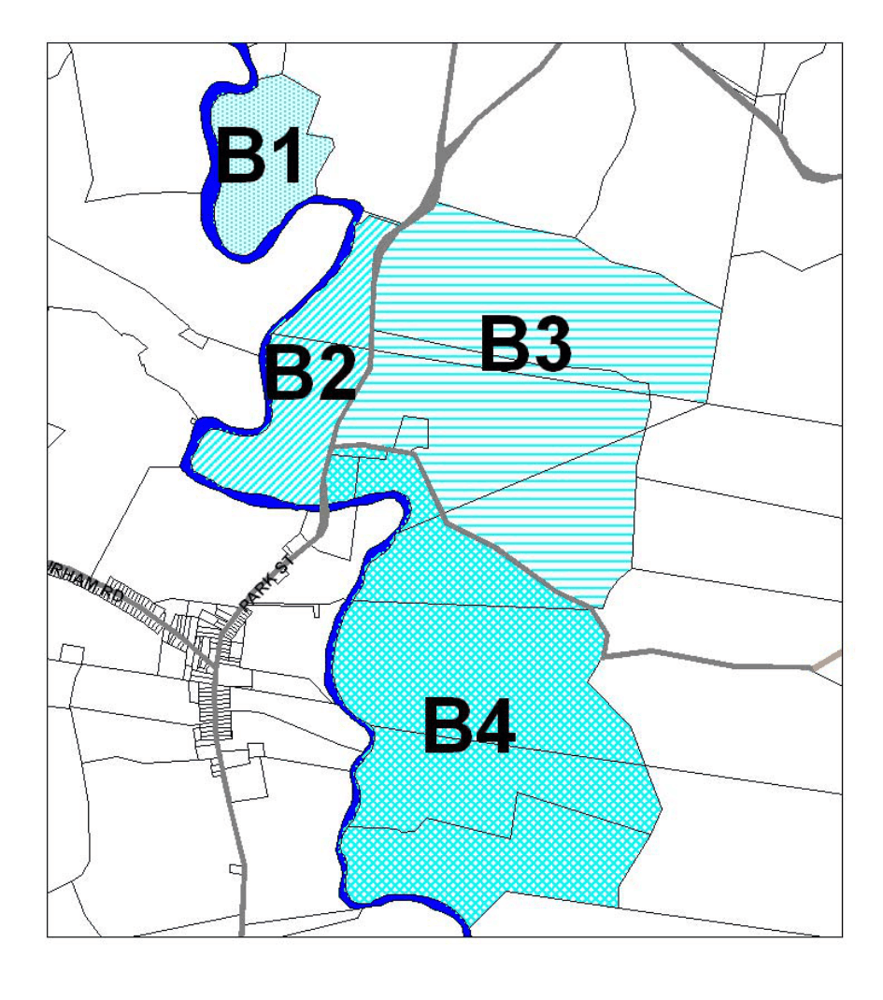

## 4. PRECINCT B - ALLYNBROO/K ROAD - LEWINSBROOK

### ROAD

Precinct B lies to the north and east of East Gresford and incorporates the area within the Investigation Zone that lies to the east of the Allyn River.

The western part of Precinct B, lying between Allyn River Road and the Allyn River is flat to undulating, with part of the area appearing to be flood prone.  As there are no flood levels for this section of the river, a flood assessment study will need to be undertaken as part of any rezoning application.

The eastern part of Precinct B, lying to the east of Allyn River Road, is undulating to hilly with areas of steep slopes in excess of 18 degrees. The slopes rise up to a ridge that forms the eastern boundary of the Investigation Area.   The hill crests along the ridge range in height from 165m to 220m asl.  The ridge and hills are visible from the village and from Durham, Allynbrook and Gresford Roads which are important tourist routes. The hills are a significant element in the landscape and identity of Gresford.

There are two access roads within the area, Allyn River Road and Lewinsbrook Road.  Allyn River Road is a main road which provides access to Dungog (via Bingleburra Road) and to the popular Allyn and Williams River areas on the southern side of the Barrington ranges. Allyn River Road is a collector road and as such direct driveway access will not be permitted. Lewinsbrook Road is a very narrow local road that is steep in places and has limited sight-lines.  While Lewinsbrook Road is not classified as a collector road, direct driveway access may not be permitted for safety reasons.

Precinct B is divided into four planning areas.

### PLANNING PRECINCT B

> [Picture on page 41: a picture, saved as a picture (images/part-d6-gresford-local-area-plan-page-41-2.gif, 150 dpi).]
