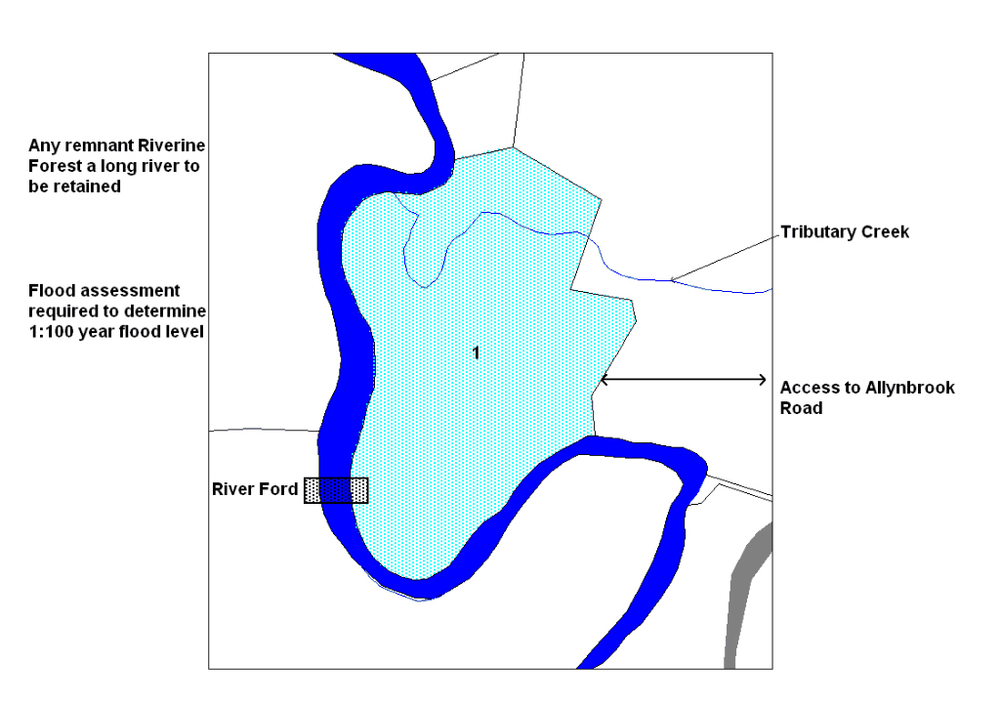

### 4.1 PLANNING AREA B1

#### The Area

Planning Area B1 is a single parcel of land, Lot 1 DP742879 which is located within a bend of the Allyn River.

#### Development Potential

The development potential of Area B1 appears limited, with a small area on the eastern edge of the Lot, possibly being suitable for development.

Area B1 is land-locked with no frontage to Allyn River Road.   The Lot lies about 0.5km west of Allyn River Road, with entry via a dirt track through an adjoining property to the east.  This access track is located along the spur and appears to be flood-free. The land between Area

B1 and Allyn River Road falls outside of the Investigation Area and is zoned Rural.  On the western boundary of the Lot there is a ford across the Allyn River, with a 4WD track connecting back through to Area A1.

Most of the northern, western and southern areas of Area B1 are low lying and appear to be flood affected.   There is a small spur on the eastern edge of the Lot that appears to lie above the flood level and could be suitable for development.  Further investigation is required to determine the 1:100 year flood level and to identify areas suitable for development.

Potential is also limited by the watercourses that traverse the Area.  There is a perennial stream, with a relatively large catchment area flowing across the northern part of the site into the Allyn River.  The area adjacent to this creek is likely to be flood affected.  The southern section of Area B1 is drained by two small, intermittent watercourses that flow into the Allyn River.

### PLANNING PRECINCT B1

> [Picture on page 42: a picture, saved as a picture (images/part-d6-gresford-local-area-plan-page-42-20.gif, 150 dpi).]

#### Masterplan

Not required.  Land capability assessment is required to assess the development potential of this area.
