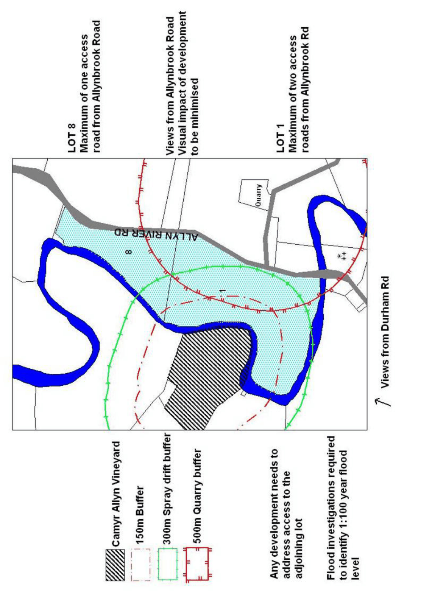

### 4.2 PLANNING AREA B2

#### The Area

Planning Area B2 is bounded by the Allyn River to the west and south and Allyn River Road to the east.  It incorporates two lots:

Lot 8 DP 654338 Lot 1 DP 120658

#### Development Potential

Area B2 has frontage to the Allyn River, with part of the Area B2 being river flats that probably lie below the 1:100 years flood level. The eastern sections for Area B2 along the Allyn River Road frontage are undulating and appear suitable for development.  At the northern end of Lot 8 there is a narrow section of land between the river and the road which has a localised section of steep slopes.  This narrow section is not suitable for development.

The development potential of all of Lot 1 and the southern corners of Lot 8 are significantly constrained by buffer zone requirements to protect existing intensive agricultural and extractive activities that are located in close proximity to the area.

Most of Lot 1 and the south western corner of Lot 8 lie within the 300m buffer zone surrounding the Camyr Allyn vineyard.   The eastern half of Lot 1 and the south eastern corner of Lot 8 lie within the 500m buffer zone surrounding the Camyr Allyn Quarry (located off Lewinsbrook Road).  The south eastern corner of Lot 1 is also within the 150m buffer zone surrounding the commercial nursery.

Development is not permitted in these buffer zones .  Should one or more of these activities cease operations, then the development potential of the affected area can be reassessed.

Other issues that impact on the development potential of Area B2 are:

Visual impact - parts of this land have been identified by the Gresford community as visually significant.  The area is part of a very scenically attractive view north from Durham Road and it is also visible from the Allyn River Road which is an important tourist route within the Shire.

Allyn River Road is a collector road and no direct driveway access will be permitted.

Allyn River Road is an entry gateway to Gresford and an important tourism drive.  The visual impact of any development along the road frontage needs to be minimised.

### PLANNING PRECINCT B2

> [Picture on page 44: a picture, saved as a picture (images/part-d6-gresford-local-area-plan-page-44-2.gif, 150 dpi).]

#### Masterplan

At this stage development will only be considered in suitable areas of Lot 8 which are located outside of the buffer zones.   A land capability assessment for all of Lot 8 is to be undertaken to identify land suitable for development.  A Masterplan is not required for the developable areas in Lot 8 provided that the subdivision plan provides for future vehicle and pedestrian access into the areas of Lot 8 and Lot 1 that are impacted on by the buffer zones.

Should the buffer zones be removed on Lot 1, Council may require the preparation of a Masterplan as this area has been identified as having high visual significance.

#### Issues & Performance Criteria

In addition to the planning controls setout in the LEP, DCP and Rural Strategy, the planning and assessment process for Area B2 must address.

| Issue | Planning Considerations / Performance Criteria |
|---|---|
| Buffer Zones | Area B2 is impacted on by 3 buffer zones. No development is permissible within the buffer zone areas. |
| Flooding | Part of Area B2 appears to be flood affected and investigations are required to determine the 1:100 year flood level. No development of land below the 1:100 year flood level is permitted. |
| Access to Collector Roads - Allyn River Road | Access from Allyn River Road is to be via properly formed and sited local roads. The siting of the access road intersections are to be determined in conjunction with Council and the RTA. No additional private driveway access or right- of-ways to Allyn River Road can be created. One access road from Allyn River Road is permitted into Lot 8. Should the buffer zones be removed, a maximum of two access roads to Lot 1 from Allyn River Road will be permitted. |
| Internal access - pedestrian, bicycle and vehicle. | If, following removal of the buffer zone requirements, land suitable for development is identified on both allotments, and this land is adjoining, then road, cycle and pedestrian links between the two lots are to be provided. |

| Lots created | Any lots created must have a minimum width to depth ratio of 1:3. Creation of long narrow lots extending from Allyn River Road to the Allyn River is not permissible. No further riverfront lots or riparian rights are to be created. |
|---|---|
| Visual impact | A Visual Assessment is required as part of the planning for rezoning and development of Area B2. The visual impact of any development along Allyn River Road needs to be minimised. No back yards to have frontage to Allyn River Road. |
| Arrival corridors / village gateways | Landscape buffer / corridor tree planting along the Allyn River Road frontage to create a village entry statement in accordance with the Landscape Policy for Gresford - East Gresford. |
| Allyn River | No further riverfront lots or riparian rights are to be created. Riparian vegetation to be protected. |
