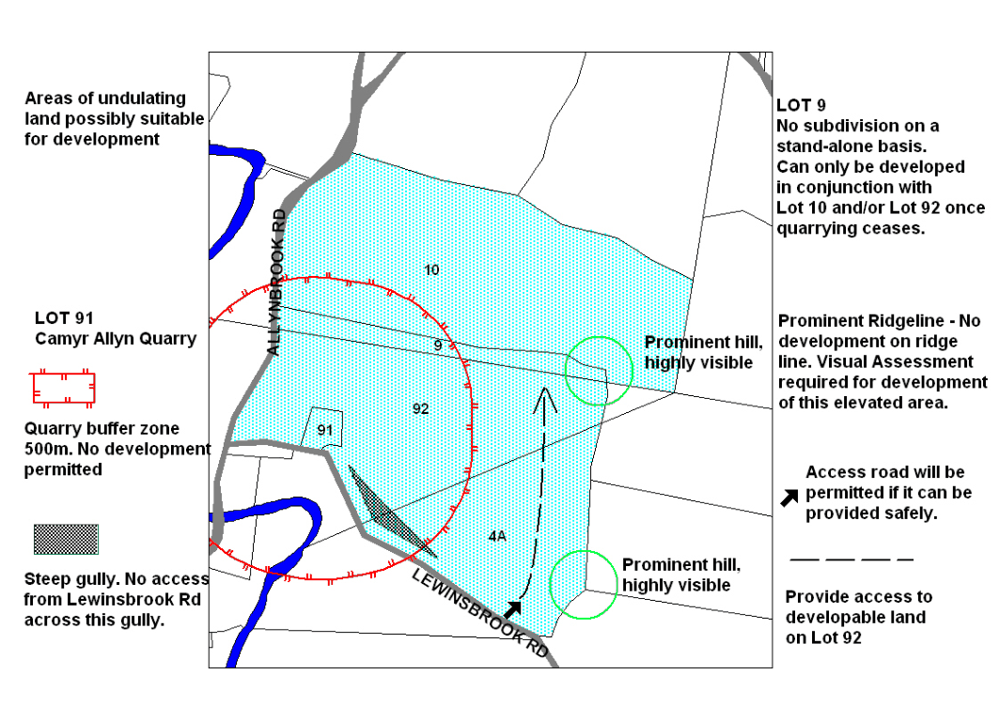

### 4.3 PLANNING AREA B3

#### The Area

Planning Area B3 forms the north-east corner of the Investigation Zone. It is bounded by Allyn River Road to the west and Lewinsbrook Road to the south.  Area B3 incorporates five lots:

Lots 9 & 10 DP 654341 Lots 91 & 92 DP 52113 Lot 4A DP 6887

Lot 91 DP 52113 is a Quarry and is zoned Special Uses 5(a).  A minimum 500 m buffer is required around the Quarry.

#### Development Potential

Area B3 forms part of a ridge system that extends north-south along the eastern boundary of the Gresford Investigation Area.  The topography of the area varies from flat to undulating in

the north west corner of Lot 10 and along the Allyn River Road frontage, to hilly and steep on the sideslopes which occupy the central and eastern parts of Area B3, to localised areas of undulating land along the ridge line.  Area B3 is dissected by a number of small creek systems, with some very steep slopes and gullies along the creek lines.  Some of the steeper areas are shown on the Dungog Shire Bushfire Map to have a high fire risk.

Lot 10 DP654341 - The western half of Lot 10 appears suitable for development, with the topography being flat to undulating.  The eastern half of the site is steeper and not considered suitable for development.  The south western corner of Lot 10 is affected by the quarry buffer zone and no development will be permitted within the buffer zone area.  Should the quarry cease operations, the impacted area may be reassessed.

Lot 9 DP654341 - This is a very long, narrow lot with a width to depth ratio of less than 1: 3. The topography is similar to Lot 10, with the western half being undulating and the eastern half comprising steep slopes.  The eastern half of the Lot is classified as bushfire prone.  The western half of the lot lies within the Quarry buffer zone area.  While the quarry remains operations, no development is permissible on Lot 9.  Should the quarry cease operations, Lot 9, due to its narrow width the depth ratio, cannot be subdivided on a stand-alone basis. Any development must be undertaken in conjunction with the development of Lot 10 and/or Lot 92.

Lot 92 DP 521113 - This is a large parcel of land with similar topography to Lots 9 and 10 to the north.  The undulating topography of western third of the Lot appears suitable for development in the future.  This area however surrounds the quarry and lies wholly within the Quarry buffer zone.  While the quarry remains operation no development will be permitted.

The central and eastern parts of Lot 9 are very steep and not suitable for development. There is a relatively localised area of undulating land on a ridge spur close to the southern boundary of Lot 92.  This area may be suitable for development if undertaken in conjunction with development of Lot 4A.  Access must be via Lot 4A.

Lot 92 has frontage to both Allynbrook and Lewinsbrook Roads. There is a very steep gully running parallel to Lewinsbrook Road in the section south east of the quarry.  Road access into Lot 92 from this section of Lewinsbrook Road will not be permitted.

Lot 4A DP6887 – Lot 4 A is an elevated parcel with some areas of flat to undulating land along the upper-slopes and ridge line.  Sections of the ridge line are visible from East Gresford and from the Allyn River Road.  Development may be possible within this area, provided that dwellings are sited below the ridgeline and are not visible from the village or Allyn River Road. A visual assessment will be required.  Any development of this part of Lot 4A will need to provide access to developable land identified on the eastern part of Lot 92.

The south western corner of this Lot lies with the Quarry buffer zone and no development will be permitted in this area while the quarry remains operational.  Parts of this corner are also bushfire prone.

> [Picture on page 48: a picture, saved as a picture (images/part-d6-gresford-local-area-plan-page-48-1.gif, 150 dpi).]

#### Masterplan

Two masterplans are required.

These Plans are to be prepared for the eastern and western parts of Area B3.  The lots that must to be planned jointly are:

The undulating western areas of Lots 9 and 10 DP 654341 and Lot 92 DP 521113 must be jointly planned.  Development of land in Lot 10 outside the buffer zone, can proceed independently of the buffer zone affected land, provided that provision is made for future vehicle and pedestrian/cycle access to the buffer zone affected area to the south.

The elevated areas of Lot 92 DP 521113 and Lot 4A DP6887 in the south east corner of Area B3.  The masterplan for this area must include a Visual Assessment and Bushfire Risk Assessment.

#### Issues & Performance Criteria

In addition to the planning controls setout in the LEP, DCP and Rural Strategy, the planning and assessment process for Area B3 must address.

| Issue | Planning Considerations / Performance Criteria |
|---|---|
| Quarry | Council to determine whether the 500m buffer zone is adequate or needs to be extended. No development permitted within the buffer zone surrounding the quarry. |
| Suitability of the north western part of Lot 10 and the elevated south-east corner of Area B3 (Lot 4a and Lot 92) for development | Land capability assessments to be undertaken to identify land outside the buffer zone area that is potentially suitable for development. |
| Lot 9 DP 654341 | Subdivision not permitted on a stand-alone basis. Any development must be undertaken in conjunction with Lot 10 and/or Lot 92. |
| Access to Collector Roads - Allyn River Road | No additional private driveway access or right- of-ways to Allyn River Road can be created. |
| Access to Lewinsbrook Road | For Lot 92, there will be no access from Lewinsbrook Road in the section between the quarry and the property boundary with Lot 4A. Any proposal to subdivided the elevated area of Lot 4A must make provision for access to the adjoining elevated area of Lot 92 if the land capability assessment has identified land within Lot 92 as suitable for development. No additional private driveway or right-of-way to Lewinsbrook Road is permitted. |
| Pedestrian and cycle access | Masterplan for the western part of Area B3 is to make provision for pedestrian and cycle access through the lots, not along the Allyn River Road corridor. |
| Visual Impact | Minimise the visual impact of any development along Allyn River Road. No back yards to have frontage to Allyn River Road. No development along the ridge and hill crests along the eastern boundary of Area B3. Development is to be located below the ridgeline in areas that are not visible from the village or Allyn River Road. A visual assessment is to be undertaken as part of the planning and assessment process. |

| Arrival corridors / village gateways | Landscape buffer / corridor tree planting along the Allyn River Road frontage to create a village entry statement in accordance with the Landscape Policy for Gresford - East Gresford. |
|---|---|
| Areas subject to bushfire risk | Bushfire risk to be assessed and addressed as part of any subdivision design. |
| Reafforestation | Areas to be re-vegetated to be identified in the Masterplan and included in subsequent development plans. |
