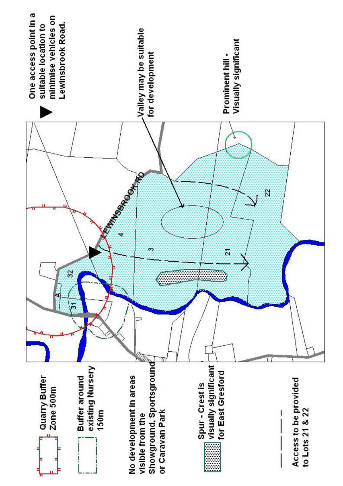

### 4.4 PLANNING AREA B4

#### The Area

Planning Area B4 lies to the east of the Allyn River and to the south of Lewinsbrook Road. Access to this area is via Lewinsbrook Road.  The area is separated from East Gresford by the Allyn River.

Area B4 incorporates seven (7) lots.

Lot A DP 418221 Lots 31 & 32 DP 804176 Lots 3 & 4 DP 6887 Lots 21 & 22 DP 615903

Lot A is a small lot that has already been zoned Rural Lifestyle.  Lot 31 has frontage to Allyn River Road, while Lots 3, 4 and 32 have frontage to Lewinsbrook Road.  Lots 21 and 22 have no road frontage.

#### Development Potential

Area B4 is a hilly, dissected area with a narrow flood plain along the Allyn River.  To the east of the flood plain is a series of hilly spurs rising to a prominent ridge line along the eastern boundary of the Investigation Area.  There is a low spur of land behind the flood plain that runs parallel to the Allyn River.  A valley separates this spur from the main ridge line.  The spur is a dominant element in the 'close-up' views from East Gresford, particularly from public areas along the River, such as the showground, caravan park, and sporting fields. The upper side slopes, hill crests and ridge line further east are visible from East Gresford and from the Gresford and Allyn River Roads and forms part of the Gresford 'setting'.   The intervening valley is not visible.

The northern part of Area B4 (Lots A, 31,32 and part of Lot 4) lies within the 500m Quarry buffer zone.  Lots A, 31 and 32, and parts of Lots 3 and 4 are also impacted on by the 150m buffer zone surrounding the commercial nursery.

Lot A DP 418221 - this Lot is zone Rural Lifestyle and no further subdivision is permissible.

Lots 31 & 32 DP 804176 - these lots lie within the Quarry and Nursery buffer zones and no development is permitted.

Lots 3 & 4 DP 6887, Lots 21 & 22 DP 615903.  These lots are large parcels of land that each contain areas of land that is suitable for development. This area is scenically significant for East Gresford and as such it is important that the visual impacts of development are minimised.

As the first step in the planning process a visual assessment and view-shed analysis is to  be undertaken to identify areas of high visibility when viewed from East Gresford, the Showground and Sportsground and Gresford Road, Park St and Allyn River Road. These areas are likely to include the eastern ridge line and upper slopes, the spur crest running parallel to the River, the western slopes of this spur and along the River.  No buildings will permissible in these areas.  Roads may be permissible if there is minimal visual impact.

Other potential constraints that will impact on the development within this area include:

Road Access - Lewinsbrook Road will need to be widened to cater for additional traffic generated by development in Area B4.  The cost of the road works is to be met by the developer.  To minimise the road works needed, consideration should be given to providing access to Area B4 via a road in from near the northern boundary of Lot 4.

Lots 21 and 22 are 'landlocked' and as such any development of Lot 3 and possibly Lot 4 must make provision for access to Lots 21 and 22.

Flooding along the Allyn River - the 1:100 year flood levels will need to be determined. No development will be permissible below the 1:100 year levels.

Quarry and nursery buffer zones – this will limit development along the western boundary of Lot 3 and the northern and western boundary of Lot 4.

Watercourses - buffer zones are required along the water courses as per Dungog Shire DCP 1.

Bushfire risk - the south eastern corner of Lot 22 is designated as bushfire prone.

> [Picture on page 52: a picture, saved as a picture (images/part-d6-gresford-local-area-plan-page-52-1.gif, 150 dpi).]

#### Masterplan

A Visual Assessment - Viewshed Analysis needs to be undertaken for Area B4 as the first step in the planning and assessment process for a rezoning application.  This assessment will identify land that is not visually significant and as such, may be suitable for development. A land capability assessment then needs to be undertaken to identify developable land.

A Masterplan is required, however if the areas of developable land area are dispersed, Council may request the preparation of separate Masterplans for each area.  The Masterplan/s must address road access for the areas to be developed.

#### Issues & Performance Criteria

In addition to the planning controls setout in the LEP, DCP and Rural Strategy, the planning and assessment process for Area B4 must address.

| Issue | Planning Considerations / Performance Criteria |
|---|---|
| Lot A DP418221 | No further subdivision permitted |
| Lots 31 & 32 DP 804176 | Lie within the Quarry and Nursery buffer zones - no development permitted. |
| Coordinated development | Lots 3, 4, 21 and 22 need to be jointly assessed and planned. The lots may be developed individually in accordance with a Masterplan/s for the total area. |
| Pattern of development | Strip development along Lewinsbrook Road is not permissible. No development in visually prominent areas. |
| Visual Impact - parts of Area B4 have high visual / scenic value. | Visual assessment required as part of the planning and assessment for Lots 3, 4, 21 and 22. No development will be permitted in areas which are highly visible. No development is to occur on ridge lines or upper slopes that are visible from East Gresford village or Gresford Road - Park St - Allyn River Road. No development on the areas of land within Lots 3 and 21 that are visible from the Showground, Sports Ground and Caravan Park. |
| Flood prone land | Flood assessment to be undertaken to determine the 1:100 year flood level. Rural Lifestyle / Enterprise development is not |

|  | permissible on land below the 1:100 year flood. |
|---|---|
| Access | Access to Area B4 will be via properly formed local roads from Lewinsbrook Road. For safety reasons, there will be no direct driveway access to Lewinsbrook Road. Any development in Area B4 will need to contribute to the cost of widening and improving Lewinsbrook Rd. Development of Lots 3 and 4 must make provision for access to lots 21 and 22. |
| Pedestrian and cycle access | Pedestrian and cycle access - the feasibility of establishing a pedestrian-cycle bridge across the Allyn River to link this area with East Gresford, via the Showground, needs to considered as part of any development proposal for Area B4. |
| Allyn River and other watercourses. | No further riverfront lots or riparian rights to be created. Riparian vegetation to be protected and the riverbank and watercourses rehabilitated. |
| Areas subject to bushfire risk | Bushfire risk to be assessed and addressed as part of any subdivision design. |
| Reafforestation | Areas to be re-vegetated to be identified in the Masterplan and included in subsequent development plans. |
