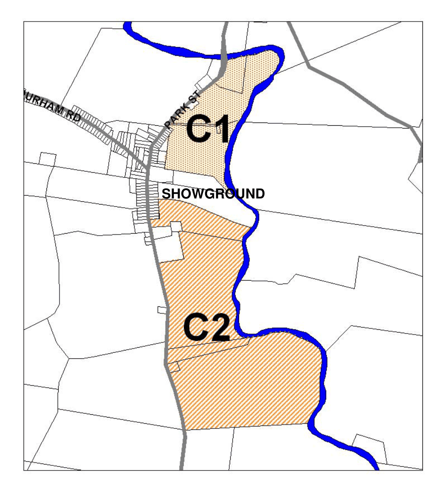

## 5. PRECINCT C - GRESFORD EAST

Precinct C abuts East Gresford, and incorporates the area between Gresford Road - Park Street and the Allyn River, extending north to Camyr Allyn Bridge.  Precinct C is divided into two planning areas, Area C1 to the north of the Showground and Area C2 to the south of the Showground.

> [Picture on page 55: a picture, saved as a picture (images/part-d6-gresford-local-area-plan-page-55-6.gif, 150 dpi).]

#### SHOWGROUND
