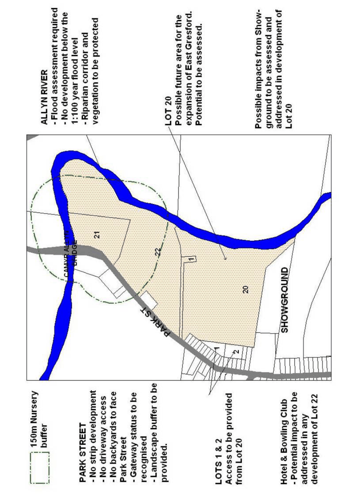

### 5.1 PLANNING AREA C1

Area C1 abuts the north eastern corner of East Gresford Village.  Area CI is bounded by the Allyn River to the north and east, Park Street to the west and Gresford Showground to the south.  The Area incorporates four (4) Lots:

Lots 21 & 22 DP 615079 Lot 1 DP 158386 Lot 20 DP 608401

All lots within Area C1 have access from Park Street.

#### Development Potential

Area CI is flat to undulating with small areas of river flats along the Allyn River.  The eastern part of Area C1 may be flood liable and a flood assessment will be required as part of the planning and assessment process.

Park Street is the northern gateway to East Gresford.  Any development within Area C1 will need to minimise the visual impact of development along Park Street and provide a landscaped buffer along the road frontage.  Strip style development along Park Street is not be permitted and no dwelling lots created can have direct driveway access from Park Street.

The Lot 20 has been identified as possibly suitable for the future expansion of East Gresford. Further investigation is required to determine whether this lot is suitable for future village uses and/or for smaller lot sizes (eg 2000 sqm) than permissible in the Rural Lifestyle zone. In particular, it needs to be determined whether this lots is free of physical and environmental constraints and can be connected to the town water supply and sewered via an on-site package treatment plant (or other system).

Lot 21 DP 615079 - A commercial nursery operates from Lot 21.  A nursery is classified as Intensive Agriculture and a buffer zone of 150m is to be provided around the property.  The buffer zone will impact on Lot 22.  The northern part of Lot 21 may be flood liable.

Lot 22 DP 615079 - the northern part of Lot 22 is impacted on by the buffer zone around the adjoining nursery, with development not permissible within this Zone.

Lot 1 DP 158386 is a battle axe allotment with a narrow access handle leading to a residential size allotment.   This lot is too small for further subdivision

Lot 20 DP 608401 abuts the existing village boundary and the Showground.  Lot 20 has been identified as a possible area for the future expansion of East Gresford, and the area needs to be investigated to determine if it can be sewered and is free from physical and environmental constraints.  A flood assessment will be required.

The southern boundary Lot 20 adjoins the Showground and any development of this lot needs to recognise that the Showground is used for a variety of day and evening activities that generate noise, dust and odours.   Likewise the adjoining Hotel Beatty and Bowling Club are existing venues that may, on occasion, provide entertainment which is also noise generating.

There are two ‘land-locked’ lots that abut the western boundary of Lot 20 that are zoned for village use (Lot 1 DP 158385 and Lot 2 DP 158385).  Access to these lots and subdivisions patterns need to be addressed in conjunction with the development of Lot 20.

### PLANNING AREA C1

> [Picture on page 57: a picture, saved as a picture (images/part-d6-gresford-local-area-plan-page-57-2.gif, 150 dpi).]

#### Masterplan

A masterplan is required to assess land capability and determine the most appropriate pattern of subdivision for Area C1.   As part of the Masterplanning process, the following issues are to be addressed and resolved:

The need for buffer zones around the commercial nursery, cemetery and possibly the Showground, and the location and width of these zones. Future village needs. Provision of sewer and water. Access to / from Park Street. Landscape treatment of the Park Street frontage. Flooding - parts of the area may be flood liable.   Areas below the 1:100 year flood level cannot be developed for Rural Lifestyle or Rural Enterprise uses.  A flood assessment is required. In addition development of the area cannot result in increased runoff or flooding in adjoining properties or downstream.

The masterplan is to show the subdivision layout, road network, pedestrian and cycle access routes, open space and interface with the Allyn River.  The Masterplan should demonstrate how development of the area can be staged.   It is likely that only part of the area may be needed for residential development in the short to medium term, with the remainder of the area developed as Rural Lifestyle and/or Rural Enterprise.  In designing the Rural Lifestyle / Rural Enterprise areas, consideration should be given to road and lot layouts that will enable subdivision for residential in the future.

#### Issues & Performance Criteria

In addition to the planning controls setout in the LEP, DCP and Rural Strategy, the planning and assessment process for Area C1 must address:

| Issue | Planning Considerations / Performance Criteria |
|---|---|
| Buffer Zones to protect existing landuses | No development within the 150m nursery buffer zone. The need for a buffer zones around the Showground need to be assessed and the width of the buffer zone defined. |
| Need for coordinated development | Land capability assessment to be undertaken for Area C1 to determine suitability for development. If suitable for development, a Masterplan to be prepared for Area C1. The Masterplan must demonstrate how developable land lying within buffer zones can be included if the need for a buffer zone ceases to exist. Subdivision to occur in accordance with the Masterplan. |
| Future expansion of East Gresford. | As part of the Masterplanning process - |

|  | identification of future needs of the village and allocation of land to meet these needs. |
|---|---|
| Flooding | Flood Assessment to be undertaken for the Allyn River Corridor to identify the 1:100 year flood level. Residential, Rural Lifestyle and Rural Enterprise development is not permitted on land located below the 1:100 year flood level. |
| Access to Park Street | Need for an appropriately designed and sited access road/s to service Area C1. The location and design are to be determined in conjunction with the RTA and Council. No lots created by subdivision are permitted to have private driveway or right-of-way access from Park Street. |
| Internal access roads | Must provide access to Lots 1 & 2 DP 158385 |
| Park Street is an entry point to East Gresford. The visual Impact of development along Park Street needs to be minimised. | Landscape buffer / corridor tree planting along the Park Street frontage to create a village entry statement in accordance with the Landscape Policy for Gresford - East Gresford. Strip development along Park Street is not permissible. No backyards to have direct frontage to Park Street. |
| Shared access ways - pedestrian and cycle ways. | To link into the village shops. Address the feasibility of providing a link through the Showground to Orana Park and the sportsground. |
| Allyn River foreshore | Riparian vegetation corridor to be defined and protected. No additional riverfront lots or riparian rights to be created, other than for recreation - open space uses. |
