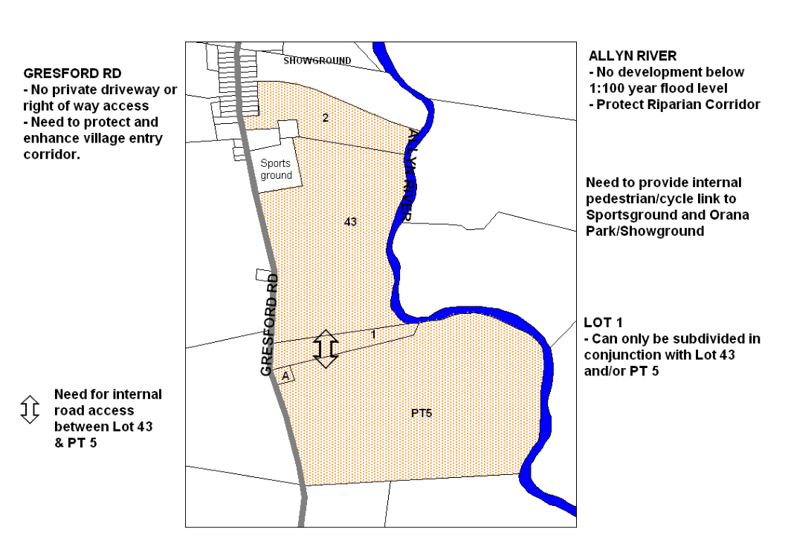

### 5.2 PLANNING AREA C2

#### The Area

Planning Area C2 extends from the Showground south to the southern limit of the Investigation Zone.  The area is bounded by the Showground to the north, Allyn River to the east and Gresford Road - Park Street to the west.   Area C2 incorporates 5 lots:

Lot 2 DP 664250 Lot 43 DP 706473 Lot 1 DP 338704 Lot A DP 354990 PT 5 DP 11562

Each of these lots has road access to Gresford Road - Park Street.  Lot A is a small lot that is already zoned Rural Lifestyle.  Clevedon Historic House is located on Lot 43.

#### Development Potential

Area C2 is flat to undulating land that has been cleared and, topographically appears suitable for development.  The eastern parts of Lot 2, 43, 1 and PT 5 along the Allyn River may be subject to flooding and a flood assessment will be required as part of the planning and assessment process.

All Lots within Area C2 have frontage to Gresford Road - Park Street.  Gresford Road is the southern gateway to East Gresford and is the primary gateway for Gresford-East Gresford. Any development within Area C2 will need to minimise the visual impact of development along Gresford Road and provide a landscaped buffer along the road frontage.

Lot A DP 354990  This lot is already zoned Rural Lifestyle.  Due to its small size, no further subdivision in permitted.

Lot 2 DP 664250 adjoins the existing village area, with the access handle to Lot 2 already zoned 2(v) Village.  The northern boundary of Lot 2 abuts the Showground and Orana Park while the south west corner of the site abuts St Helen Cemetery.

Lot 2 has been identified as possibly suitable for the future expansion of East Gresford. Further investigation is required to determine whether this lot is suitable for future village uses and/or for smaller lot sizes (eg 2000 sqm) than permissible in the Rural Lifestyle zone. In particular, it needs to be determined whether Lot 2 is free of physical and environmental constraints and can be connected to the town water supply and sewered via an on-site package treatment plant (or other system).

Any development of Lot 2 must include provisions for a pedestrian and cycle link from Lot 43 through to the Orana Park - Showground area.

Lot 43 DP 706473 is a very large parcel of land located on the southern edge of East Gresford.  The north-west corner of this Lot abuts the Sportsground and St Helens Cemetery.  Clevedon Historic House is centrally located within the Lot.  This former hospital is of heritage significance and a heritage assessment is to be undertaken as part of any land capability assessment / rezoning application.  As part of heritage assessment the curtilage around the building needs to be defined.  If Lot 43 is free from physical and environmental constraints and can be sewered via an on-site package treatment plant (or other system) this area may be suitable for smaller lot sizes than permissible under a Rural Lifestyle or Rural

Enterprise zoning.  The northern part of the Lot, adjacent to the Sportsground may also be suitable for future village uses.  Any development of Lot 43 must make provision for vehicle, pedestrian and cycle links with PT 5.

Lot 1 DP 338704 - Lot 1 is a long narrow lot, with a width to depth ratio of less than 1:3. Due to its shape, this lot must be developed in conjunction with the adjoining Lot 43 and/or PT 5. It cannot be planned and subdivided on a stand-alone basis.

PT 5 DP 11562 - PT 5 is a large parcel of land that, subject to flood assessment, appears suitable for Rural Lifestyle or Rural Enterprise development.

### PLANNING AREA C2

> [Picture on page 61: a picture, saved as a picture (images/part-d6-gresford-local-area-plan-page-61-10.gif, 150 dpi).]

#### Masterplan

Given the size of the area involved, it is likely that development will be staged, possibly over an extended time period.  A Masterplan is required to ensure a coordinated approach to development that will facilitate future growth of the East Gresford, protect Clevedon House and curtilage, produce a range of lot sizes and provide an internal access network throughout the area.

The Masterplan is to include a land capability assessment and determine the most appropriate type and pattern of subdivision for Area C2.   As part of the Masterplanning process, the following issues are to be addressed and resolved:

Future village needs - for village uses and for the expansion of sporting facilities.

Possible buffer zone around the Showground. Provision to protect Clevedon House and its curtilage. Provision of sewer and water. Access to / from Gresford Road. Internal access - local road links between Lots 43, 1 and PT 5 and pedestrian and cycle links between these lots and through Lot 2 to Orana Park / Showground.  The objective is to provide internal links to the village centre so that pedestrians and cyclists do not have to use the Gresford Road corridor. Minimising the visual impact from Gresford Road. Flooding - parts of the area may be flood liable.  Areas below the 1:100 year flood level cannot be developed for Rural Lifestyle or Rural Enterprise uses.  A flood assessment is required. In addition development of this area cannot result in increased runoff and flooding in adjoining properties or downstream.

The masterplan is to show the subdivision layout, road network, pedestrian and cycle access routes, open space and interface with the Allyn River.  The Masterplan should demonstrate how development of the area can be staged.   It is likely that only part of the area may be needed for village uses in the near future, with the remainder of the area developed as Rural Lifestyle and/or Rural Enterprise.  In designing the Rural Lifestyle / Rural Enterprise areas, consideration should be given to road and lot layouts that will enable subdivision for residential in the future.

#### Issues & Performance Criteria

In addition to the planning controls setout in the LEP, DCP and Rural Strategy, the planning and assessment process for Area C2 must address:

| Issue | Planning Considerations / Performance Criteria |
|---|---|
| Lot A 354990 | No further subdivision permitted |
| Lot 1 DP338704 | Can only be developed if undertaken in conjunction with Lot 43 and/or PT 5. |
| Buffer Zones to protect existing landuses | The need for a buffer zone around the Showground needs to be assessed and the width of the buffer zone defined. |
| Protection of Clevedon House & Curtilage | Heritage assessment to be undertaken |
| Need for co-ordinated development | Land capability assessment to be undertaken for Area C2 to determine suitability for development. If suitable for development, a Masterplan is to be prepared for Area C2. The Masterplan must show how development can be staged. Subdivision to occur in accordance with the Masterplan. |

| Future expansion of East Gresford. | The Masterplanning process is to include identification of future needs of the village and allocation of land to meet these needs. |
|---|---|
| Flooding | Flood Assessment to be undertaken for the Allyn River Corridor to determine the 1:100 year flood level. Residential, Rural Lifestyle and Rural Enterprise development is not permissible on land located below the 1:100 year floodlevel. |
| Access to Collector Roads - Gresford Road | Need for an appropriately designed and sited access road/s to service Area C2. The location and design will need to be determined in conjunction with the RTA and Council. No lots created by subdivision are permitted to have private driveway or right-of-way access from Gresford Road. |
| Internal access roads | The subdivision plan for the area must include road links between Lot 43 and PT 5 through Lot 1. |
| Gresford Road is an entry point to East Gresford and is the main arrival gateway for the village. The visual impact of development along Gresford Road needs to be minimised. | Landscape buffer / corridor tree planting along the Gresford Road frontage to create a village entry statement in accordance with the Landscape Policy for Gresford - East Gresford. Strip development along Gresford Road is not permissible. No backyards to have direct frontage to Gresford Road. |
| Shared access ways - pedestrian and cycle ways. | A pedestrian-cycle link/s is to be provided to link adjoining lots and provide a link through to Orana Park / Showground area. This link must be provided internally, not along the Gresford Road corridor. |
| Allyn River foreshore | Riparian vegetation corridor to be defined and protected. No additional riverfront lots or riparian rights to be created, other than for recreation - open space uses. |
