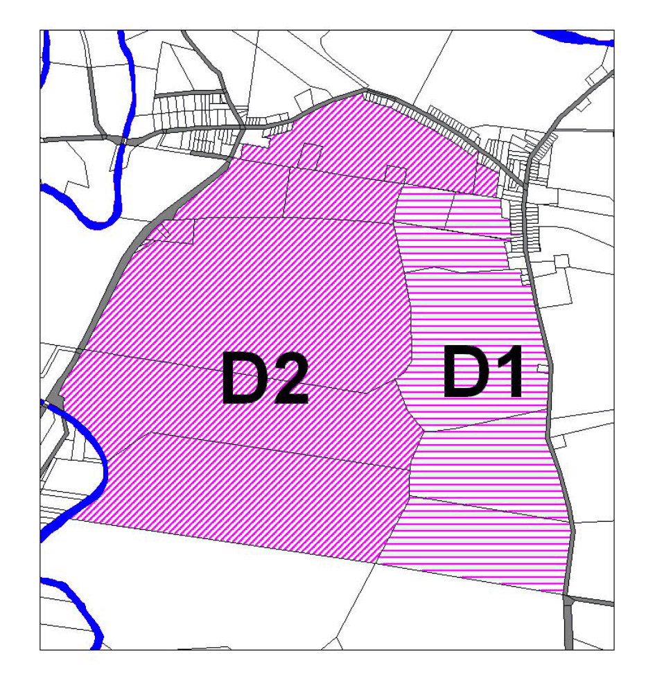

## 6. PRECINCT D - GRESFORD SOUTH

Precinct D incorporates the large hill just south of the village.  The Precinct abuts the southern edge of Gresford and East Gresford and is bounded by Durham Road to the north, Gresford Road and Park Street to the east and Glendonbrook Road to the west.  The hill, which rises to an elevation of 243 metres, is a very significant landmark and feature of the Gresford area.  The hill forms the drainage divide between the Allyn and Paterson Rivers.  It also separates the settlements of East Gresford and Gresford.   Precinct D is divided into two planning areas.

> [Picture on page 64: a picture, saved as a picture (images/part-d6-gresford-local-area-plan-page-64-9.gif, 150 dpi).]
