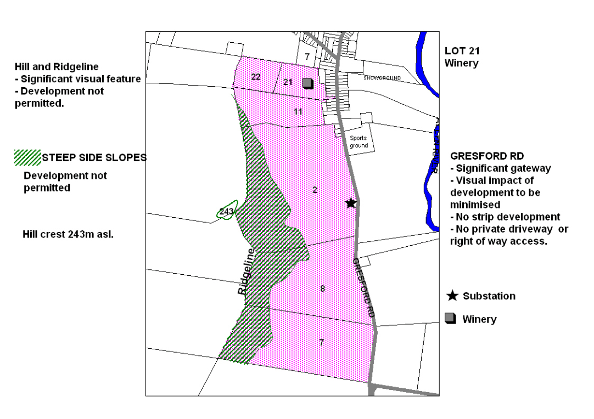

### 6.1 PLANNING AREA D1

#### The Area

Area D1 is located on the eastern side of the hill and extends from the ridge line east to Gresford Road - Park Street.  The Area D1 incorporates six (6) lots:

Lots 21 and 22 DP1086314 Lot 11 DP 662442 Lot 2 DP 519676 Lots 7 & 8 DP 11562

A winery has been established on Lot 21.  There is an electrical substation on Gresford Road adjacent to Lot 2 DP 519676.

#### Development Potential

The development potential of Area D1 is constrained by the topography and prominence of the area.  The western boundary of Area D1 runs along the ridge line.  The side slopes below the ridge are very steep and not suitable for development.  The foothills, along the Gresford Road frontage are undulating to hilly.  These lower slopes may be suitable for development if setback requirements from Gresford Road and from the numerous small creeks and watercourses rise on the hill and flow east to the Allyn River, can be met.

Area D1 is highly visible from the Gresford Road approach into East Gresford.  The hill, ridge line and upper slopes are highly visible from the village and from a number of vantage points on all access roads into Gresford - East Gresford.  The hill is an integral part of the Gresford landscape.

Lot 21 DP1086314 –  There is a winery operating on this lot.  Consideration is being given to developing the area between the winery and Gresford Road as a tourist attraction with the focus being a small lake with walking trail, bird viewing area and possibly a boutique eatery.

Lot 22 DP1086314 – Lot 22 has no road frontage and is accessed via a right-of-way from Lot

21\.  While the winery remains operational any development of Lot 22 will need to occur in conjunction with Lot 20 to the north and/or Lot 11 to the south.

Lot 11 DP 662442 – Most of the area of Lot 11 appears to be suitable for development.  Any development will need to be undertaken in conjunction with adjoining lots, with consideration given to providing access to Lot 22 if this Lot has land suitable for development.

Lot 2 DP 519676, Lots 7 & 8 DP 11562 - these lots are similar in their physical characteristics, being undulating to hilly along the Gresford Road frontage, rising steeply to the ridge line along their western boundary.  Only the undulating area of these lots is possibly suitable for development.   In addition to topography other constraints include:

Stability - the Hill has been cleared and there is minor evidence of instability on some of the steeper slopes.  A geotechnical assessment may be required as part of the land capability assessment.

Water courses - there are a number of small water courses that rise along the ridge and flow east to the Allyn River. DCP 1 requires development to be set-back from the water courses.

Area of high visual significance - this is the main gateway for Gresford - East Gresford and any development will need to be set back from the Gresford Road and have minimal visual impact.

Gresford Road is a collector road and no private driveway or right of way access to Gresford Road will be permitted.  All access is to be via properly sited and constructed local roads.

The lot yield from Area D1 is likely to be low given the terrain, visual impact considerations and the need to satisfy the setback requirements from main roads and watercourses.

### PLANNING AREA D1

> [Picture on page 66: a picture, saved as a picture (images/part-d6-gresford-local-area-plan-page-66-4.gif, 150 dpi).]

#### Masterplan

A land capability assessment is required to identify the areas suitable for development within Area D1.  The land capability assessment must include a visual assessment.  Dungog Shire Council may also require a geotechnical study.

Depending on the size and location of land identified in the land capability assessment as suitable for development, Council may require the preparation of a Masterplan for all or part of Area D1.

#### Issues & Performance Criteria

In addition to the planning controls setout in the LEP, DCP and Rural Strategy, the planning and assessment process for the developable land within Area D1 must address.

| Issue | Planning Considerations / Performance Criteria |
|---|---|
| Winery – Lot 21 | The winery is an existing, approved use and any development of adjoining land needs to recognise that during harvest the winery may operate 24 hours per day and that noise, odours and/or light may be emitted. |
| Electricity substation | Energy Authority to be consulted to determine setback and other requirements. |
| Need for co-ordinated development | Land capability assessment to be undertaken for Area D1 to determine suitability for development. If suitable for development, Council may require that a Masterplan to be prepared for all or parts of Area D1. The Masterplan must show how development can be staged. Subdivision to occur in accordance with the Masterplan. |
| Stability - need to assess the risk of slippage / landslide from the steeper upper slopes. | Council may require that a geotechnical assessment be undertaken as part of the land capability assessment |
| Access to Collector Roads - Gresford Road | Need for an appropriately designed and sited access road/s to service Area D1. The location and design will need to be determined in conjunction with the RTA and Council. No lots created by subdivision are permitted to have private driveway or right-of-way access from Gresford Road. |
| Gresford Road is an entry point to East Gresford and is the main arrival gateway for the village. The visual Impact of development along Gresford Road needs to be minimised. | Landscape buffer / corridor tree planting along the Gresford Road frontage to create a village entry statement in accordance with the Landscape Policy for Gresford - East Gresford. Strip development along Gresford Road is not permissible. No backyards to have direct frontage to Gresford Road. |
| Shared access ways - pedestrian and cycle ways. | Depending on the pattern of development, a pedestrian-cycle link may be required by Council. This link should be provided internally, not along the Gresford Road corridor and link through to East Gresford and to Durham Road to link with the footpath - cycle way between Gresford and East |

|  | Gresford. |
|---|---|
| Watercourses | Development is to be setback from watercourses as required in DCP 1. No additional riparian rights can be created. |
| Reafforestation to improve stability | Areas to be re-vegetated are to be identified in the Masterplan and included in subsequent development plans. |
