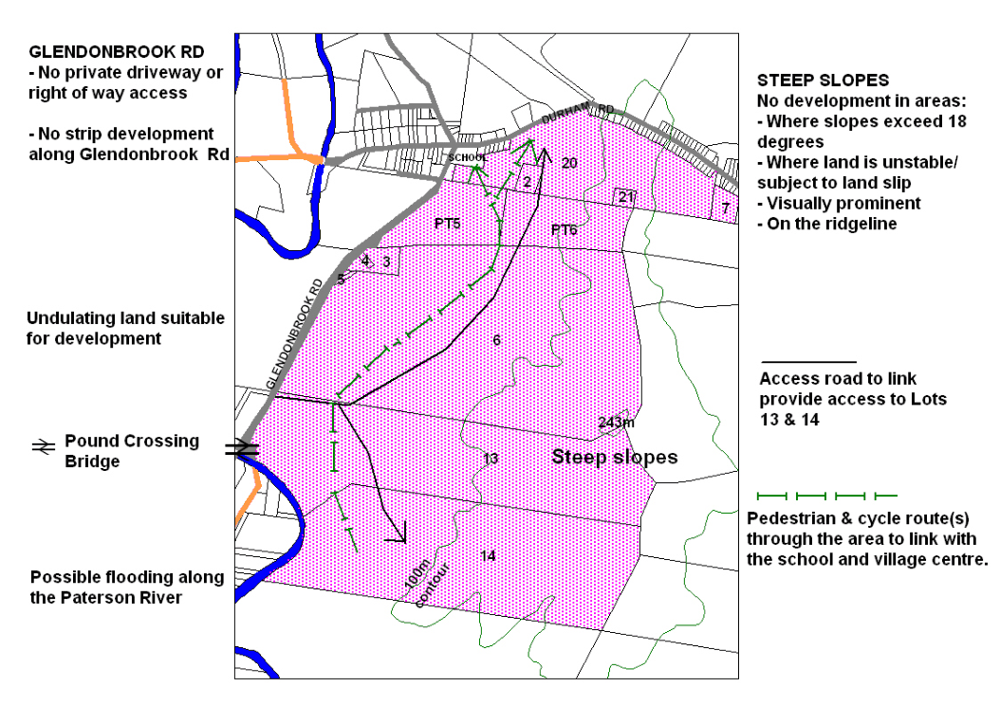
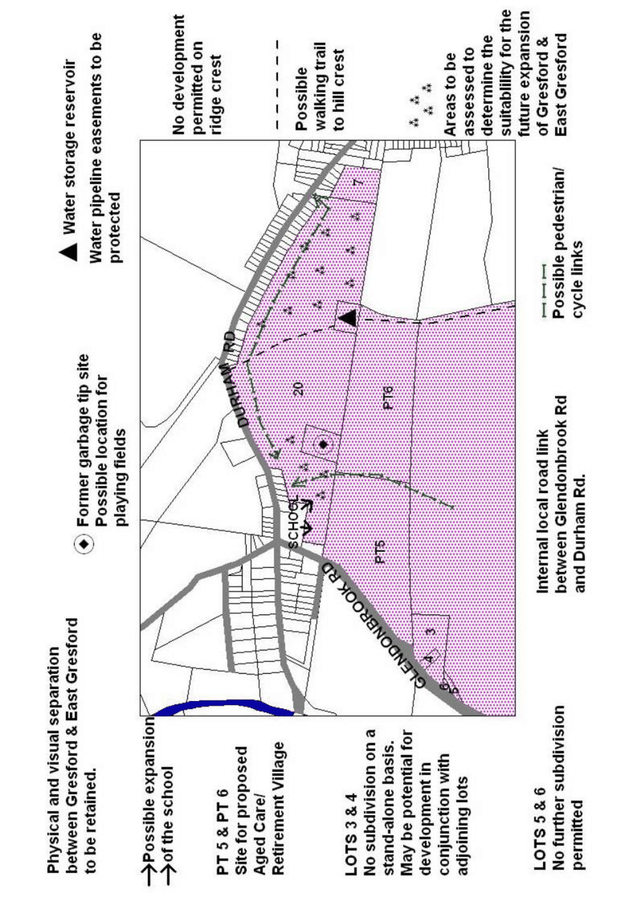

### 6.2 PLANNING AREA D2

#### The Area

Area D2 is located south of Durham Road on the western side of the hill and extends from the ridge line west to Glendonbrook Road. Area D2 abuts the southern boundary of Gresford village.  The Paterson River forms the south western corner of Area D2.  The Area incorporates eleven (11) lots:

Lot 7 DP 38901 Lot 20 DP 1014637 PT 5 DP752464 (eastern side of Glendonbrook Rd) PT 6 DP 752464 Lots 3, 4, 5 & 6 DP 614286 Lot 6 DP 831568 Lot 13 DP 650435 Lot 14 DP 11562

Lots 3, 4, 5 & 6 DP 614286 are small lots that have already been zoned Rural Lifestyle.  Due to their size and location, no further subdivision Lots 5 and 6 is permissible.  Lots 3 and 4 could potentially be re-subdivided as part of the development of adjoining land (Pt 5 or Lot 6 DP 831568).  Lots 3 and 4 will not be able to be subdivided on an individual basis.

Lot 20 has frontage to Durham Road.  The Lot spans the area from Gresford to East Gresford across the ridge line.  Two small lots have been excised from Lot 20, with these being the former Rubbish tip (Lot 2 DP 1059713) and the Water Storage Reservoir for Gresford (Lot 21 DP 1014637).  There are also a number of easements across Lot 20 to provide access to these two facilities and for the pumping of water from the Allyn and Paterson Rivers.

Lot 7, PT 6 and Lot 14 have no road frontage.  Lot 7 DP38901 is accessed via Berks Lane, a narrow lane (6m wide) accessed from Parkes Street.  PT6 is owned by the Anglican Church who also owns PT 5 (adjoining Lot) which has frontage to Glendonbrook Road.  Lot 14 is serviced by a Right of Way from Glendonbrook Road.

The remaining lots have frontage to and access from Glendonbrook Road.

#### Development Potential

Area D2 contains large tracts of developable land and is the preferred location for the expansion of Gresford Village and for Rural Lifestyle development within the Gresford Investigation Zone.  The western, central and northern parts of Area D2 are undulating and

rise gradually to the east.   The south eastern part of Area D2 incorporates steep side slopes which rise to the hill crest and ridge line along the eastern boundary.

Key considerations in developing Area D2 include:

Identifying and providing sufficient land to accommodate the future growth of Gresford. Pattern of subdivision - no strip development along Durham or Glendonbrook Roads. Maintaining the physical and visual separation of Gresford and East Gresford. Minimising the visual impact of development particularly along the ridge lines and upper side slope areas. Access to collector roads - developing a network of local connecting roads within Area D. No private driveway or right-of-way access to Durham or Glendonbrook Roads is permitted. Protecting the watercourses within the area. Providing pedestrian and cycle links to connect to Gresford village and possibly to East Gresford. 150m buffer zone around the market gardens which are located near Pound Crossing Bridge, just south of the Investigation Area.

Lot 7 DP 38901 - Lot 7 is a small lot that abuts the village boundary in East Gresford.  This lot is already zoned Rural Lifestyle.  Access is via Berks Lane.  The lane is very narrow and does not have the capacity for increased traffic use.  Access for any subdivision on Lot 7 needs to be provided through Lot 20.   Subject to having no physical or environmental constraints, and access to the sewer, Lot 7 may be suitable for future village uses.  The planning and development of this lot needs to be undertaken in conjunction with the development of Lot 20.

Lot 20 DP 1014637 - spans the area across the ridge from Gresford to East Gresford.  The western area of Lot 20 abuts Gresford Village and has been identified as potentially suitable for the future expansion of this settlement.  Gresford Primary School occupies a small site adjacent to Lot 20 and has advised that additional land may be required if the school is to grow to accommodate the future needs of Gresford, East Gresford and the surrounding area.

The former Garbage Tip site, which lies within Lot 20 has also been identified by the Gresford community as a possible location for the development of sporting facilities -possibly an oval and two courts, to service both the school and Gresford village.

The eastern section of Lot 20 abuts East Gresford Village.  The area below the ridge contains a number of small watercourses and localised areas of steeper slopes.  A land capability assessment is required to determine if this land is suitable for the expansion of East Gresford.  Any development in this area needs to be done in conjunction with Lot 7. Consideration also needs to be given to providing access to Lot 22 in Area D1 and the establishment of a pedestrian-cycle link through Lot 20 to link Area D1 to Gresford village

The intervening land (between the former Tip and East Gresford) rises to a spur ridge line, with the water storage reservoir located on the highest point within Lot 20.  This intervening area currently provides the separation between Gresford and East Gresford.  This separation is an integral part of the character of the Gresford area, with the community wanting to see this separation remain.  The community workshop recommended that this area become parkland or open space.  A walking trail to the top of the hill has also been suggested for inclusion within this area.  Careful consideration needs to be given to development within this intervening area, with priority to be given to retaining the visual separation of the two settlements.  Strip development along Durham Road will not be permitted.  There will be no private driveway or right-of way access to Durham Road.

The subdivision planning for Lot 20 will need to address access for Lots 7 and 22 in East Gresford and PT 6 DP 752464 and lots further south on the Gresford side.  A pedestrian -cycle link between Gresford and East Gresford may also be required with provision to link into Area D1.

PT5 DP 752464 - This Lot abuts the southern end of Gresford village and is an ideal site for the future expansion of the village.  PT5 has been identified as a possible site for aged housing / retirement home to meet the needs of the local community.  This is an ideal location for a retirement home, possibly integrated with other village uses.

PT6 DP 752464 - This area is gently undulating and suitable for development.  No development is to occur along the crest of the ridge or in areas that are highly visible. Provided that the area can be sewered, PT6 may be suitable for smaller lot subdivision (eg 2,000sqm).  The subdivision design needs to recognise that this land may be re-subdivided in the future for to meet the need for residential land for Gresford.

Lots 3, 4, 5 & 6 DP 614286 are small lots that have already been zoned Rural Lifestyle.  Due to their size and location, no further subdivision Lots 5 and 6 is permissible.  Lots 3 and 4 could potentially be re-subdivided as part of the development of adjoining land (Pt 5 or Lot 6 DP 831568).  Lots 3 and 4 will not be able to be subdivided on an individual basis.

Lot 6 DP 831568 - The western and central areas of Lot 6 (most of the area below 100m asl) is considered highly suitable for Rural Lifestyle or Rural Enterprise development.  Provided that there are no environmental or physical constraints and the property is sewered (either an on-site package treatment plant or other arrangements), smaller lot subdivision may be considered for part of this Lot.

The eastern third of the site rises steeply to the ridge line along the eastern boundary with the crest of the hill (243m asl) forming the south east corner of the Lot.  The hill and side slopes are highly visible from Glendonbrook Road and form part of the visual approach to Gresford.  Parts of this area are also visible from Gresford village.   There may be sites on the lower and mid slopes that could potentially be suitable for development provided that the development is not visually obtrusive and the impact of the development on the view-shed is minimal.   Where potentially suitable development sites are situated below areas of steep slopes the stability of the area will need to be assessed.

Lot 13 DP 650435 - The topography of Lot 13 is similar to Lot 6 with the western half of the area being undulating and suitable for development and the eastern half being hilly and steep and not suitable for development.  Flooding may occur along the Paterson River frontage and a flood assessment is required to identify the 1:100 year flood level.  Given the proximity to Pound Crossing Bridge and the alignment and sightlines along this section of Glendonbrook Road, Lots 6 and 13 should share the same access road with Lot 6.  Access also needs to be provided through Lot 13 to Lot 14.  The south western corner of Lot 13 lies within the 150m buffer zone around the market garden, which is located just across the river.

Lot 14 DP 11562  - The undulating area between the Paterson River and the spur which rises up to the ridge line is potentially suitable for development, provided that it lies above the 1:100 year flood level and outside the 150m market garden buffer zone.   No development will be permissible in the area to the east of the spur.  The area to he east of the spur is hilly to steep and bushfire prone.

### PLANNING AREA D2

> [Picture on page 71: a picture, saved as a picture (images/part-d6-gresford-local-area-plan-page-71-2.gif, 150 dpi).]

### PLANNING AREA D2 NORTH

> [Picture on page 72: a picture, saved as a picture (images/part-d6-gresford-local-area-plan-page-72-2.gif, 150 dpi).]

#### Masterplan

A Masterplan is required. The Masterplan is to show:

Areas for the future expansion of Gresford and possibly East Gresford villages. How the visual separation between Gresford and East Gresford is to be achieved. The proposed subdivision layout, including areas to be subdivided for village use (residential, aged care, sporting facilities etc) as well as for rural lifestyle / rural enterprise development. Road layout and pedestrian and cycle links through the area. Open space areas and corridors. Areas of visual significance and the provisions to preserve these areas. Market garden buffer zone (150m). The interface with the Paterson River and the creek systems. Areas to be reafforested.

The Masterplan must demonstrate how development of the area will be staged as it is likely that only the northern part of the area will be needed for village growth in the short to medium term.

#### Issues & Performance Criteria

In addition to the planning controls setout in the LEP, DCP and Rural Strategy, the planning and assessment process for the developable land within Area D2 must address.

| Issue | Planning Considerations / Performance Criteria |
|---|---|
| Need for co-ordinated development | Preparation of a Masterplan for the development of Area D2. The Masterplanning process is to include: Land capability assessment to be undertaken for Area D2 to determine suitability for development for a range of village uses and rural lifestyle / enterprise development. Assessment of the future needs of Gresford and East Gresford and, where suitable, the allocation of land to meet these needs. Visual analysis / view-shed assessment to preserve areas of high visual significance. Subdivision is to occur in accordance with the Masterplan. |
| Separation of Gresford and East Gresford | The visual separation of Gresford and East Gresford is to be retained. |
| PT 5 DP 752464 | If the area can be sewered, this Lot is to be rezoned for 2(v) Village. |
| Smaller lot subdivision | Provided that the area can be sewered, PT 6 |

|  | DP 752464 and the north western area of Lot 6 DP 831568 may be suitable for smaller lot subdivision (eg 2,000sqm). The subdivision design needs to recognise that this land may be re-subdivided in the future to meet the need for residential land for Gresford |
|---|---|
| Lots 5 & 6 DP 614286 | No further subdivision is permissible. |
| Lots 3 & 4 DP 614286 | Can only be subdivided further as part of the development of adjoining land. These lots cannot be subdivided on a stand-alone basis. |
| Lot 7 DP 38901 | Possibly suitable for future village use. Planning for this Lot needs to be undertaken in conjunction with the planning of Lot 20. Access to Lot 7 is to be via Lot 20 not Berks Lane. |
| Visual Impact - parts of Area D2 have high visual / scenic value. | Visual assessment required as part of the planning and assessment process. No development will be permitted in areas which are highly visible. No development on ridge lines or upper slopes (broadly defined as the area above 100m asl) that are visible from East Gresford, Gresford, Durham Road or Glendonbrook Road. |
| The visual Impact of development along both Durham and Glendonbrook Roads needs to be minimised. | Landscape buffer / corridor tree planting along the road frontage to create a village entry statement in accordance with the Landscape Policy for Gresford - East Gresford. Strip development along these roads is not permissible. No backyards to have direct frontage to these roads. |
| Stability - need to assess the risk of slippage / landslide from the steeper upper slopes. | Council may require that a geotechnical assessment be undertaken as part of the land capability assessment. |
| Access to Collector Roads - Durham Road and Glendonbrook Road | Need for an appropriately designed and sited access road/s to service Area D2. The location and design will need to be determined in conjunction with the RTA and Council. No lots created by subdivision are permitted to have private driveway or right-of-way access from Durham or Glendonbrook Roads. |

| Local road network | A north-south local road is to be provided linking Glendonbrook Road (in the vicinity of the current access point for Lots 6, 13 and 14) through to Durham Road. The access road from Glendonbrook Road must be the point of entry to Lot 6 DP 650435, Lot 13 and Lot 14. |
|---|---|
| Shared access ways - pedestrian and cycle ways. | A pedestrian - cycle route is to be provided that links the village to Pound Crossing Bridge. This link must be provided internally, not along the Glendonbrook Road corridor. Council may also require the provision of an east - west link between Gresford and East Gresford, with this to be set back from the Durham Road corridor. |
| Flood prone land - Paterson River | Flood assessment to be undertaken to determine the extent of flood prone land on Lots 13 and 14. Rural Lifestyle / Enterprise development is not permissible on land below the 1:100 year flood. Areas below the 1:100 year flood level to be rezoned Rural 1(a) or Environment 7(a) depending on the location and environmental attributes of the area. |
| Watercourses | Watercourses are to be protected. Development is to be setback from watercourses as required in DCP 1. No additional riparian rights can be created. |
| Market Garden, south east of Pound Crossing Bridge | 150m buffer zone. No development permissible within the buffer zone area. |
| Reafforestation to improve stability | Areas to be re-vegetated are to be identified in the Masterplan and included in subsequent development plans. |
| Areas subject to bushfire risk | Bushfire risk to be assessed and addressed as part of any subdivision design. |
