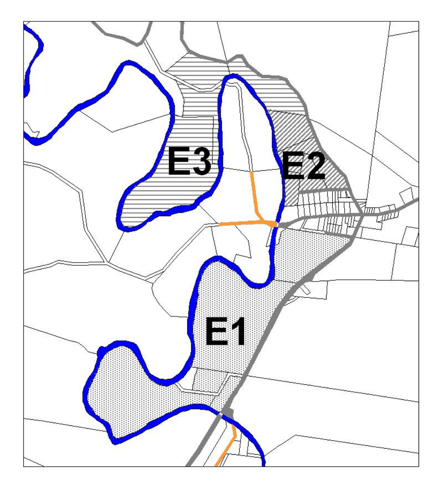

## 7. PRECINCT E - PATERSON RIVER - GRESFORD WEST

#### The Area

Precinct E incorporates the area within the Investigation Zone, which lies between the Paterson River and Glendonbrook - Paterson River Roads.  Precinct E abuts the northern and southern boundaries of Gresford village.   Precinct E is divided into 3 planning areas.

> [Picture on page 76: a picture, saved as a picture (images/part-d6-gresford-local-area-plan-page-76-6.gif, 150 dpi).]
