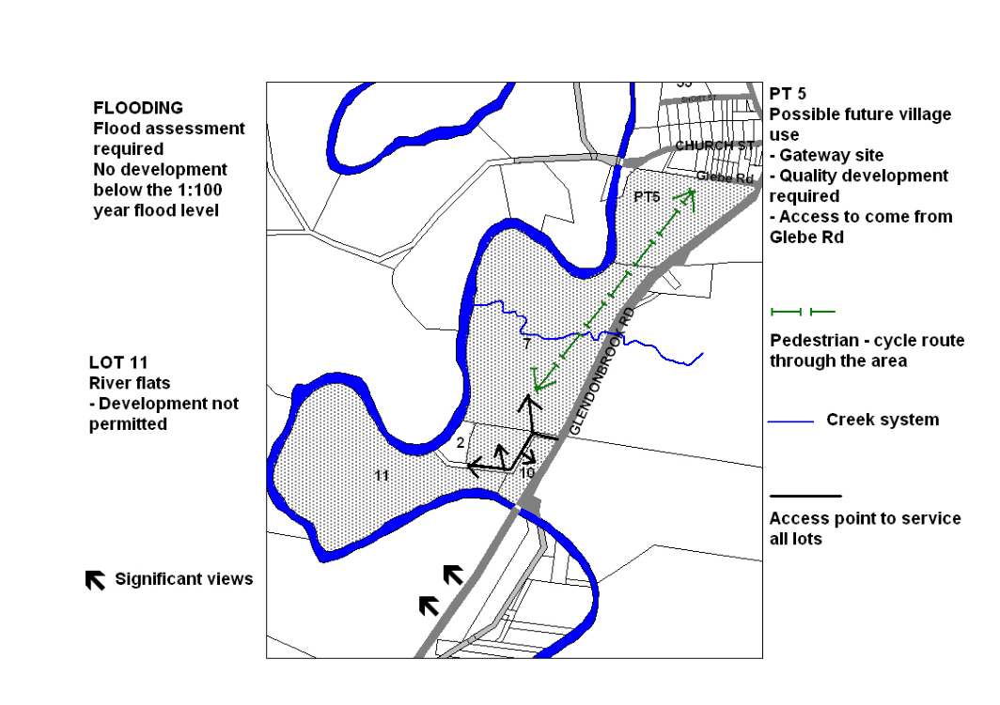

### 7.1 PLANNING AREA E1

#### The Area

Area E1 incorporates the area to the south of Gresford and is bounded by Glebe Road to the north, the Paterson River to the west and south and Glendonbrook Road to the east. Area E1 incorporates four (4) lots:

PT 5 DP 752464 (West) Lot 7 DP 831568 Lots 10 & 11 DP 1021970

PT5, Lot 7 and Lot 10 all have frontage to Glendonbrook Road, with Part 5 also having frontage to Glebe Road.  Lot 11 is accessed via an unformed road from Glendonbrook Road. This unformed road is also used by Lot 10 for access.

#### Development Potential

Area E1 has frontage to the Paterson River, with Lots 7 and 11 having extensive areas of river flats.  These river flats appear to lie below the 1:100 years flood level.  Flooding may also occur along the creek system that flows across Lot 7 into the Paterson River. A flood assessment will be required as part of the planning and assessment process.

The remainder of Area E1 is undulating and appears suitable for development.  Parts of Area

E1 (primarily the river flats) have been identified by the Gresford community as having high visual significance that needs to be preserved.  A visual assessment - view shed analysis is to be undertaken as part of the planning process.

Glendonbrook Road is the southern gateway to Gresford.  Any development within Area E1 will need to minimise the visual impact of development along Glendonbrook Road and provide a landscaped buffer along the road frontage (as per Council's requirements).

PT5 DP 752464 adjoins the southern boundary of Gresford village and has been identified as potentially suitable for future village use.  Part of the lot may suitable for the establishment of sporting facilities if the Rubbish Tip Site / Lot 20 in Area D2 is not suitable or available. Alternatively, this area (subject to sewer) could be used for aged housing or for smaller lot subdivision (eg 2,000sqm) than permitted in Rural Lifestyle zones.  A key consideration in the development of this area will be visual impact.  PT5 is a gateway site and the quality of the development needs to reflect this.

Lot 7 DP 831568 - the more elevated areas of this Lot may be suitable for Rural Lifestyle / Rural Enterprise development.  Given the topography of the area and the creek system, a maximum of two access points will be permissible from Glendonbrook Road.

Lot 11 DP 1021907 - a large area of this Lot is river flats and no development will be permissible on these flats.  Limited development could potentially occur to the east of Lot 2.

Lot 10 DP 1021970 - This lot could potentially be subdivide further provided that access comes from the unformed road, lots created have a minimum width to depth ration of 1:3, no additional river front lots or riparian rights are created and there are no backyards facing Glendonbrook Road.

### PLANNING PRECINCT E1

> [Picture on page 78: a picture, saved as a picture (images/part-d6-gresford-local-area-plan-page-78-2.gif, 150 dpi).]

#### Masterplan

A basic masterplan will be required for the total area.

#### Issues & Performance Criteria

In addition to the planning controls setout in the LEP, DCP and Rural Strategy, the planning and assessment process for Area E2 must address:

| Issue | Planning Considerations / Performance Criteria |
|---|---|
| Determining the development potential of Area E2. | Land capability assessment required to determine suitability of the area for village uses, smaller lot subdivision (eg 2,000 sqm) and rural lifestyle / rural enterprise. |
| Flooding | Flood Assessment to be undertaken for the Paterson River corridor to determine the 1:100 year flood lavel. Residential, Rural Lifestyle and Rural Enterprise development is not permitted on |

|  | land located below the 1:100 year flood level. |
|---|---|
| Need for co-ordinated development | Masterplan to be prepared for Area E1. Subdivision must be in accordance with the adopted Masterplan for Area E1. Subdivision can be staged in accordance with this plan. |
| Pattern of subdivision | Long lots that run from Glendonbrook Road through to the Paterson River will not be permitted. No additional Riparian Rights along the Paterson River are to be created. All lots created are to have a minimum width to depth ratio of 1:3. |
| Access to Collector Roads - Glendonbrook Road | No private driveway or right of way access to be provided from Glendonbrook Road. Access to PT5 is to come from Glebe Road. The existing unformed road adjacent to Lot 10, is to be used to provide access to development on Lot 7 (southern portion), Lot 10 and Lot 11. Lot 7 may also have another access point to service development in the northern area of the lot. |
| Pedestrian and cycle access | Pedestrian and cycle route to link internally through the area to the village rather than along Glendonbrook Road. |
| Visual Impact - parts of Area E1 have high visual / scenic value. | Visual assessment required as part of the planning and assessment process. Development may be prohibited in areas which are identified as having high visual significance. |
| The visual Impact of development along Glendonbrook Road needs to be minimised. | Landscape buffer / corridor tree planting along the road frontage to create a village entry statement in accordance with the Landscape Policy for Gresford - East Gresford. Strip development is not permissible. No backyards to have direct frontage to Glendonbrook Road. |
| Paterson River Corridor / | Hydrology / drainage of the area is to be |

watercourses through the area

assessed as part of the land capability assessment.

Watercourses are to be protected.

Development is to be setback from watercourses as required in DCP 1.

No further riverfront lots or riparian rights to be created.

Riparian vegetation to be protected and the vegetation along the riverbank and watercourses to be rehabilitated.
