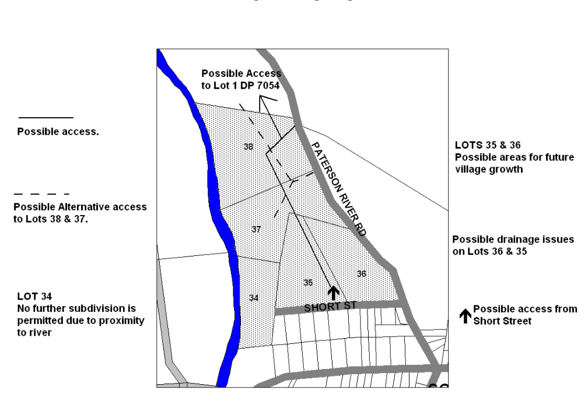

### 7.2  PLANNING AREA E2

#### The Area

Area E2 lies immediately to the north of Gresford and is bounded by Short Street to the south, Paterson River Road to the east and the Paterson River to the west.  Area E2 incorporates five (5) lots.

Lots 34, 38, 351, 361 & 371 DP 7055.

Lot 34 is zoned Rural Lifestyle.  The Short Street frontage of Lots 351 and 361 is zoned village uses, with the area behind zoned Rural Lifestyle.  Lots 371 and 38 are zoned 9(a) Investigation.

#### Development Potential

A land capability assessment is required to determine the suitability of land within Area E2 for future village use and Rural Lifestyle development. While the topography is undulating to hilly the area may have drainage problems.  There appears to be a number of small water courses, springs and seepage lines throughout the area.  The close proximity to the Paterson River and the frontage to a collector road (Paterson River Road) are also constraints to development.

Lot 34 is zoned Rural Lifestyle and, given its proximity to the River, no further subdivision is permitted.

Lots 351 and 361 - the Short Street frontage of these lots is already zoned 2(v) Village and the remainder of the land has been identified as possibly suitable for the future expansion of Gresford Village.  This area already zoned 2(v) has not been subdivided and as such provides the opportunity to access the rear of these lots, as well as Lots 371 and 38, from a road in from Short Street.

Further investigation is required to determine whether Lots 351 and 361 are suitable for future village uses and/or for smaller lot sizes (eg 2,000 sqm) than permissible in the Rural Lifestyle zone.  In particular, it needs to be determined whether these lots are free of physical and environmental constraints and can be connected to the town water supply and sewered via an on-site package treatment plant (or other system).

Lots 371 and 38 may also be suitable for development for Rural Lifestyle / Rural Enterprise. Key considerations on these lots are drainage, access, proximity to the River and visual impact.

Subdivision that produces long narrow lots that run from Paterson River Road through to the Paterson River will not be permitted. Due to the alignment and narrow pavement of Paterson River Road adjacent to Area E3, the preferred access road for this area is a 'spine' road coming off Short Street.  Alternatively a cul-de-sac layout coming off Paterson River Road may be considered.  The cul-de-sac would need to provide access to both Lot 371 and 38 and possibly, Lot 1 DP 7055 in Area E3.

Within Area E2, pedestrian and cycle access is to be provided internally within the area and not along Paterson River Road.

> [Picture on page 81: a picture, saved as a picture (images/part-d6-gresford-local-area-plan-page-81-12.gif, 150 dpi).]

### PLANNING PRECINCT E2

#### Masterplan

Provided that the land capability assessment identifies Area E2 as suitable for development, a basic Masterplan for the coordinated development of Lots 351, 361, 371 and 38 will be required.  The Masterplan is to show the subdivision layout, road network, pedestrian and cycle access route, open space and the interface with the Paterson River.

#### Issues & Performance Criteria

In addition to the planning controls setout in the LEP, DCP and Rural Strategy, the planning and assessment process for Area E2 must address:

| Issue | Planning Considerations / Performance Criteria |
|---|---|
| Lot 34 DP 7055 | No further subdivision or development permitted. |
| Determining the development potential of Area E2. | Land capability assessment required to determine suitability of the area for village uses, smaller lot subdivision (eg 2,000 sqm) and rural lifestyle / rural enterprise. |
| Need for co-ordinated development | Masterplan to be prepared for Area E2. (Lot 34 excluded) Subdivision must be in accordance with the adopted Masterplan for Area E2. Subdivision can be staged in accordance with this plan. |
| Pattern of subdivision | Long lots that run from Paterson River Road through to the Paterson River will not be permitted. No additional Riparian Rights along the Paterson River are to be created. All lots created are to have a minimum width to depth ratio of 1:3. |
| Access to Collector Roads - Paterson River Road | No private driveway or right of way access to be provided from Paterson River Road. Only one access point along the Paterson River Road frontage of Area E2 will be permitted. This access point must service both Lot 371 and 38 (assuming that the land on both lots is suitable for development) Access to Lots 351 and 361 is to be via Short Street. The feasibility of extending this road to service Lots 371 and 38 must be assessed as part of the Masterplanning / Subdivision design process. |
| Pedestrian and cycle access | Pedestrian and cycle route to link internally through the area rather than along Paterson River Road. |

| The visual Impact of development along Paterson River Road needs to be minimised. | Landscape buffer / corridor tree planting along the road frontage to create a village entry statement in accordance with the Landscape Policy for Gresford - East Gresford. Strip development is not permitted. No backyards to have direct frontage to Paterson River Road. |
|---|---|
| Paterson River Corridor / watercourses through the area | Flooding / hydrology / drainage of the area is to be assessed as part of the land capability assessment. No development below the 1:100 year flood level. Watercourses are to be protected. Development is to be setback from watercourses as required in DCP 1. No further riverfront lots or riparian rights to be created. Riparian vegetation to be protected and the riverbank and watercourses rehabilitated. |
| Areas subject to bushfire risk | Bushfire risk to be assessed and addressed as part of any subdivision design. |
