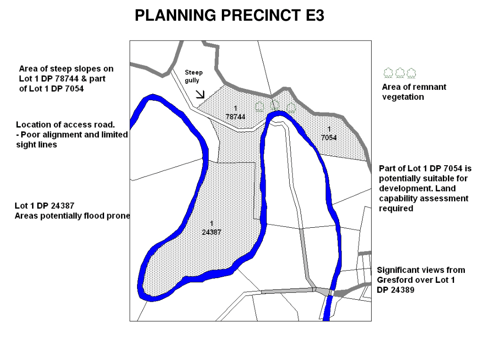

### 7.3  PLANNING AREA E3

#### The Area

Area E3 lies to the north and west of Area E2 and includes land within a large bend of the Paterson River.  Area E3 incorporates three (3) lots:

Part of Lot 1 DP 7054 (area to the south of Paterson River Road) Lot 1 DP 78744 Lot 1 DP 613616

#### Development Potential

The development potential of Area E3 is very limited with the major constraints being:

Steep slopes - The northern parts of Lots 1 DP 7054 and Lot 1 DP 78744 are very steep, and there is a significant drop between Paterson River Road and the Paterson River below.

Flooding - Lot 1 DP 24387 and part of Lot 1 DP 78744 lie within a bend in the Paterson River, with the lower lying areas of these lots appearing to be flood prone.

Poor access -  Access to most of Area E3 is difficult.  The section of the Paterson River Road that services this area is narrow, very windy and in poor condition.  The surrounding areas are unstable and the road is subject to landslips.  Due to the steep slopes, the access road to Lot 1 DP 24387 and Lot 1 DP 78744 lies to the west of the Investigation Area.  The intersection of this unsealed access road and Paterson River Road is poorly sited and aligned, however is possibly the 'best' available given the very steep topography in the area.   Paterson River Road could not accommodate additional traffic without major upgrading.  Given the terrain, the cost of this is likely to be prohibitive.

Area of High Visual Significance - the river bend area of Area E3 (Lot 1 DP 24387) lies within a view shed that has been identified by the Gresford community as having high visual significance that needs to be protected.

Bushfire Prone - The steeper slopes on both sides of Paterson River Road are bushfire prone.

Instability – the steep slopes along Paterson River Road are unstable and the are is subject to slippage.

The only land within Area E3 that may be suitable for development is the southern section of Lot 1 DP 7054 where it adjoins Planning Area E2.  Any development of this part of the lot will need to be undertaken in conjunction with Precinct E2.Due to the constraints outlined above, development will not be permitted in the remainder of Area E3.

> [Picture on page 84: a picture, saved as a picture (images/part-d6-gresford-local-area-plan-page-84-21.gif, 150 dpi).]

### PLANNING PRECINCT E3
