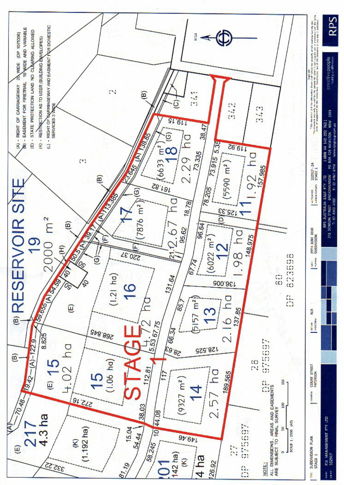
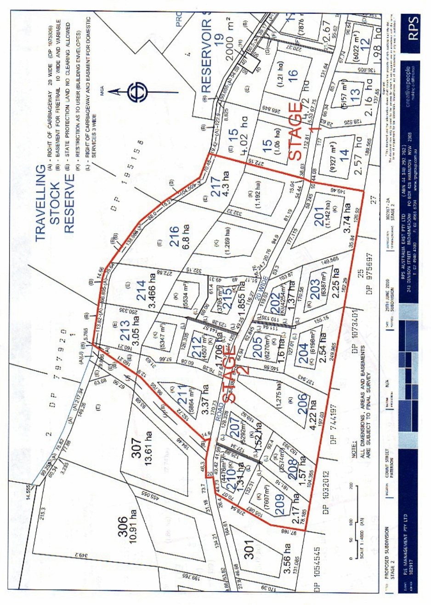
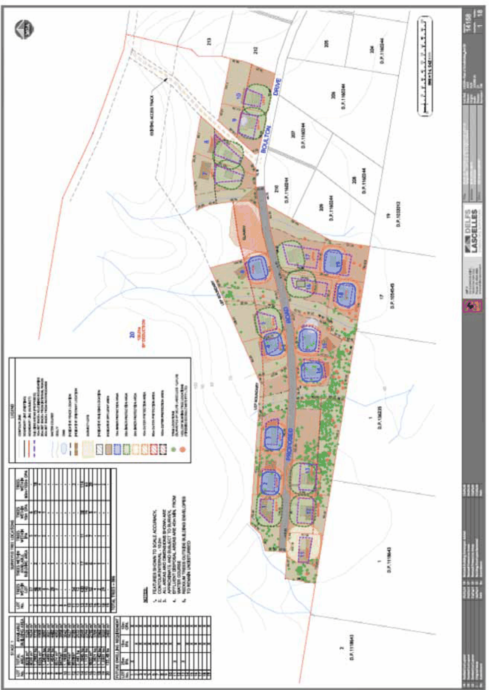
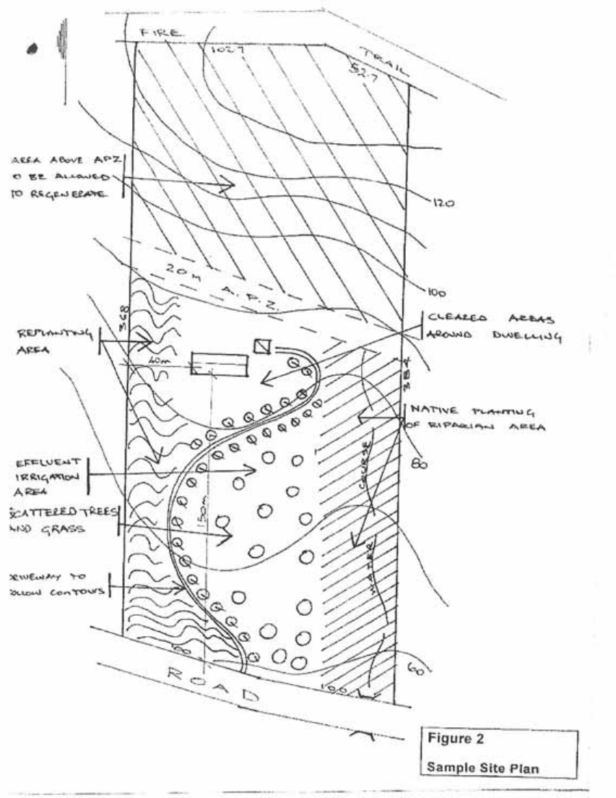

### 7.3 RESIDENTIAL DEVELOPMENT

#### 7.3.1  Dwelling‐Houses and Other Structures ‐ Planning Principles

1\) All new structures are to be sited and designed:‐

To lie within the nominated development envelope for the site (as per Figure 1). To  respect  the  visual  privacy  and  views  enjoyed  from  existing  and  potential dwellings within the Estate. To avoid potential for erosion, sedimentation and contamination of watercourses and water storage areas. To minimise the removal of native vegetation.

2\) To ensure that dwellings are of a design which reflects a high quality of finish and be of a scale which compliments the character of the bushland setting.

3\) To encourage energy efficient housing.

4\) To  protect  the  riparian  environment  of  watercourses  by  the  incorporation  of appropriate water management and erosion controls.

5\) To encourage housing which is of a design that reduces exposure to the risks of bushfire.

#### 7.3.2  Building Siting and Design

1\) Each  of  the  allotments  has  unique  physical  characteristics  and  prior  to commencing the design of a dwelling, owners should have prepared a detailed site assessment.  This assessment and site plan is required to be submitted with all applications for development on the allotment.  The elements which need to be taken into consideration when preparing the plan are:‐

Land contours and slope – a detailed site survey at 0.5m contour intervals with the locations of large trees and creek lines shown; Location  of  existing  areas  of  native  vegetation,  including  Slaty  Redgum  trees (Eucalyptus glaucina); Topographical  features  –  e.g.  rock  outcrops,  unique  trees,  old  access  tracks, vehicle entry point, boundaries, areas of slope over 18 degrees (State Protected Land), etc; Bushfire Asset Protection Zones; Location of existing services; Preferred route of access road, road grade and drainage; The preferred ‘building area’ – an area of up to 2500m2, for Lots 202‐205, 207 ‐ 210  and  Lots  212‐215.    For  other  lots,  5000m2  is  considered  adequate  to comfortably accommodate a dwelling, outbuildings, house garden and recreation areas, outdoor storage areas and vehicle circulation; Areas  which  will  be  retained  in  their  natural  state  –  e.g.  <20m  either  side  of watercourses, existing treed areas outside of the ‘building area’, Slaty Redgum trees, etc; View corridors and location of building on adjoining properties; Landscaping  proposed  to  mitigate  visual  impact  of  the  dwelling  on  the  site, landscaping proposed to be planted on the northern (high) side of buildings on the  northern  lots,  and  between  other  dwellings/buildings  or  potential dwelling/building sites; Type of entry treatment, e.g. entry statement and front fencing detail; Relative RL of proposed dwelling and building platforms; Proposed stormwater drainage of hard surface areas; Proposed location and size of any dams; Proposed location of on‐site effluent disposal system and irrigation areas; and Proposed location of services from road to dwelling/building and if underground or overhead supply.

#### 7.3.3  Building Design Guidelines Development Envelope

Applicants seeking to develop land lying outside the development envelope or alter the configuration of the envelope are required to provide evidence that such work will not significantly impact upon the habitat of endangered or vulnerable flora/fauna or impact upon the amenity of adjoining properties.

The  building  envelope  sets  the  external  position  of  any  structures.    Within  this  area, owners are required to identify a “building area” being an area of no more than 2500m2 for Lots 202‐205, 207 ‐210 and Lots 212‐215, and no more than 5000m2 for other Lots. The removal of significant stands of native vegetation outside this area, except for the maintenance of bushfire asset protection zones, is prohibited.

Separate building envelopes for dwellings and other structures have been nominated for allotments within Stage 3 as shown in Figure 1.

#### Building Design

Council’s objective is to encourage well designed development which will provide a good living place for the residents and ensue all new structures and buildings will  relate  sympathetically  in  scale  and  form  to  the  surrounding  area.    These guidelines  seek  to  encourage  more  imaginative  and  innovative  ecologically sustainable development which fit well within the landscape.

All  structures,  i.e.  dwelling‐houses,  garages,  sheds,  fencing,  shall  be  designed having consideration to the bushland character of the area, the topography and landscape features of the site.  Particular consideration will need to be given to building  location,  solar  access,  form,  colour  and  construction  materials. Applicants will be required to demonstrate that these considerations have been taken into account.

Buildings  should  be  designed  to  accommodate  the  topography  of  the  site  and should not require cut or fill in excess of 2 metres in depth.

On  steeper  sloping  sites,  the  use  of  slab  design  is  not  encouraged  due  to  the significant  problems  associated  with  sizable  excavations.    On  these  sites  every effort  should  be  made  to  locate  the  dwelling  and  outbuildings  on  areas  of relatively flat land rather than undertake extensive earthworks.

Dwellings  are  required  to  meet  an  acceptable  energy  rating  as  determined  by Council and BASIX Certificate requirements.

#### Building Materials

External  materials  should  be  sympathetic  in  colour,  texture  and  range  to  achieve  a harmonious  composition.    On  the  more  elevated  lots,  materials  which  have  a  high reflectivity  index,  e.g.  zincalume,  or  light  coloured  colourbond  or  tile  will  not  be approved.    In  order  for  dwellings  and  buildings  to  “fit  comfortably  within  the  rural landscape” the use of non‐reflective materials is required.

#### Specific Controls

Each  of  the  allotments  has  specific  characteristics  resulting  in  a  site  specific  building envelope.  Each building envelope is larger than is required to accommodate a dwelling and associated outbuildings, etc.  In preparing site plans, all buildings should be located within  the  nominated  building  envelope.    Areas  not  used  for  buildings,  outbuildings, recreational facilities and driveways must be landscaped using species native to the area. A list of these species appears as Appendix A.  Details of the landscaping must be shown on  the  site  plan  submitted  with  the  development  application  for  each  allotment.    An example of a site plan is provided as Figure 2.

The use of exotic species within the dwelling gardens are discouraged to prevent them escaping into the surrounding area.

The  wildlife  corridor  located  on  the  northern  ridgeline  shall  be  revegetated  and maintained  with  appropriate  local  species.    Livestock  are  not  permitted  within  the wildlife corridor area.

#### Special Design Controls on Lot Nos 15 to 18, 211‐217 & 304‐307.

Several of the lots located on the northern side of the public road have been assessed as having  a  high  or  medium  level  of  visual  exposure  and  sensitivity.    In  order  to  ensure buildings  on  these  lots  do  not  have  a  significant  detrimental  impact  on  the  rural landscape, a number of additional controls apply to development.  Owners of these lots are  encouraged  to  seek  the  services  of  an  architect  when  preparing  site  plans  and housing  design.    On  these  sites,  it  is  a  requirement  that  a  detailed  landscape  plan, prepared by a landscape architect, is submitted with a development application for any building.

The following controls apply to Lots 15 to18, 211 – 217 & 304 – 307

Buildings  should  be  single  storey  or  split‐level  construction  and  not  exceed  6 metres in height above natural ground level.

Buildings should not be overly bulky, of excessive site coverage, or surrounded by excessive hard surface areas, requiring the intensive clearing of vegetation.

Sheds  and  ancillary  buildings  shall  not  exceed  5  metres  in  height.

Development  is  to  comply  with  the  Building Development  Controls  as  listed  in Table 1.

Wall and roofing materials shall be non‐reflective with darker tones that blend with  the  natural  appearance  of  the  site.    Roofing  materials  that  are  of  lower reflectivity  than  colorbond  steel  or  aluminium  are  preferred,  such  as  unglazed tile, slate, shingle or visually similar products.  Cladding for building and sheds other  than  masonry  should  be  of  dark  non‐reflective  tones.    Painted  surfaces, including masonry should be of darker saturated colours relevant to the natural context,  for  example  dark  greens,  browns  and  greys,  in  preference  to  light unsaturated colours such as pastel shades or bright vibrant colours.

Extensive landscaping is to be undertaken on the higher side of the allotments with taller growing tree species so as to eliminate the ‘skyline silhouette’.  Taller native trees should also be planted on land below the dwelling, so as to reduce the visual impact of the building when viewed from Tocal College, Tocal Road and within the village of Paterson.

Driveways and ancillary developments to the house should be sited appropriately so as to ensure they are not visible from vantage points outside the development. In  particular,  driveways  should  follow  the  contours  to  benefit  from  tree screening.

The use of indigenous native vegetation is encouraged.

### Table 1:  Building Development Controls

| Lot Number | Visual Sensitivity | Effluent System | SETBACK Metres Road Rear | SETBACK Metres East West | Special Requirements |
|---|---|---|---|---|---|
| 305 | Low | Aerated | 50 50 | 40 25 | All building materials to be non‐ reflective and dark earthy tones |
| 306 | Low | Aerated | 50 300v | 25 40 | All building materials to be non‐ reflective and dark earthy tones |
| 307 | Low | Aerated | 50 170v | 25 25 | All building materials to be non‐ reflective and dark earthy tones |
| 211 | Low | Aerated | 50 180v | 55 25 | All building materials to be non‐ reflective and dark earthy tones |
| 212 | Low | Aerated | 50 20 | 25 25 | All building materials to be non‐ reflective and dark earthy tones |
| 215 | Medium | Aerated | 50 20 | 25 25 | All building materials to be non‐ reflective and dark earthy tones |
| 216 | Medium | Type 3 | 50 150v | 25 55 | All building materials to be non‐ reflective and dark earthy tones |
| 217 | Medium | Type 3 | 50 110v | 25 25 | All building materials to be non‐ reflective and dark earthy tones |
| 15 | Low | Type 2 | 50 100v | 25 25 | All building materials to be non‐ reflective and dark earthy tones |
| 16 | Medium | Type 2 | 50 85v | 25 55 | All building materials to be non‐ reflective and dark earthy tones |
| 17 | High | Type 2 | 50 50 | 25 25 | All building materials to be non‐ reflective and dark earthy tones |
| 18 | High | Type 2 | 50 30 | 25 25 | All building materials to be non‐ reflective and dark earthy tones |
| 11 | Low | Aerated | 20 50 | 25 25 |  |
| 12 | Low | Aerated | 20 50 | 25 25 |  |
| 13 | Low | Aerated | 20 50 | 25 55 |  |

| Lot Number | Visual Sensitivity | Effluent System | SETBACK Metres North South | SETBACK Metres East West | Special Requirements |
|---|---|---|---|---|---|
| 14 | Low | Aerated | 20 50 | 25 25 |  |
| 201 | Low | Aerated | 20 50 | 25 55 |  |
| 202 | Low | Aerated | 20 20 | 25 25 |  |
| 205 | Low | Aerated | 20 20 | 25 25 |  |
| 206 | Low | Aerated | 20 50 | 25 55 |  |
| 207 | Low | Aerated | 20 20 | 25 25 |  |
| 210 | Low | Aerated | 20 20 | 25 25 |  |
| 301 | Low | Aerated | 20 50 | 55 25 |  |
| 302 | Low | Aerated | 20 50 | 40 400v |  |
| 304 | Low | Aerated | 50 50 | 60 25 | All building materials to be non‐ reflective and dark earthy tones |
| 303 | C | Aerated | N/A | N/A |  |
| 203 | Low | Aerated | 20 | 25 25 |  |
| 204 | Low | Aerated | 20 | 25 25 |  |
| 208 | Low | Aerated | 20 | 25 25 |  |
| 209 | Low | Aerated | 20 | 25 25 |  |
| 213 | Low | Aerated | 150v | 25 25 | All building materials to be non‐ reflective and dark earthy tones |
| 214 | Medium | Aerated | 175v | 25 25 | All building materials to be non‐ reflective and dark earthy tones |

Notes:‐  Type  2  systems  are  to  be  constructed  in  accordance  with  Rosewood Environmental Services Report # E0894.

Type 3 – On these sites detailed geotechnical investigations are to be undertaken and details  of  the  type  of  system  to  be  used  and  its  location  should  be  provided  prior  to determining the location of the dwelling.

#### Site Constraints  within stage 3

The  allotments  within  Stage  3  (subdivision  approval  171/2014)  have  a  number  of constraints, which are illustrated in Figure 1.  Further technical information is available from the reports that were prepared to support the subdivision approval, which include:

| Document | Author | Date | Version |
|---|---|---|---|
| Subdivision Plan | Delfs Lascelles Consulting Surveyors | 15.04.2016 | 18 |
| Ecological Assessment | Firebird ecoSultants Pty Ltd | 25.02.2016 | n/a |
| Plan of Management | Firebird ecoSultants Pty Ltd | November 2017 | n/a |
| Traffic Study | BJ Bradley & Associates | 19.01.2016 | n/a |
| Wastewater Report | Whitehead | 20.01.2016 | Report_1442‐006 |
| Bushfire Threat Assessment | Firebird ecoSultants Pty Ltd | November 2015 | n/a |
| Statement of Environmental Effects | Perception Planning | April 2016 | Rev B |
| Visual Impact Assessment | Envisage Consulting Pty Ltd | 2.04.2015 | E71/15 VIA |
| Stormwater Drainage Strategy | GCA Engineering Solutions | 2.04.2015 | Revision 1 |

#### Fencing

All  fencing  shall  be  rural  type  fencing,  colourbond  fencing  is  not  considered  to  be suitable.  Fencing near the wildlife corridor along the northern ridgeline should be of a style  that  allows  easy  egress  for  fauna  i.e.  fences  should  have  no  barbed  wire  and  a maximum of 4 horizontal wires at a minimum spacing of 250mm from 300mm above the ground.

All lands lying to the north of the bushfire asset protection zone on Lots 15, 16, 211, 213, 214, 216, 217, 306, and 307 have been fenced off as these lands, being steeper than 18 degrees,  are  classified  as  State  Protected  Land  (SPL)  and  should  not  be  disturbed. Clearing of native vegetation in this area is prohibited, except with the written approval of the relevant Government Agency.  Only activities in this area which constitute minimal environmental disturbance are permitted.

Boundary fencing north of the asset protection zone on Lots 15, 16, 211, 213, 214, 216, 217, 306, and 307 is not permitted, with the exception of the common boundary on the ridge running East West.  Fencing is to be completed prior to the release of the final plan.

#### Erosion and Sedimentation

Soil erosion is a major environmental problem, particularly on steeper sloped allotments. The loss of topsoil from the land limits the growth of vegetation and the sedimentation downstream leaves deposits of mud in stormwater drains, creeks, dams and rivers.  This in  turn  affects  the  capacity  of  drains  and  streams  to  carry  stormwater,  disturbs  river habitat,  and  may  lead  to  further  erosion  and  changes  in  the  course  of  creeks  and streams.  Most of the sediment is mobilised during the construction and development phase.  Large quantities of soil can erode during a storm event.

Prior to undertaking any site works, landowners are required to prepare a sedimentation and erosion plan and implement the requirements of the plan before any construction works, including cutting of access roads, or earthworks for buildings.

#### Stormwater Management

All hardstand areas will result in increased stormwater runoff.  In order to avoid off site impacts, all development is to be designed so as to result in neutral off site stormwater discharge.    This  is  to  be  achieved  by  use  of  on‐site  water  storage,  and/or  detention ponds, dams, etc.  It is recommended that owners engage the services of qualified civil engineers to assist in the design of the stormwater drainage and water reuse system. Stormwater Management Plans must be provided with the Development Application.

#### Water Supply

Water  supply  is  available,  although  further  advice  from  Hunter  Water  should  be obtained regarding connections and water pressure.

#### 7.3.4  On Site Waste Disposal Systems

Effluent disposal must be carried out in accordance with geotechnical reports relevant for individual blocks.  A copy of each report should be provided to purchasers prior to exchange of contracts.  An 88B Instrument is also to be established detailing that special conditions apply for effluent disposal on Lots 15, 16, 17, 18, 216 & 217.

#### 7.3.5  Bushfire Controls

All  development  must  satisfy  the  provisions  of  Planning  for  Bushfire  Protection  2006 including  provisions  of  asset  protection  zone,  water  supply,  building  construction  and access standards.  A number of allotments have an Asset Protection Zone registered on the property title. These areas are to be maintained in ‘fuel free’ state in accordance with NSW Rural Fire Service requirements.

The design of the dwelling and precautionary measures taken by the residents in the lead up to the bushfire danger period are the most important elements for ensuring a dwelling does not burn down during a bushfire.  A number of publications/fact sheets are available for information on house design and safety precautions on the RFS website www.rfs.nsw.gov.au

It has been proven that certain building materials and designs offer better protection and  resistance  to  bushfire  and  should  be  investigated  for  use  in  new  house  designs. Residents  are  encouraged  to  contact  the  RFS  about  appropriate  hazard  reduction measures and regimes for areas surrounding their dwelling.

#### 7.3.6  Dams

Dams  shall  be  designed  and  constructed  in  accordance  with  the  requirements  of  the NSW  Office  of  Water  or  subsequent  relevant  Government  Agency.    The  location  of proposed dams must be shown on the site plan.

The combined total size of any dam/s is limited to 10% of the average regional yearly rainfall  runoff  for  each  allotment,  known  as  “Harvestable  Right”.    This  has  been determined  as  0.09  megalitres  per  hectare  of  land  area.    One  megalitre  equals  1000 cubic  metres  or  1  million  litres  of  water.    For  example  a  property  with  an  area  of  5 hectares has a harvestable right of 0.45 megalitres.

A development approval is required to be obtained from Council prior to construction of any dam.  The NSW Office of Water should be contacted to obtain advice on the design and siting of dams.

#### 7.3.7  Household Waste Disposal

All  dwellings  are  required  to  have  household  wastes  removed  via  Councils  domestic waste collection service.

### FIGURE 1‐ COUNT STREET, PATERSON ‐ LOCAL AREA PLAN MAP

> [Picture on page 12: a picture, saved as a picture (images/part-d7-boulton-drive-paterson-page-12-2.gif, 150 dpi).]

> [Picture on page 13: a picture, saved as a picture (images/part-d7-boulton-drive-paterson-page-13-1.gif, 150 dpi).]

> [Picture on page 14: a picture, saved as a picture (images/part-d7-boulton-drive-paterson-page-14-1.gif, 150 dpi).]

### FIGURE 2‐ SAMPLE SITE PLAN

> [Picture on page 15: a picture, saved as a picture (images/part-d7-boulton-drive-paterson-page-15-2.gif, 150 dpi).]

### APPENDIX A

#### LIST OF FLORA SPECIES NATIVE TO THE SITE

The following list includes all species of vascular plants observed on site during fieldwork.  It should be noted that such a list cannot be considered comprehensive, but rather indicative of the flora present on the site.  It can take many years of flora surveys to record all of the plant species occurring within any area, especially plant species that are only apparent in some seasons such as Orchids.

A number of species cannot always be accurately identified during a brief survey, generally due to a lack of suitable flowering and/or fruiting material.  Any such species are identified as accurately as possible, and are indicated in the list thus:‐

Specimens  which  could  only  be  identified  to  genus  level  are  indicated  by  the  generic name followed by the abbreviation “sp.”, indicating an unidentified species of that genus; Specimens for which identification of the genus was uncertain are indicated by a question mark (“?”) placed in front of the generic, which is followed by the abbreviation “sp.” and; Specimens which could be accurately identified to genus level, but could be identified to species level with only a degree of certainty are indicated by a (“?”) placed in front of the epithet.

Authorities for the scientific names are not provided in the list.  These follow the references outlined below.

- Harden, G. (ed) (2000). Flora of New South Wales, Volume 1. Revised edition. New South Wales University Press, NSW.

- Harden, G. (ed) (2002). Flora of New South Wales, Volume 2. Revised edition. New South Wales University Press, NSW.

- Harden,  G.  (ed)  (1992).  Flora  of  New  South  Wales,  Volume  3.  New  South  Wales University Press, NSW.

- Harden,  G.  (ed)  (1993).  Flora  of  New  South  Wales,  Volume  4.  New  South  Wales University Press, NSW.

Names of families and higher taxa follow a modified Cronquist System (1981).

Threatened  species  listed  under  the  Threatened  Species  Conservation  Act  1995  or  the Environment  Protection  and  Biodiversity  Conservation  Act  1999  and  /  or  ROTAP‐listed species are indicated in bold font and marked as thus:‐

(V) = Vulnerable Species listed under the Threatened Species Conservation Act 1995 (E) = Endangered Species listed under the Threatened Species Conservation Act 1995 (EE) = Species listed under the Commonwealth EPBC Act 1999 as Endangered

(EV) = Species listed under the Commonwealth EPBC Act 1999 as Vulnerable (R) = Rare or Threatened Australian Plant (ROTAP)as per Briggs and Leigh (1996)

The  following  standard  abbreviations  are  used  to  indicate  sub  specific  taxa:  ssp.  ‐ subspecies var.‐ variety ‐ hybrid between the two indicated species

| FAMILY |  |
|---|---|
| Scientific Name | Common Name |
| CLASS FILICOPSIDA (FERNS) |  |
| ADIANTACEAE |  |
| Adiantum aethiopicum | Common Maidenhair Fern |
| AZOLLACEAE |  |
| Azolla pinnata | Ferny Azolla |
| DENNSTAEDTIACEAE |  |
| Pteridium esculentum | Bracken Fern |
| SINOPTERIDACEAE |  |
| Cheilanthes sieberi ssp. sieberi | Mulga Fern |
| CLASS MAGNOLIOPSIDA (FLOWERING PLANTS) |  |
| SUBCLASS MAGNOLIIDAE (Dicotyledons) |  |
| APIACEAE |  |
| Centella asiatica |  |
| APOCYNACEAE |  |
| Parsonsia straminea var. straminea | Monkey Rope |
| ASTERACEAE |  |
| Cassinia uncata | Bent Cassinia |
| Chrysocephalum apiculatum | Yellow Buttons |
| Craspedia variabilis | Billy Buttons |
| Gnaphalium sp. | Cudweed |
| Ozothamnus dismifolius | White Dogwood |
| BIGNONIACEAE |  |
| Pandorea pandorana | Wonga Vine |
| CASUARINACEAE |  |
| Allocasuarina torulosa | Forest Oak |
| CHENOPODIACEAE |  |
| Einadia hastata |  |
| CONVOLVULACEAE |  |
| Dichondra repens | Kidney Weed |
| Polymeria calycina | Swamp Bindweed |
| DILLENIACEAE |  |
| Hibbertia diffusa | Guinea Flower |
| Hibbertia sp. |  |
| DROSERACEAE |  |
| Drosera peltata | Sundew |
| EPACRIDACEAE |  |
| Leucopogon juniperinus | Bearded Heath |

| EUPHORBIACEAE |  |
|---|---|
| Breynia oblongifolia | Breynia |
| Glochidion ferdinandi | Cheese Tree |
| Phyllanthus hirtellus | Thyme Spurge |
| Poranthera microphylla | Small Poranthera |
| FABOIDEAE |  |
| Chorizema parviflorum | Eastern Flame Pea |
| Daviesia ulicifolia | Gorse Bitter‐pea |
| Desmodium rhytidophyllum |  |
| Glycine sp. |  |
| Glycine clandestina | Love Creeper |
| Glycine microphylla | Love Creeper |
| Glycine tabacina | Love Creeper |
| Hardenbergia violacea | False Sarsaparilla |
| Oxylobium ilicifolium | Native Holly |
| LAURACEAE |  |
| Cassytha pubescens | Common Devil's Twine |
| LOBELIACEAE |  |
| Pratia purpurascens | White Root |
| LORANTHACEAE |  |
| Dendropthoe vitellina | Mistletoe |
| MIMOSOIDEAE |  |
| Acacia falcata | Falcate Wattle |
| Acacia longifolia | Sydney Golden Wattle |
| Acacia ulicifolia | Prickly Moses |
| Acacia sp. |  |
| MYRTACEAE |  |
| Angophora floribunda | Rough‐barked Apple |
| Callistemon linearis | Narrow‐leaved Bottlebrush |
| Corymbia maculata | Spotted Gum |
| Eucalyptus acmenoides | White Mahogany |
| Eucalyptus canaliculata | Large‐fruited Grey Gum |
| Eucalyptus capitellata | Brown Stringybark |
| Eucalyptus glaucina (V) | Slaty Red Gum, |
| Eucalyptus punctata | Grey Gum |
| Eucalyptus siderophloia | Northern Grey Ironbark |
| OLEACEAE |  |
| Notelaea longifolia | Mock Olive |
| ONAGRACEAE |  |
| Ludwigia peploides ssp. montevidensis | Water Primrose |
| OXALIDACEAE |  |
| Oxalis perennans |  |
| PITTOSPORACEAE |  |
| Bursaria spinosa | Blackthorn |

| POLYGONACEAE |  |
|---|---|
| Persicaria decipiens | Knotweed |
| PROTEACEAE |  |
| Grevillea robusta | Silky Oak |
| Persoonia linearis | Narrow‐leaved Geebung |
| RANUNCULACEAE |  |
| Clematis glycinoides | Forest Clematis |
| Ranunculus inundatus | River Buttercup |
| ROSACEAE |  |
| Rubus parvifolius | Native Rasberry |
| RUBIACEAE |  |
| Galium binifolium | A Bedstraw |
| Opercularia aspera | Coarse Stinkweed |
| Opercularia hispida | Hairy Stinkweed |
| Pomax umbellata | Pomax |
| SANTALACEAE |  |
| Exocarpus cupressiformis | Cherry Ballart |
| SOLANACEAE |  |
| Solanum prinophyllum | Forest Nightshade |
| STACKHOUSIACEAE |  |
| Stackhousia muricata | Stackhousia |
| STYLIDIACEAE |  |
| Stylidium graminifolium | Trigger Plant |
| VIOLACEAE |  |
| Viola hederacea | Native Violet |
| SUBCLASS LILIIDAE (Monocotyledons) |  |
| ANTHERICACEAE |  |
| Tricoryne simplex | Yellow Rush‐lily |
| COLCHICACEAE |  |
| Wumbea dioica sibsp. Dioica | Early Nancy |
| CYPERACEAE |  |
| Carex longebrachiata | Bergalia Tussock |
| Fimbristylis dichotoma | Common Fringe‐rush |
| Isolepis inundata | Swamp Clun‐rush |
| Lepidosperma laterale | Variable Sword‐sedge |
| Schoenoplectus mucronatus | Club‐rush |
| Schoenus apogon | Fluke Bogrush |
| HYDROCHARITACEAE |  |
| Ottelia ovalifolia | Swamp Lily |

| IRIDACEAE |  |
|---|---|
| Patersonia sericea | Silky Purple Flag |
| Romulea rosea var. australis | Onion Grass |
| JUNCACEAE |  |
| Juncus planifolius | Broad‐leaf Rush |
| Juncus remotiflorus | A Rush |
| Juncus usitatus | Common Rush |
| LOMANDRACEAE |  |
| Lomandra filiformis ssp. filiformis | Wattle Mat Rush |
| Lomandra longifolia | Spiny Mat Rush |
| Lomandra multiflora |  |
| LUZURIAGACEAE |  |
| Eustrephus latifolius | Wombat Berry |
| Geitonoplesium cymosum | Scrambling Lily |
| ORCHIDACEAE |  |
| Caladenia sp | Lady’s fingers |
| Microtis parviflora | Slender Onion Orchid |
| PHILYDRACEAE |  |
| Philydrum lanuginosum | Frogsmouth |
| PHORMIACEAE |  |
| Dianella caerulea var. caerulea | Blue Flax Lily |
| POACEAE |  |
| Agrostis avenacea | Blown Grass |
| Aristida ramosa | Three‐awn Speargrass |
| Axonopus sp |  |
| Danthonia tenuior | Wallaby Grass |
| Dichelachne micrantha | Plume Grass |
| Echinopogon caespitosus var. caespitosus | Tufted Hedgehog Grass |
| Entolasia marginata | Bordered Panic |
| Eragrostis sp | Blady Grass |
| Poa labillardieri | Tussock Grass |
| Sporobolus indicus var. capensis | Parramatta Grass |
| Themeda australis | Kangaroo Grass |
| TYPHACEAE |  |
| Typha sp. | Cumbungi |
