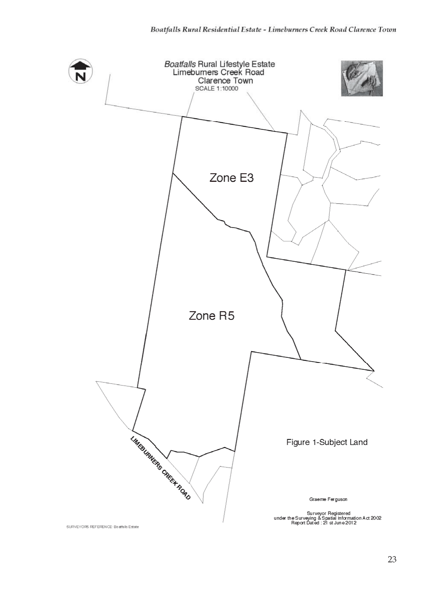
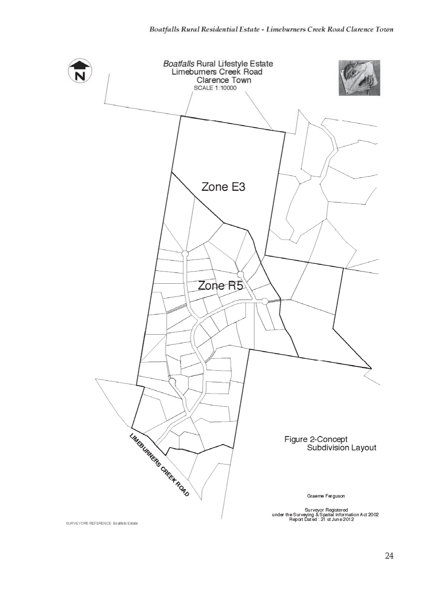
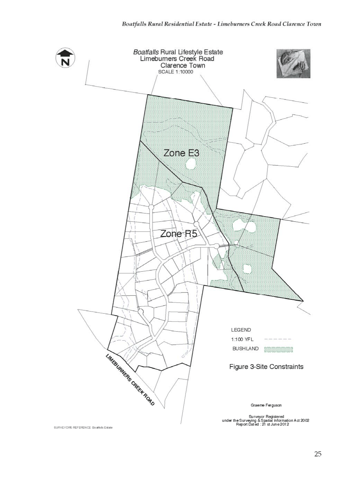
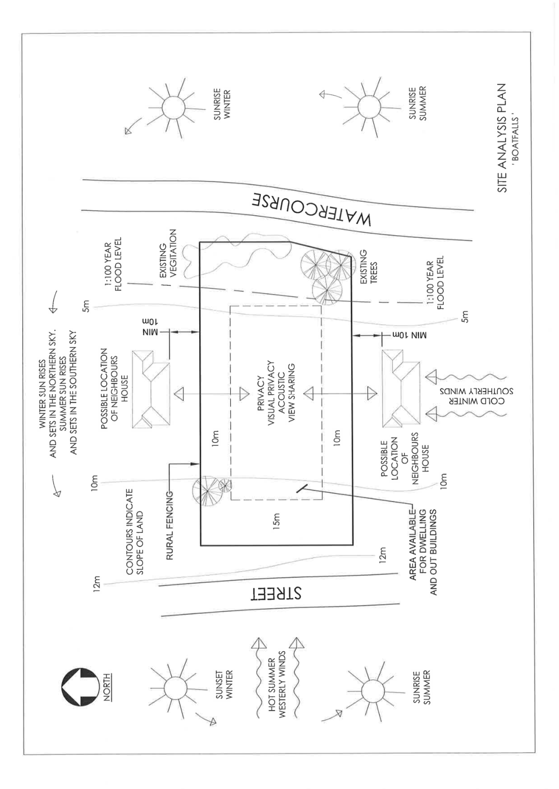

## 7. On‐site Disposal Requirements and Recommendations

The installation and operation of the on‐site sewage disposal system should be undertaken in accordance with the following guidelines.

### 7.1 Buffer Setbacks

The  location  of  the  disposal  area  must  be  in  accordance  with  the  following  buffer dimensions for the chosen irrigation method shown in Table 5 below.

Table  5:  Buffer  Distance  Requirements  for  Drip  &  Trickle,  Spray  &  Subsurface  Disposal Mechanisms

| BUFFER DISTANCE (m) |  |  |  |  |  |  |
|---|---|---|---|---|---|---|
| Feature | Drip/Trickle |  | Spray |  | Subsurface |  |
|  | Upslope | Downslope | Upslope | Downslope | Upslope | Downslope |
| Dwelling | 6 | 3 | 15 | 15 | 6 | 3 |
| Driveway | 6 | 3 | 6 | 3 | 6 | 3 |
| Path | 6 | 3 | 3 | 3 | 6 | 3 |
| Pool | 6 | 3 | 6 | 6 | 6 | 3 |
| Dam | 40 | 40 | 40 | 40 | 40 | 40 |
| Permanent Water | 100 | 100 | 100 | 100 | 100 | 100 |
| Intermittent Water | 40 | 40 | 40 | 40 | 40 | 40 |
| Property Boundary | 6 | 3 | 6 | 3 | 6 | 3 |

### 7.2 Drainage

The surface of the disposal area should be graded to prevent effluent ponding on or running off the disposal area.  A raised soil berm should be provided down slope from the disposal area to intercept any rainfall runoff from the disposal area and encourage it to filter through the soil.

An uphill diversion drain must be constructed to protect the disposal area from surface run off  from  surrounding  areas.    Upslope  subsurface  seepage  should  be  intercepted  and diverted away from the disposal area by a subsoil drain.

### 7.3 Installation

The installation of the selected treatment system is to be performed by a qualified agent of the manufacturer.

### 7.4. Vegetation

The effluent disposal site must to be vegetated before effluent is applied.  The vegetation can include grasses, shrubs and trees.

Vegetation  should  be  regularly  mowed  and  pruned  to  maintain  the  rate  of evapotranspiration.    Clippings  and  weeds  removed  from  the  disposal  area  should  be disposed  of  away  from  the  area  to  avoid  increased  nutrient  loads  on  the  irrigation  area. Likewise, clippings and other vegetation should not be disposed of on the area.  Buffer zones (Section 7.1) adjacent to the irrigation area should also be planted with suitable vegetation.

### 7.5. Effluent Quality

Effluent  from  the  selected  wastewater  treatment  system  is  to  be  disposed  of  on  the irrigation  area  in  accordance  with  the  requirements  of  AS  1547  and  Table  14  of  On‐Site Sewage Management for Single Households.  Methods to reduce effluent strength include:‐

i. Using  the  minimum  recommended  amounts  of  low  phosphate,  biodegradable  liquid detergents and cleaning agents;

ii. Avoiding large quantities of bleaches, disinfectants and whiteners; and

iii. Minimising  the  amount  of  solid  waste  entering  the  septic  system,  especially  non‐ biodegradable items such as plastics.

It is important that the occupant makes a consistent effort to reduce the strength of the treated effluent.

### 7.6. Maintenance

The  disposal  system  should  be  regularly  checked  to  ensure  that  it  is  operating  correctly. Signs of failure include surface ponding, effluent run off, erosion, leaching of the soil, poor vegetation growth including burnt vegetation, odour or the formation of surface crusts.

> [Picture on page 21: a picture, saved as a picture (images/part-d8-boatfalls-rural-residential-estate-page-21-1.gif, 150 dpi).]

> [Picture on page 22: a picture, saved as a picture (images/part-d8-boatfalls-rural-residential-estate-page-22-1.gif, 150 dpi).]

> [Picture on page 23: a picture, saved as a picture (images/part-d8-boatfalls-rural-residential-estate-page-23-1.gif, 150 dpi).]

> [Picture on page 24: a picture, saved as a picture (images/part-d8-boatfalls-rural-residential-estate-page-24-1.gif, 150 dpi).]
