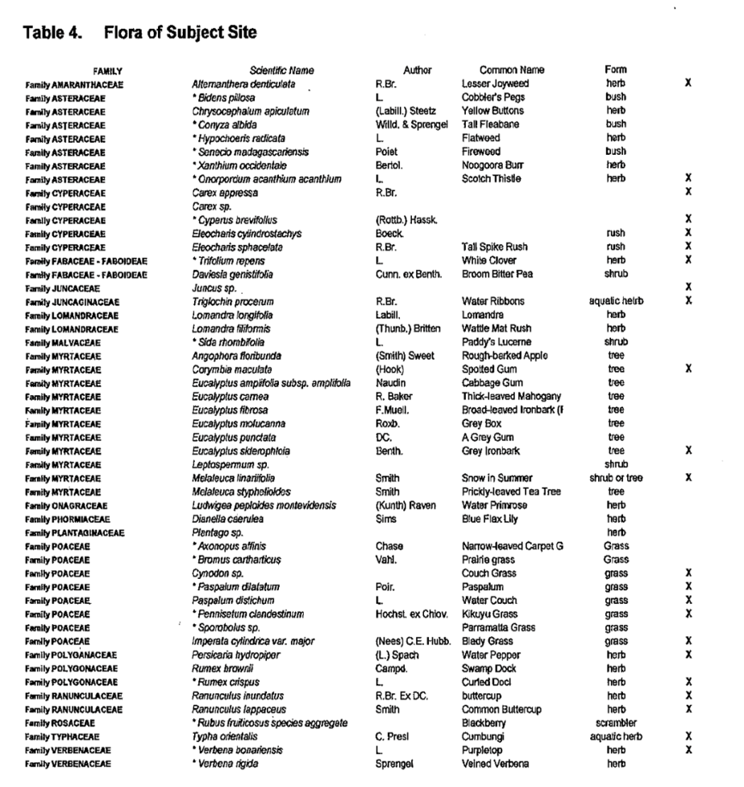

# Dungog Development Control Plan - Part D8 Boatfalls Rural Residential Estate

> This chapter is split into 3 section file(s), one per numbered heading, in the order they appear in the PDF.

Source PDF: [PART-D.8-Boatfalls-25.5.20.pdf](PART-D.8-Boatfalls-25.5.20.pdf)

### DUNGOG DEVELOPMENT CONTROL PLAN No 1

### PART D.8

### BOATFALLS RURAL RESIDENTIAL ESTATE

### D.8 – BOATFALLS RURAL RESIDENTIAL ESTATE

### 8.1 APPLICATION

This Local Area Plan applies to all land within the Boatfalls Rural Residential Estate as shown edged heavy black on the Development Control Plan map (Figure 1).

The land to which this plan applies comprises an area of 105 hectares and is zoned R5 Large Lot Residential and E3 Environmental Management pursuant to Dungog LEP 2014. The site has the potential to create a community comprising some 66 dwellings, set in a rural landscape.

### 8.2 AIM AND OBJECTIVES

The aims of the Plan are:‐

a) To  attain  a  high  quality  rural  residential  precinct  which exhibits  a  good  visual presence and environmental sustainability.

b) To provide guidelines for property owners in respect to the design and siting of dwellings, structures, property access, and protection of environmental values of the site.

c) To encourage development which is sympathetic to the environmental qualities and land capability of the site.

d) To  provide  site  planning  guidelines  including  measures  to  be  taken  to  reduce erosion and minimise the loss of native vegetation.

e) To ensure development occurs in an orderly and cost effective manner and in accordance with sound planning principles.

f) To ensure that development occurs in a manner that achieves and satisfies the requirements of Planning for Bushfire Protection 2006.

g) To encourage building designs which are aesthetically pleasing, energy efficient and bushfire resistant.

h) To retain the visual amenity of the site by maximising the retention of existing vegetation and the incorporation of appropriately selected landscaping.

i) To  ensure  site  clearing  is  minimised  and  watercourses  are  protected  and enhanced through appropriate landscaping.

j) To provide guidance in respect to appropriate on‐site effluent disposal systems.

### 8.3 SUBDIVISION

The concept road layout and subdivision design is shown in Figure 2.  Internal roads are to be designed in accordance with Council’s subdivision guidelines.  At a minimum, the following elements are to be incorporated into the design:‐

1\) Roads to be designed in accordance with Council’s Roads Management Strategy, Policy  C3.18  Provision  of  Rural  Road  Services,  AUSPEC  documentation  and relevant Austroads Standards, where applicable.  Roads to be designed where

possible to reflect land topography.

2\) All  lots  to  accommodate  an  unconstrained  area  of  3000m2  within  which  a dwelling, effluent disposal area and Asset Protection Zone (APZ) can be located having regard to other provisions of this Plan.  This area shall not be subject to hazards such as erosion; landslip; poor drainage; flooding; or vegetation/habitat assets; scenic amenity; buffer areas; or the like and is capable of on‐site disposal of domestic effluent within the criteria set in Clause 2.6.5.

3\) Vegetated screen 10m wide along the Limeburners Creek Road frontage.

4\) The provisions of NSW Rural Fire Service – Planning for Bushfire Protection 2006.

5\) Aboveground electricity supply to all lots.

6\) Underground telecommunication services to all lots.

7\) Cats and dogs to be kept within the residence or in a secure enclosure at all times.

8\) Prohibit  the  use  of  motorbikes  and  other  recreational  vehicles  in  constrained areas.

9\) Boundary fencing to be limited to timber post and rail/wire rural type fencing which permits the movement of native fauna across the site and is  free from ‘netting type’ material.

10\) Stormwater management in accordance with Council’s requirements.

11\) Minimising  native  Vegetation  removal  through  sensitive  design  and maximisation of the cleared lands for urban development.  Incentives for this are provided via the provision of reduced boundary setbacks for structures.

### 8.4 ENVIRONMENTAL MANAGEMENT

An environmental management plan is to be prepared for the construction phase for each stage of the development where roadworks are required to be constructed (EMP Construction Phase).  The EMP is to provide:‐

A  framework  for  the  control  of  likely  environmental  impacts  from  building construction  activities,  including  practical  and  achievable  performance requirements, a system of monitoring and reporting corrective and preventative action; A framework for the control of likely environmental impacts from Rural Lifestyle development,  including  practical  and  achievable  performance  requirements,  a system of monitoring and reporting corrective and preventative action; and the community with assurance by demonstration that the management of this construction project is conducted in an environmentally acceptable manner.

Those matters to be included in the EMP ‐ Construction Phase are to include:‐

Copies of relevant development consents and construction certificates; Approved engineering plans; Approved landscape plan; Sedimentation controls; Contractors  contact  details  include  key  personnel  responsible  for  the construction – site manager, contractors, etc; Location of compound and management of equipment and wastes generated by the compound;

Management of transport to/from and within the site; Rehabilitation of compound at completion; Awareness and training of senior staff of environmental issues likely to occur on site; Incident management and reporting; Emergency contacts; Minimisation of noise; dust; traffic; sediment discharge; spillage of fuels; impact on native vegetation; waterways and heritage, waste and weed management; Verification, monitoring & recording; and Management of complaints.

Environmental management of the property will become the responsibility of each title holder  following  the  sale  of  the  land  from  the  developer  to  the  purchaser.    As  the environmental attributes of each allotment differs, a standard set of requirements have been prepared.  These requirements apply to all lots except where stated.

### 8.5 ENVIRONMENTAL MANAGEMENT REQUIREMENTS

#### 8.5.1  Landscaping & Rehabilitation

The  property  owner  is  responsible  for  ensuring  the  landscaping  located  on  the allotment which has been provided by the developer in accordance with an approved landscape  plan,  is  maintained  in  perpetuity.    The  landowner  is  also  responsible  for maintaining the grass on the verge and any trees located on the verge.

Landowners are encouraged to undertake additional plantings sourced from the list of plants indigenous to the local area as listed in Appendix 1.  Plans submitted with an application for a Construction Certificate are required to be accompanied with a site landscape plan detailing additional landscaping works.

The ongoing use of the land must be managed to achieve the following objective:‐

#### Objective

To  manage  and  maintain  landscaping  and  landscaped  areas  within  the  estate  in accordance with the approved landscape management plan.

#### Procedures

1\) Limit the use of chemical sprays to prevent plant growth.

2\) Maintain landscaped areas by selective pruning, including roots, stems, branches etc,  to  inhibit  vegetation  excessive  propagation  (see  details  of  maintenance obligations below).

3\) Ensure that any material transported to the site is weed free.

4\) Use work methods that will minimise spread of weeds.

5\) Imported soils and/or vehicles should be free of seeds or viable plant material.

6\) Remove any noxious weeds and dispose of appropriately.

7\) Remnant and riparian vegetation on the site is to be retained.

8\) Landscaping  should  maximise  vegetation  that  is  indigenous  to  the  area  and

designed in a way that is appropriate to the landscape.

9\) Landscaping  of  lots  should  minimise  the  use  of  exotic  trees  or  shrubs.  No environmental weeds should be used in any landscape plan.

10\) Where vegetation is required to be removed to achieve a required APZ, in lieu of vegetation removal, building material and/or construction standards should be increased.

#### 8.5.2  Landscape Plan Maintenance Requirements

The  obligation  of  protecting  and  maintaining  the  landscape  works  including  the Endangered Ecological Community vegetation shall transfer to the land owner/s at the completion of the Developer’s one (1) year maintenance period and be applied by the land  owner/s  in  accordance  with  this  document  and  the  approved  Landscape Management Plan.

Street Trees ‐ At the end of the one (1) year maintenance period of the last stage of the estate, the Developer shall remove all tree guards from the site at which time control of all landscape elements within the road reserve shall transfer to Dungog Shire Council.

#### 8.5.3  Stormwater Management, Flooding and Dams Objective

To control, minimise or prevent the release of contaminants to the drainage system and waterways.

#### Procedures

1\) Separate  all  animal  enclosures  and  holding  pens  from  permanent  or  semi‐ permanent watercourses and major drainage lines to reduce flows of polluted storm water into watercourses.

2\) Rationalise the use of fertilisers and animal manures to prevent degradation of receiving waters and water quality in streams.

3\) Clearly  understand  the  water  requirements  of  your  property  prior  to undertaking any major works.

4\) On‐site water treatment disposal areas shall not be within 40m of a watercourse or drainage channel.

5\) Ensure motor vehicles, plant or machinery is washed away from watercourses or drainage lines and on a permeable surface.  This will restrict detergents, grease and solids from entering waterways and allow them to be filtered by the existing ground cover.

6\) Domestic vehicle or machinery repairs should be carried out in a bunded area. Any waste oil is to be collected and stored before being disposed off‐site.

7\) As  opposed  to  allowing  excessive  organic  matter  to  accumulate  in  residential areas and be eventually swept into the waterways, the material can be collected and composted.

8\) When cleaning hard stand areas like driveways and footpaths, sweep rather than

hose. This reduces the amount of sediment entering the stormwater system.

9\) Avoid using pesticides and herbicides in rain or wind periods.

10\) Landscape using native plants as they require less water and fertiliser than their introduced counterparts.

11\) Carry out the correct sediment and erosion control initiatives as detailed below.

#### 8.5.4  Flora and Fauna

In relation to the native flora and fauna, the development and ongoing use of the land must be managed to achieve the following objective:

#### Objectives

k) To control, minimise or prevent the destruction of native vegetation, limit the overall impact of the development on vegetation and native fauna, and prevent the spread of noxious weeds;

l) To prevent adverse impacts on native fauna, including threatened species; and

m) To manage pets/companion animals so as to prevent adverse impacts on local biodiversity and the amenity of existing and future owners and residents.

#### Procedures

1\) Minimise  soil  compaction  or  disturbance.    All  disturbed  areas  must    be rehabilitated with saved topsoil and salvaged plants.

2\) All native vegetation within the riparian areas should be retained in accordance with the approved Landscape Management Plan.

3\) Native grasses should be planted in preference to exotic grasses to retain the native vegetation of an area and to reduce maintenance and resources needed by exotic grasses, such as fertilisers and excessive watering.

4\) Pockets of regenerating bushland and young trees must be protected during any building  construction  work  with  suitable  protective  fencing  and  restricted access, including material stockpiling.

5\) Minimise the use of pesticides and herbicides around areas of native vegetation.

6\) Hollow bearing trees are important to the protection of native fauna and every effort should be made to minimize their removal.  Where this is unavoidable, care  should  be  taken  to  ensure  the  protection  of  any  species  which  may  be roosting in the tree prior to removal.  Where the presence of fauna is known, the services of a qualified ecologist should be employed to advise on the best method of removing the tree.  Nest boxes attached to remaining trees will assist in mitigating impact caused by the removal of hollow bearing trees.

7\) All  native  fauna  (including  snakes)  are  protected.    Animals  shall  not  be unnecessarily disturbed or harmed.

8\) Feeding of native animals is prohibited.

9\) Minimise movement of vehicles through sensitive areas.

10\) When operating motor vehicles or gardening machinery take particular care  not to harm native fauna.

11\) All boundary fencing to be of a type that allows for the unrestricted movement of native animals through the site, e.g. five strand plain wire rural fencing; no netting.

#### 8.5.5  Management of Waterways and Riparian Zones

In relation to the native vegetation located within and adjacent to watercourses and dams, the development and ongoing use of the land must be managed to achieve the following objective:‐

#### Objective

To  protect  and  enhance  habitat  for  native  fauna  and  the  ecology  of  those  areas containing threatened species, to assist in maintaining the quality of water leaving the site and to maintain the rural character of the estate.

#### Procedures

1\) All remnant and planted riparian vegetation within the estate, including around dams,  is  to  be  retained,  enhanced  and  protected,  unless  a  separate  approval from  the  Hunter‐Central  Rivers  Catchment  Management  Authority  has  been obtained.

2\) Minimise the use of pesticides, herbicides and fertilizers around areas of native vegetation.

3\) Planting  of  appropriate  native  trees  along  watercourses  and  around  dams  for bank stability and erosion control is encouraged.

4\) Do not remove streamside vegetation (this includes reeds, trees and grasses), unless directed as part of an approved catchment and waterway management program.

5\) Control rabbits or other pests to allow effective regeneration.

6\) Involvement of lot owners in voluntary groups such as Landcare is encouraged to promote community involvement and an awareness of environmental issues.

#### 8.5.6  Livestock Management Objective

To manage pets / companion animals to prevent adverse impacts  on native fauna and on existing and future owners and residents of land within the Estate.

#### Procedures

1\) All pets are to be kept in accordance with the Dungog Shire Council Companion Animal Management Plan 2007.

2\) When not under the effective control of an adult, all cats and dogs must be kept within residences or within secure enclosures at all times.

3\) Ensure the keeping of livestock does not contribute to a decline in water quality, spread of noxious and environmental weeds, contribute to unreasonable noise and  odours,  create  unmanageable  effluent  and  wastewater  pollutants  via nutrient run off or create soil compaction and erosion.

4\) Horses,  bovines,  goats,  sheep,  and  other  introduced  grazing  animals  are  not permitted within the native vegetation offset area of the PVP.

5\) In order to reduce land use conflict and environmental issues, livestock are to be stocked  at  the  appropriate  densities  in  accordance  with  the  Department  of Industry and Investment guidelines.

#### Relevant Supporting Documentation

For  further  detail  in  relation  to  management  of  companion  animals  refer  to  the Companion  Animals  Act  1998  and  to  Dungog  Shire  Council’s  Companion  Animal Management Plan 2007.

#### 8.5.7  Bushfire Management

The site located within a bush fire area and in accordance with legislative requirements a  bushfire  threat  assessment  was  prepared  in  2012.    The  bushfire  assessment concluded that the proposal is located in an area of low to moderate bushfire risk and meets  the  requirements  of  the  NSW  Rural  Fire  Service.    All  allotments  have  been constructed so as to comprise an area of land which is clear of native vegetation for the location of a sizable dwelling together with the required Asset Protection Zone (APZ).

An Asset Protection Zone (APZ) is an area between a bush fire hazard and the building, which is managed to minimise fuel loads, inhibit a fire path and reduce the effects of heat, flame, ember and smoke attack.  Put simply it keeps the effects of the fire away from the building.  The size of the APZ is based on vegetation type, slope and levels of construction.    The  APZ’s  provided  above  are  indicative  only.    Every  development application submitted for a dwelling on a lot must be accompanied by a Bushfire Threat Assessment  (BTA)  which  determines  the  required  APZ.    The  NSW  Rural  Fire  Service provides guidelines for the preparation of a BTA and the creation and maintenance of APZ’s (www.rfs.nsw.gov.au).

When preparing a development application for the erection of a dwelling house, it is a requirement that the provisions of RFS Guidelines be followed.

#### 8.5.8  Visual amenity Objective

To ensure buildings are appropriate within their setting and complimentary to the rural environment.

#### Procedures

1\) Dwellings should be located, designed and constructed of appropriate materials to not be visually obtrusive or detract from the rural character of the area.

2\) Dwellings must be designed to reflect the local landform, colours and materials present  on  the  site  and  surrounds.  Typically,  low  building  forms,  timber  and corrugated iron reflect the rural character of the area. Roof pitches should not exceed 30 degrees.

3\) Dwellings are to be sited so as to comply with the provisions of Clause 16.

4\) Limit  cuts  and  bench  construction  for  house  sites,  outbuildings  and  access driveways. Minimise  ground  disturbance  generally  and  utilise  erosion  controls measures around disturbed areas.

5\) Keep tall native vegetation plantations an appropriate distance away from the main dwelling.

#### 8.5.9  Erosion and sediment control Objective

To  avoid  the  adverse  impacts  associated  with  uncontrolled  clearing  of  land  and inappropriate construction techniques.

#### Procedures

1\) Any filling to a depth greater than 200mm is to be compacted to a 95% standard in accordance with AS1289‐E(1.1).

2\) For  any  disturbed  or  filled  land,  appropriate  sediment  and  erosion  control measures shall be utilised and maintained until adequate grass cover has been established.

3\) Identify existing areas affected by soil or water erosion and undertake mitigation measures.  Improving vegetation cover in gully heads and around erosion‐prone areas can assist in minimising soil loss.

4\) Planting of appropriate native trees along water courses for bank stability and erosion control is encouraged.

5\) All  on‐site  roads  shall  be  constructed  so  as  to  minimise  surface  run‐off  and sedimentation  of  watercourses.    Open  swale  drains  shall  be  used  to  trap overflow and drain the road surface.

6\) Alignment of all roads and access tracks shall follow contours, minimise the need for batters, and avoid unnecessary crossings of draining lines.

#### 8.5.10 Fencing Objectives

To allow for the passage of native fauna; and To avoid adverse impacts on environmentally sensitive areas.

#### PROCEDURES

1\) All boundary fencing is to be constructed in a manner to allow for the movement through the site by native fauna.

2\) For visual amenity purposes ensure rural fencing is generally consistent in design and scale.

3\) Fencing  off  the  areas  of  the  site  if  they  are  susceptible  to  over  grazing, pedestrian or development pressure.

4\) Those  areas  of  the  site  that  have  been  fenced  for  the  purpose  of  protecting recently planted areas of native vegetation are to be maintained.

#### 8.5.11 Minimising Edge Effects of Wallaroo State Forest

The environmental integrity of the adjoining Wallaroo State Forest could be impacted if landowners  whose  properties  so  adjoin,  fail  to  properly  manage  their  land  in  a sustainable  manner.    As  the  Forest  presents  a  high  bush  fire  risk,  landowners  must ensure  an  APZ  in  excess  of  20m  is  maintained  at  all  times.    Landowners  should  not deposit waste material into the Forest or allow domestic animals to access to forest.

This provision only applies to Lots 110, 111 and 112 in DP 1195463, Lots 123, 124 and 126 in DP 1220678 and Lots 132 to 136 in DP 1232974.

### 8.6 RESIDENTIAL DEVELOPMENT

#### 8.6.1  Dwelling‐Houses and Other Structures ‐ Planning   Principles

a)  All new structures are to be sited so as to comply with the following setbacks:‐

50m from Limeburners Creek Road 15 metres from internal roads 10m from side and rear boundaries 40m from a watercourse Outside of constrained areas (Figure 3)

b) All new habitable structures are to be sited so as to lie above the 1 in 100 year flood  level.  Finished  floor  levels  of  habitable  buildings  shall  be  at  least  500mm above the 1 in 100 year flood level.

c) All  non‐habitable  structures  are  to  be  constructed  above  the  1  in  20  year  flood level.

d) New dwellings are to be sited and designed so as to:‐

(i) respect the visual privacy and views enjoyed from existing and potential dwellings within the Estate.

(ii) Avoid  potential  for  erosion,  sedimentation  and  contamination  of watercourses and water storage areas, and

(iii) minimise the removal of native vegetation.

(iv) reflect  a  high  quality  of  finish  and  be  of  a  scale  which  compliments  the character of the rural setting.

(v) encourage energy efficient housing and solar design

(vi) protect the riparian environment of watercourses by the incorporation of appropriate water management and erosion controls.

(vii) encourage housing which is of a design which  reduces  exposure  to the risks of bushfire.

(viii) ensure building colours be limited to earthy tones with no highly reflective materials.

(ix) ensure a potable water tank with a minimum storage capacity of 40,000 litres plus a static water supply for firefighting purposes of 10,000 litres for lots up to 1hectare in area, and 20,000 litres for lots in excess of 1 hectare in area.

#### 8.6.2  Building Siting and Design

Each of the allotments has unique physical characteristics and prior to commencing the design  of  a  dwelling,  owners  should  have  prepared  a  detailed  site  assessment. Constrained areas are shown on Figure 3.  This assessment and site plan is required to be submitted with applications for development on each allotment.  An example of a Site Plan is provided as Figure 4.

The elements which need to be taken into consideration when preparing the plan are:‐

> [Picture text on page 11 is stored in the PDF without readable letters (no character map), so it could not be copied; see the original PDF.]

Land contours and slope – a detailed site survey at 0.5m contour intervals with the locations of large trees and creek lines shown. Location of existing areas of native vegetation. Topographical  features  –  e.g.  rock  outcrops,  unique  trees,  old  access  tracks, vehicle entry point, boundaries, slope, drainage lines, etc. Bushfire Asset Protection Zones in accordance with RFS requirements. Location of existing services. Preferred route of access road, road grade and site drainage. Areas which will be retained in their natural state – e.g. < 20m either side of watercourses, existing treed areas outside of the ‘building area’, trees, etc View corridors and location of buildings on adjoining properties. Landscaping proposed to mitigate visual impact of the dwelling on the site. Type of entry treatment, e.g. entry statement and front fencing detail. Relative RL of proposed dwelling and building platforms. Proposed storm water drainage of hard surface areas. Proposed location and size of any dams and water tanks. Proposed  location  and  type  of  on‐site  effluent  disposal  system  and  irrigation areas. Proposed location of services from road to dwelling/building and if underground or overhead supply.

#### 8.6.3  Specific Controls Building Design

All  structures,  i.e.  dwelling‐houses,  garages,  sheds,  fencing,  shall  be  designed having  consideration  to  the  rural  character  of  the  area,  the  topography  and landscape features of the site. Particular consideration will need to be given to building  location,  solar  access,  form,  colour  and  construction  materials. Applicants will be required to demonstrate that these considerations have been taken into account. Council encourages the construction of non‐obtrusive structures which fit well within the landscape. Buildings should be designed to accommodate the topography of the site and should not require cut or fill in excess of 1 metre in depth. Buildings  should  be  designed  to  be  energy  efficient  through  the  use  of insulation, correct orientation on the site, passive solar design, cross ventilation and other energy saving technologies. In particular dwellings should be designed to  locate  living  rooms  to  take  advantage  of  winter  solar  radiation,  whilst  the design should minimise the extent that summer solar radiation enters windows on  the  northern  and  western  facades  of  buildings.  Dwellings  are  required  to meet an acceptable energy rating as determined by BASIX. The  design  and  height  of  the  dwelling  must  respond  to  the  natural  and  built features of the area. Building materials must comply with bushfire safety standards.

The dwelling and outbuildings must generally be of muted colours to blend with the surrounding natural setting. The use of verandas and awnings are encouraged to reduce the apparent bulk of dwellings. Garages on the front façade of dwellings must be articulated. Fences, screens and retaining walls must be compatible with the overall building and landscape design.

#### Building Materials

Roofing materials should be non‐reflective. Wall materials should be earthy tones.

#### Specific Controls

Each allotment contains an unconstrained area in excess of 3000m2. This area is considered sufficient to accommodate a large dwelling, effluent disposal areas, and asset protection zone. Dwellings  and  on‐site  sewerage  disposal  areas  must  comply  with  set‐back requirements. In preparing site plans, all buildings should be located within the unconstrained area of the lot. Areas not used for buildings, outbuildings, recreational facilities and driveways should be set aside for landscaping using species native to the area, and for small scale agricultural pursuits. A list of these species appears as Appendix  1.  Details  of  the  landscaping  must  be  shown  on  the  site  plan submitted with the development application for each allotment. Provision to be made for cats and dogs to be contained within the allotment when not on a leash.

#### 8.6.4  Bushfire Controls

All  development  must  satisfy  the  provisions  of  Planning  for  Bushfire  Protection  2006 including provisions of asset protection zone, water supply, building construction and access standards.

The design of the dwelling and precautionary measures taken by the residents in the lead up to the bushfire danger period are the most important elements for ensuring a dwelling does not burn down during a bushfire.  A number of publications are available for  information  on  house  design  and  safety  precautions.    Information  should  be obtained from the NSW Rural Fire Service website:‐

Everyone’s Guide to Bushfire Control. Everyone’s Guide to Bushfire Prevention in Urban Bushland Areas. Everyone’s Guide to House Design and Modification in Bushfire Prone Areas. Planning for Bushfire Protection: A guide for land use planners, fire authorities, developers and home owners.

It has been proven that certain building materials and designs offer better protection and  resistance  to  bushfire  and  should  be  investigated  for  use  in  new  house  designs.

Residents are advised to contact the NSW Rural Fire Service about appropriate hazard reduction measures and regimes for areas surrounding their dwelling.

#### 8.6.5  On‐Site Effluent Disposal Systems

All lots have the capability of managing effluent via means of an aerated/spray irrigated waste disposal system.  An on‐site effluent disposal assessment was undertaken for the whole site and recommended the following design criteria:‐

Required irrigation area of 1050m2 for a four bedroom dwelling with a reserve area of 1050m2 which is to be set aside in the event of failure of the primary disposal area. Additional  design  details  are  included  as  Appendix  2  –  Extracts  from  On‐site Effluent  Disposal  Investigation  838  &  840  Limeburners  Creek  Road  – Ecobiological June 2012.

A separate application to install and operate an on‐site sewage management system must be submitted to Council for approval prior to any development requiring sewage disposal occurring on any lot within the subdivision.

The design of on‐ site sewage management systems should have regard to the design specifications  provided  in  the  geo‐technical  report  prepared  by  Ecobiological  (June 2012).

#### 8.6.6  Dams

Dams shall be designed and constructed in accordance with the requirements of the Department  of  primary  Industries  –  NSW  Office  of  Water  (NOW).  The  location  of proposed dams must be shown on the site plan.

#### 8.6.7  Household Waste Disposal

All  dwellings  are  required  to  have  household  wastes  removed  via  Councils  domestic waste collection service.

#### 8.6.8  Recreational Motorbikes

Unregistered motorbikes are not permitted to be used on any allotments.

#### APPENDIX 1 ‐ SPECIES NATIVE TO THE LOCAL AREA

> [Picture on page 14: a picture, saved as a picture (images/part-d8-boatfalls-rural-residential-estate-page-14-2.gif, 150 dpi).]

APPENDIX 2 ‐ EXTRACTS FROM ON‐SITE EFFLUENT DISPOSAL INVESTIGATION, 838 & 840 LIMEBURNERS CREEK ROAD CLARENCE TOWN – ECOBIOLOGICAL,

#### JUNE 2012.

### 4.1 Site Investigation

Site  investigations  revealed  that  the  typical  subsurface  profile  consisted  of  a  very  dark grey/brown  sandy  clay  loam  to  varying  depths,  overlying  a  grey/brown  to  yellow/brown sandy clay with orange mottle to varying depths, overlying orange weathered sandstone. Orange weathered sandstone was not encountered within TP 3, 7 and 6; however, it was encountered at depths varying between 0.3 and 0.8m in TP 1, 2, 4 and 5.

Neither surface water nor groundwater was encountered during the investigation.

The results of the soil analysis on the representative soil samples taken from Test Pit 1, 5, 6 and 7 are shown in Table 2 below.

Table 2: Soil sampling results

| Sample | CEC | Na | K | Ca | Mg | Al | P Sorp (mgP/kg) | pH | EAT1 | ESP2 % | EC (dS/m) |
|---|---|---|---|---|---|---|---|---|---|---|---|
| TP1 | 2.25 | 0.11 | 0.07 | 1.31 | 0.71 | 0.05 | ‐ | 5.3 | 2 | 4.88 | 0.2 |
| TP5 | 5.65 | 0.47 | 0.11 | 2.92 | 2.12 | 0.03 | 309.4 | 5.2 | 2 | 8.32 | 0.4 |
| TP6 | 13.67 | 1.11 | 0.3 | 3.07 | 9.17 | 0.02 | 314.4 | 5.4 | 2 | 8.12 | 0.8 |
| TP7 | 5.32 | 0.24 | 0.12 | 2.92 | 2.04 | 0 | 209.5 | 6 | 4 | 4.51 | 0.4 |

### 4.2 Disposal Area Calculations

The on‐site effluent disposal area calculated by each of the 5 methods described in Table 1, for a 4 and 5‐bedroom residence, is summarised below in Table 3.  The water usage is based on  140L/day  per  person  with  a  4  bedroom  dwelling  having  7  people  and  a  5  bedroom dwelling having 8 people.  Worked examples of each calculation are shown in the Disposal Area Calculation Sheet in the attachments.

Table 3: On‐site Effluent Disposal Irrigation Areas & Storage Volumes.

| Method | 4‐Bedroom Dwelling |  | 5‐Bedroom Dwelling |  |
|---|---|---|---|---|
|  | Required Irrigation Area (m2) | Wet Weather Storage | Required Irrigation | Wet Weather |
| Nitrogen Loading Method 10mg/L | 392 | ( 48 ) | ( 448 ) | 54 |
| Phosphorus Loading Method 8mg/L | 667 | 11 | 762 | 12 |
| Minimum Area Method | 335 | 67 | 383 | 77 |
| Nominated Area Method | 1050 | 0 | 1200 | 0 |
| AS 1547 Method | 343 | 63 | 392 | 72 |

The “On‐site Sewage Management for Single Households” guideline recommends that wet weather  storage  be  provided  to  store  run‐off  that  will  occur  when  the  combination  of rainfall and effluent exceeds the capacity of the site to absorb water.

Section  6  describes  the  above  results  in  relation  to  the  treatment  and  disposal  systems recommended for the site.

These  figures  may  be  revised  upon  receipt  of  effluent  treatment  data  from  accredited systems  with  different  total  nitrogen  and  phosphorus  contents.    Council  may  choose  to reduce or waive the requirement for wet weather storage.

<!-- sections -->
## Sections

1. [5 Limitations to on‐site Effluent Disposal](01-5-limitations-to-on-site-effluent-disposal.md)
2. [6 Conclusions –Treatment and Disposal Options](02-6-conclusions-treatment-and-disposal.md)
3. [7 On‐site Disposal Requirements and Recommendations](03-7-on-site-disposal-requirements-and.md)
