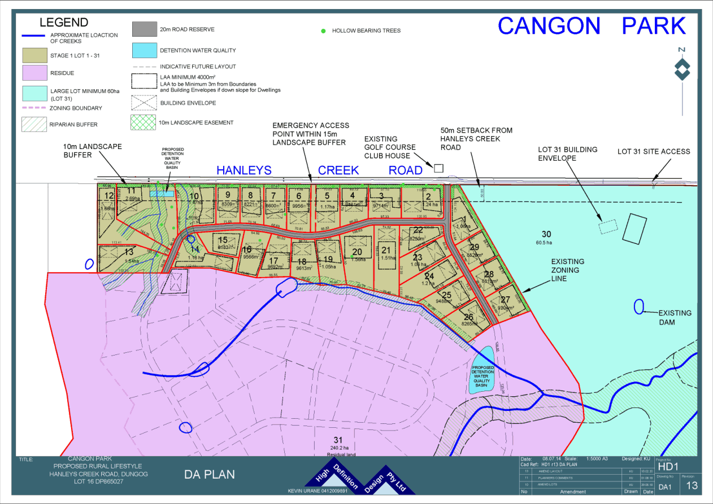
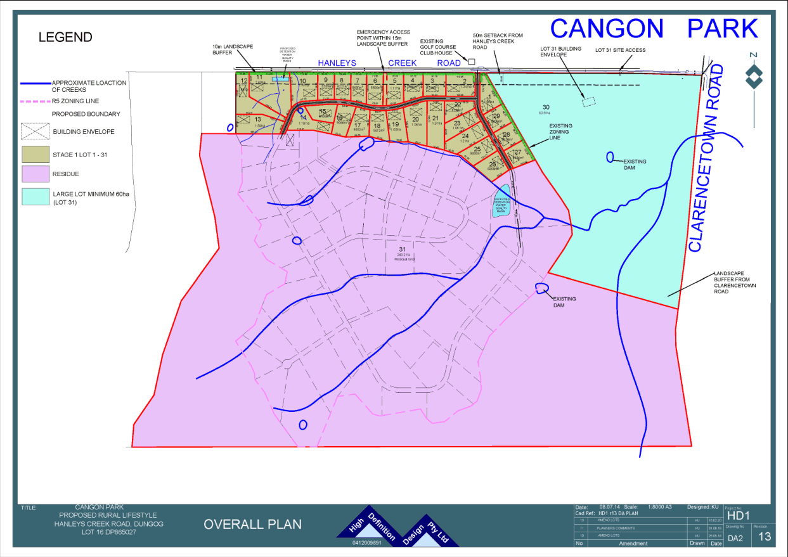

## PART 1 - PRELIMINARY

Commencement

1\. This plan has been prepared in accordance with the Environmental Planning and

Assessment Act 1979 (Division 3.2) and the Environmental Planning and Assessment

Regulation 2000 (Part 3).

2\. The plan came into force on the 1 April 2020, and was advertised on 1 April 2020 in

accordance with the Environmental Planning and Assessment Regulation 2000 (Part

3).

Name of the Plan

3\. This Development Control Plan may be cited as Dungog Shire Development Control

Plan No 1 Part D Section 9 – Cangon Park Rural Residential Development, Dungog.

The Parent Local Environmental Plan

4\. This Development Control Plan conforms with the provisions of the Dungog Local

Environmental Plan 2014, which contains the legal planning controls for the

Development of land in the Shire of Dungog.

Land to Which the Plan Applies

5\. This plan applies to all land within the Cangon Park Rural Residential Development

described as Lot 16 DP865027, Hanleys Creek Road, Dungog. The area to which the

DCP applies is Stage 1 of the Cangon Park Rural Residential Estate (FIGURE 1).

The Purpose of the Plan

6\. This plan provides more detailed provisions than those contained in the Local

Environmental Plan or in Part C.2 of DCP No.1 – Development in Rural Residential

Zones. Its purpose is to give detailed guidance for development carried out within the

specified area. The plan also indicates Councils objectives and policies for the area

which can form a basis for negotiation should a departure from the provisions of this

plan be sought.

7\. The site has the potential to create a community comprising of approximately 30

dwellings set in a rural/rural residential landscape.

8\. The principles in the plan complement the approach of a large range of lot sizes to

increase residual land management rather than one larger unmanageable parcel.

Status of the Plan

9\. The status of a Development Control Plan (DCP) under the Environmental Planning

and Assessment Act 1979 is that it is a matter Council is obliged to consider in the

determination of a development application (Clause 4.15). A DCP is however only an

‘official guideline’.

Application of the Plan

10\. Council shall take the provisions of this plan into consideration in determining

applications for subdivision, development and building in the area covered by the

plan.

11\. Where there is an inconsistency between this plan and any environmental planning

instrument, the provisions of the environmental planning instrument shall prevail.

12\. Compliance with the provisions of this plan does not necessarily imply that Council

will consent to an application. Council must consider the full range of matters listed

under of the Environmental Planning and Assessment Act 1979 (Clause 4.15) and

relevant building legislation (National Construction Code). Each application will be

considered on its merits.

13\. Council may consent to an application that departs from the provisions of this plan.

Where applications seek to depart from the provisions of this plan, they should be

accompanied by a written justification, however, as a DCP is only a guideline such

departures will not create an undesirable precedent.

FIGURE 1 – DCP Land Application, Subdivision Design and Hollow Bearing Trees Map

> [Picture on page 4: a picture, saved as a picture (images/part-d9-cangon-park-rural-residential-development-page-4-2.gif, 150 dpi).]

#### FIGURE 2 – Future Precincts Map

> [Picture on page 5: a picture, saved as a picture (images/part-d9-cangon-park-rural-residential-development-page-5-2.gif, 150 dpi).]
