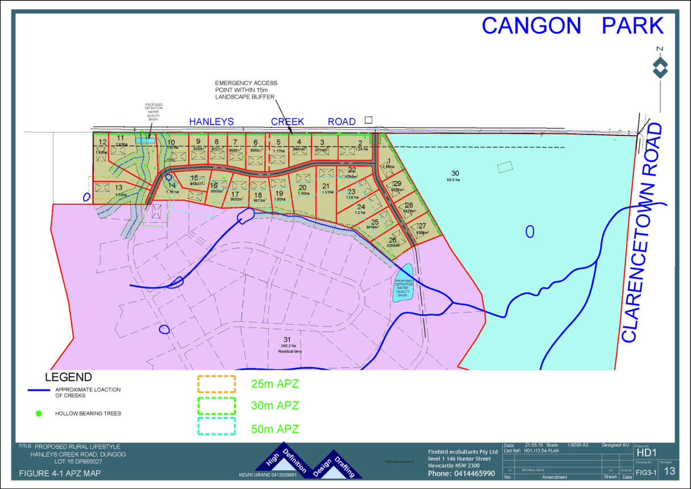

## PART 2 - OBJECTIVES AND APPLICATION OF THE PLAN

Aim and Objectives of the Plan

a) The aims of the Development Control Plan are:

1\. To attain a high quality rural residential precinct which exhibits a good visual

presence and environmental sustainability.

2\. To create a functional, integrated and connected community of which is a

highly desirable location to reside in.

3\. To provide guidelines for property owners in respect to the design and siting

of dwellings, structures, property access, and protection of environmental

values of the site.

4\. To encourage development which is sympathetic to the environmental

qualities and land capability of the site.

5\. To provide site planning guidelines including measures to be taken to

improved land management and minimise the loss of native vegetation.

6\. To retain the visual amenity of the site by maximising the retention of existing

native vegetation and the incorporation of appropriately selected landscaping.

7\. To ensure native vegetation clearing is minimised and watercourses are

protected and enhanced through appropriate landscaping.

8\. To provide guidance in respect to appropriate on-site effluent disposal

systems.

Intent / Character Statement

Cangon Park Rural Residential Development is a large lot residential area identified in Councils

Land Use Strategy and Local Environmental Plan. The area is to provide rural residential lots

to meet Dungog’s rural residential demand on the southern periphery of town.

The design of Cangon Park Rural Residential Development is to promote a balance between

development, conservation and aesthetic values and the natural topography of the site.

All lots within Cangon Park Rural Residential Development are to be provided with a full range

of services including onsite waste water, electricity and telecommunications.

The design of reserves and road layouts is to provide linkages throughout Cangon Park Rural

Residential Development and to the perimeter of the estate.

The road layout will be a combination of through roads and cul-de-sacs, which includes

perimeter roads/emergency exit for fire safety and permits easy public access to open space.

Roads are to be lined with trees and grass swales where appropriate to ensure stormwater

from roads, driveways and building structures is adequately managed; promoting the

principles of Water Sensitive Urban Design

### SUBDIVISION GENERAL

1\. The concept road layout and subdivision design is shown in (FIGURE 1). Internal roads

are to be designed in accordance with Council’s subdivision guidelines. At a minimum,

the following elements are to be incorporated into the design:

a) Roads to be designed in accordance with Council’s Roads Management

Strategy, Policy C3.18 Provision of Rural Road Services, AUSPEC

documentation and relevant Austroads Standards where applicable. Roads to

be designed where possible to reflect land topography.

b) Provide a diverse range in lot sizes. A variation will be sought to the minimum

lot size for some of the proposed lots in the RU1 zone.

c) All lots to accommodate an unconstrained area of 4,000m2 within which a

dwelling, effluent disposal area and Asset Protection Zone (APZ) can be located

having regard to other provisions of this Plan.

d) Vegetation corridor 100m wide along the Clarence Town Road frontage and 10

metres wide along Hanleys Creek Road to provide a partial visual screen of

trees.

e) The provisions of NSW Rural Fire Service – Planning for Bushfire Protection

f) Prohibit the use of motorbikes and other recreational vehicles in constrained

areas only (e.g. riparian management zones).

g) Boundary fencing to be limited to timber post and rail/wire rural type fencing

which permits the movement of native fauna across the site and is free from

‘netting type’ material and maintains the open rural nature of the landscape.

h)  Stormwater management in accordance with Council’s requirements.

i) Minimising native vegetation removal through sensitive design and

maximisation of the cleared lands for urban development – note the

subdivision layout has been designed to avoid vegetation removal.

### List of Figures

1 – DCP Land Application, Subdivision Design and Hollow Bearing Tree Map 2 – Future Precincts Map 3 - Indicative Asset Protection Zone and Hollow Bearing Tree Map

### Residential Amenity General – Planning Principles

(FIGURE 1) depicts the various rural residential themed precincts of layout.

Objective

a. To create a high class and quality rural residential development

Performance Criteria

1\. All new dwellings are to be sited to comply with the following setbacks:

i. 800m minimum from Clarence Town Road

ii. 50m Hanleys Creek Road

iii. 15 metres from internal roads

iv. 10m from side and rear boundaries

v. 40m from a watercourse

2\. New dwellings are to be sited and designed so as to:

i. respect the visual privacy and views enjoyed from existing and potential

dwellings within the Estate.

ii. avoid potential for erosion, sedimentation and contamination of watercourses

and water storage areas, and

iii. minimise the removal of native vegetation.

iv. reflect a high quality of finish and be of a scale which compliments the

character of the rural setting.

v. encourage energy efficient housing and solar design

vi. protect the riparian environment of watercourses by the incorporation of

appropriate water management and erosion controls.

vii. encourage housing which is of a design that reduces exposure to the risks of

bushfire.

viii. ensure building colours are limited to earthy tones with no highly reflective

materials.

### Visual Amenity

(FIGURE 1) depicts the building envelopes and landscaping that reflect visual amenity.

Objective

a. To ensure buildings are appropriate within their setting and complimentary to the

rural environment.

b. To minimise the visual intrusion of the development as viewed from the main road

‘entry to Dungog’.

Performance Criteria

1\. Dwellings should be located, designed and constructed of appropriate materials to not

be visually obtrusive or detract from the rural character of the area.

2\. Building envelopes should be sited so as to avoid the loss of large trees where possible.

3\. Buildings should not be located on the western ridgeline at a height above where the

apex of the roof would be closer than 5m (in vertical height) from the ground-line of

the ridge.

4\. Limit cut and bench construction for house sites, outbuildings and access driveways.

Building Design and materials

1\. All structures, i.e. dwelling-houses, garages, sheds, fencing, shall be designed having

consideration to the rural character of the area, the topography and landscape

features of the site. Particular consideration will need to be given to building location,

solar access, form, colour and construction materials.

2\. Colours for dwellings and ancillary buildings/structures should be ‘earthy type’ colours

rather than bright or light ones.  In particular, cream, white or very bright colours

should be minimised.

3\. Roofing is to be of colourbond or similar material (i.e. not tile).

4\. Buildings should be designed to accommodate the topography of the site and should

not require cut or fill in excess of 1 metre in depth.

5\. Dwellings are required to meet an acceptable energy rating as determined by BASIX.

6\. The use of verandas and awnings are encouraged to reduce the apparent bulk and

improve the amenity of dwellings.

7\. Ancillary buildings such as detached garages, sheds and carports/awnings are to have a

maximum height of 5 m and a maximum area of 150 m².   The combined area of ancillary

buildings (excluding exempt development) on each allotment is to be no more than 150

m².

### Effluent Management

(FIGURE 1) depicts the effluent management areas for each lot.

Objective

a. To ensure that all wastewater generated by each lot is treated and managed appropriately and sustainably within the boundaries of each lot.

b. To ensure that there are no off-site impacts resulting from the on-site management of wastewater on each lot within the subdivision; as well as neighbouring properties and the broader environment.

Performance Criteria

1\. Prior to development, detailed on-site wastewater management plans and reports are

to be prepared for each lot by appropriately qualified and experienced personnel.

Responsibility for these reports rests with the lot owner.

2\. The prepared report must include the results of a site and soil assessment considering

land capability for effluent management, as well as details of proposed wastewater

treatment and effluent management systems.

3\. Each lot will be serviced by an on-site wastewater treatment system that is approved

by NSW Health. A minimum standard of secondary treatment with disinfection is

required (septic tanks alone are not sufficient).

4\. Selection and management of on-site wastewater treatment systems will be the

responsibility of lot owners, in compliance with Council’s approval process under the

NSW Local Government Act 1993 (s68).

5\. On-site wastewater treatment systems are to be regularly inspected and serviced by

appropriately qualified personnel as per the current NSW Health Certificate of

Accreditation for the specified system.

6\. All treated effluent is to be land-applied using appropriately designed effluent

management (disposal) systems, being subsurface drip irrigation. Conventional

absorption or evapotranspiration/absorption systems (trenches and beds) are not

considered appropriate due to the existing constraints identified throughout the site

and its location within a drinking water catchment.

7\. Upstream stormwater is to be diverted away from effluent treatment areas.

8\. All effluent management systems must be appropriately sized for the likely

(maximum) wastewater load using current NSW and national best- practice design and

sizing guidelines, including (but not limited to) the NSW Environment and Health

Protection Guidelines: On-site Sewage Management for Single Households (DLG, 1998)

and AS1547:2012 - Onsite Domestic Wastewater Management (Standards Australia,

2012).

9\. Effluent irrigation systems (surface and subsurface) are to be designed, installed and

managed in accordance with the above guidelines as well as the NSW Environment

Guidelines: Use of Effluent by Irrigation (DEC, 2004).

10\. Effluent must not be applied within designated setback buffers, as recommended in

NSW Environment and Health Protection Guidelines: On-site Sewage Management for Single Households.

11\. Effluent must not be applied within any areas identified as unsuitable for effluent

management on individual lots, as per the on-site wastewater management report

and plan prepared for that lot.

12\. The minimum soil depth for effluent irrigation systems (surface or subsurface) is

600mm. On each lot, appropriate areas with adequate soil depth should be used, or

imported topsoil should be used to achieve the minimum required soil depth

throughout the entire effluent management area.

13\. Conventional or modified absorption trenches and beds would only be considered

appropriate in areas where at least 1,200mm of free draining soil is present

throughout the entire effluent management area.

14\. During installation of the effluent management system on each lot, native soils should

be amended with gypsum at an appropriate application rate to improve soil structure

and minimise erosion and dispersion.

15\. All effluent management systems must be properly installed and commissioned by

appropriately qualified and experienced personnel, in accordance with the

manufacturer’s instructions and any Council approval conditions.

16\. All effluent management systems must be appropriately vegetated, preferably using

turf or groundcover species as listed in Appendix 7 of the NSW Environment and

Health Protection Guidelines: On-site Sewage Management for Single Households

(DLG, 1998). Cut vegetation should be removed from the effluent management area

to maintain nutrient budgets.

17\. All on-site wastewater treatment and effluent management systems must be

accessible, clearly identified and available for routine inspection by Council during and

following construction, and/or, as required.

### Vegetation Communities

(FIGURE 1) depicts the vegetation of significance, being the hollow bearing trees.

Objective

a. To control, minimise or prevent the destruction of native vegetation, limit the overall

impact of the development on vegetation and native fauna, and prevent the spread

of noxious weeds.

b. To prevent adverse impacts on native fauna

c. To manage pets/companion animals so as to prevent adverse impacts on local

biodiversity and the amenity of existing and future owners and residents.

Performance Criteria

1\. Minimise soil compaction or disturbance. All disturbed areas must be rehabilitated

with saved topsoil and salvaged plants;

2\. All native vegetation within the riparian areas should be retained and managed in

accordance with the approved Landscape Management Plan;

3\. Pockets of regenerating bushland and young trees must be protected during any

building construction work with suitable protective fencing and restricted access,

including from material stockpiling;

4\. Minimise the use of pesticides and herbicides around areas of native vegetation;

5\. Hollow bearing trees are important to the protection of native fauna and every effort

should be made to minimize their removal. Where this is unavoidable, an ecologist

should be present during any habitat tree removal to ensure the protection of any

species that may be roosting;

6\. Restriction on the ownership of cats

7\. All native fauna are protected under the National Parks and Wildlife Act 1974. Animals

shall not be unnecessarily disturbed or harmed;

8\. Feeding of native animals is prohibited;

9\. Restriction of cattle from the riparian management zones;

10\. Minimise movement of vehicles through sensitive areas

11\. All boundary fencing to be of a type that allows for the unrestricted movement of native

animals through the site, e.g. Five strand plain wire rural fencing; no netting.

### Riparians Lands Management

(FIGURE 1) depicts the riparian corridors for the identified watercourses.

Objective

a. To maintain and improved the riparian areas that will in turn improve the ecology of

the area, assist in maintaining the quality of water, and maintain the rural character

of the estate.

Performance Criteria

1\. All remnant and planted riparian vegetation within the estate, including around dams,

is to be retained, enhanced and protected, unless a separate approval from the

Hunter-Central Rivers Catchment Management Authority has been obtained;

2\. Minimise the use of pesticides, herbicides and fertilizers around areas of native

vegetation;

3\. Planting of appropriate native trees along watercourses and around dams for bank

stability and erosion control is encouraged by future owners and will initially be

carried out by the developer;

4\. Do not remove streamside vegetation (this includes reeds, trees and grasses), unless

directed as part of an approved catchment and waterway management program;

5\. Control rabbits or other pests to allow effective regeneration; and

6\. Involvement of lot owners in voluntary groups such as Landcare is encouraged to

promote community involvement and an awareness of environmental issues.

### Flooding and Water Management

(FIGURE 1) depicts the watercourses and proposed detention basins.

Objective

a. To ensure no people or buildings are exposed to localised flooding during the local 100

Year ARI storm event.

b. To ensure peak flow rates downstream of land to which this plan applies are not

increased in the 100 Year ARI storm event.

c. To control, minimise or prevent the release of contaminants to the receiving

waterways.

d. To integrate stormwater detention with the provision of open space and the urban

landscape.

e. To provide an effective stormwater management system that is sustainable and

requires minimal maintenance.

f. To encourage the re-use of rainwater

Performance criteria

1\. All buildings are to be built clear from flood or stormwater affected areas;

2\. Separate all animal enclosures and holding pens from permanent or semipermanent

watercourses and major drainage lines to reduce flows of polluted storm water into

watercourses;

3\. Minimise the use of fertilisers and animal manures to prevent degradation of receiving

waters and water quality in streams;

4\. On-site water treatment disposal areas shall not be within 40m of a watercourse or

drainage channel;

5\. Where required by the owner, heavy vehicle parking areas should be nominated in

development applications. Vehicle parking areas should be located 40m clear of any

watercourse and vegetated buffer strips should be maintained in the area between

the vehicle parking area and the watercourse;

6\. Landscape using native plants as they require less water and fertiliser than their

introduced counterparts;

7\. Carry out the correct sediment and erosion control initiatives as detailed in this DCP;

8\. Overflows from rainwater tanks should be disposed to rubble trenches;

9\. Roads should have rural type construction, with table drains in lieu of kerb and gutter;

10\. A combined detention and water quality basin should be installed adjacent to the

main watercourse in eastern catchment near the boundary of the R5 Zoned land;

11\. A combined detention and water quality basin should be installed on a lot in the

northern catchment near the boundary of the site at Hanleys Creek Road; and

12\. Council will be responsible for the control and periodic maintenance of the combined

detention / water quality basins.

### Aboriginal Archaeology

Objective

a. To avoid disturbance to any aboriginal artefact or relic

Performance Criteria

1\. During the planning stage, and prior to the submission of a DA, if the area of PAD cannot be completely excluded from development impact, the Proponent should consult with a qualified archaeologist to determine if the proposed subdivision and residential development is likely to impact the PAD.

2\. The PAD is removed from the developable area and will remain zoned RU1

### Bushfire

(FIGURE 3) indicates Hollow Bearing Trees and Asset Protection Zones.

Objective

a. To ensure that risks associated with bushfire are appropriately and effectively

managed.

b. To mitigate risks to property and life associated with bushfire hazards.

c. To ensure that bushfire risk is managed in connection with the preservation of the

ecological values of the site

#### FIGURE 3 – Indicative Asset Protection Zone and Hollow Bearing Tree Map

> [Picture on page 16: a picture, saved as a picture (images/part-d9-cangon-park-rural-residential-development-page-16-2.gif, 150 dpi).]

Performance Criteria

1\. All development (including the subdivisions design) must satisfy the provisions of NSW

Planning for Bushfire Protection, including provisions of asset protection zone, water

supply, building construction and access standards. The design of the dwelling and

precautionary measures taken by the residents in the lead up to the bushfire danger

period are the most important elements for ensuring a dwelling does not burn down

during a bushfire.

2\. Asset Protection Zones must occur within the development area.

3\. Asset Protection Zones should:

i. Be incorporated into the design of the development;

ii. Be as low maintenance as possible; and

iii. Be located outside areas of ecological value.

4\. Designated APZ’s and other measures to address bushfire risk must be shown on the

subdivision plan.

5\. Clearing of vegetation must be limited to that necessary to meet the NSW Planning

for Bushfire Protection Guidelines.

6\. Future dwellings must comply with NSW Planning for Bushfire Protection Guidelines

and the Australian Standard 3959 (AS3959) Construction of Buildings in Bushfire Prone

Areas.

### Landscape

Objective

a. To ensure landscaping is appropriate to the nature and scale of the development.

b. To ensure landscaping enhances the appearance, amenity and character of the area

to promote an overall sense of place.

c. To ensure landscaping enhances the setting of buildings and new development is

unobtrusive and sympathetic to the surrounding streetscape and neighbourhood.

d. To provide for a network of passive and active recreational areas.

e. To encourage native landscaping that requires minimal maintenance and irrigation.

f. To protect visually prominent locations from obtrusive development.

g. To provide a safe accessible environment for residents and visitors.

Performance criteria

1\. The landscaping of the estate is to be designed generally in accordance with the

concept landscape plan.

2\. Where vegetation is required to be removed to achieve a required APZ, in lieu of

vegetation removal, building material selection should be considered or setbacks

increased.

3\. Where practicable, existing vegetation is to be maintained and rehabilitated, so as to

provide buffers and landscaped visual relief within the subdivision.

4\. New landscaping shall be provided in visually prominent locations throughout the subdivisions, including the western ridgeline and road reserves where practicable, to provide visual relief to the built elements.

5\. Landscape design is to complement and support on-site stormwater management through appropriate landscape treatment, including stabilisation, minimising run-off and creating attractive parkland.

6\. Preference should be given to establish street trees in informal groups and at non-regular spacings so as to achieve an informal appearance and express the road hierarchy.

7\. The entrance to the subdivision should not be highlighted by a large entry statement or ‘gateway’ as such features are more typical of urban environments. A more modest one may be suitable if designed appropriately.

8\. The majority of tree species in the public realm and along streets should be local natives, although it may be appropriate to have some exotic species in some locations.

9\. The 100m vegetation corridor along Clarence Town Road boundary and the 10m vegetation corridor along the Hanleys Road boundary will comprise plantings as determined by a detailed Visual Impact Assessment and Landscape Plan.

### Traffic and Connectivity / Movement Hierarchy

(FIGURE 1) depicts the traffic, connectivity and movement hierarchy.

Objectives

a. To ensure a high quality, functional, safe, legible and visually attractive public domain.

b. To achieve a simple and safe movement system for private vehicles, public transport, pedestrians and cyclists.

c. To ensure the road design reflects the function of the road, the needs of the road user and connectivity to existing and future development.

d. To ensure all access crossings / entry points have sufficient safe intersection sight distance (SISD)

Performance Criteria

1\. The road hierarchy is to ensure that connectivity and traffic safety is maintained. The major road layout for the estate is to be designed generally in accordance with the concept movement hierarchy plan

2\. A safe movement system for private vehicles, public transport, pedestrians and cyclists with consideration to all future users

### Animal Management

Objective

a. To manage pets / companion animals to prevent adverse impacts on native fauna and

on existing and future owners and residents of land within the Estate.

Procedures

1\. All pets are to be kept in accordance with the Dungog Shire Council Companion Animal

Management Plan 2007;

2\. When not under the effective control of an adult, all cats and dogs must be kept within

residences or within secure enclosures at all times;

3\. Ensure the keeping of livestock does not contribute to a decline in water quality,

spread of noxious and environmental weeds, contribute to unreasonable noise and

odours, create unmanageable effluent and wastewater pollutants via nutrient run off

or create soil compaction and erosion;

4\. In order to reduce land use conflict and environmental issues, livestock are to be

stocked at the appropriate densities in accordance with the Department of Industry

and Investment guidelines.

### Environmental Management

Objective

a. To provide ongoing environmental management of the site in line with best practice

principles

b. An environmental management plan is to be prepared for the construction phase for

each stage of the development where roadworks are required to be constructed

(EMP– Construction Phase).

Performance Criteria

1\. A framework for the control of likely environmental impacts from building

construction activities, including practical and achievable performance requirements,

a system of monitoring and reporting corrective and preventative action;

2\. A framework for the control of likely environmental impacts from Rural

Lifestyle development, including practical and achievable performance requirements,

a system of monitoring and reporting corrective and preventative action; and

3\. Provides the community with assurance by demonstration that the management of

this construction project is conducted in an environmentally acceptable manner.

4\. Those matters to be included in the EMP - Construction Phase are to include:

• Copies of relevant development consents and construction certificates

• Approved engineering plans

• Approved landscape plan

• Sedimentation controls

5\. Contractors contact details include key personnel responsible for the construction –

site manager, contractors, etc

6\. Location of compound and management of equipment and wastes generated by the

compound

7\. Management of transport to/from and within the site. All contractors shall be

responsible and aware of the construction EMP

8\. Rehabilitation of compound at completion

9\. Awareness and training of senior staff of environmental issues likely to occur on site

10\. Incident management and reporting

11\. Emergency contacts

12\. Minimisation of noise; dust; traffic; sediment discharge; spillage of fuels; impact on

native vegetation; waterways and heritage, waste and weed management

13\. Verification, monitoring & recording

14\. Management of complaints

15\. Environmental management of the property will become the responsibility of each

title holder following the sale of the land from the developer to the purchaser. As the

environmental attributes of each allotment differs, a standard set of requirements

have been prepared.
